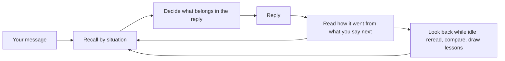

<p align="center">
  
</p>

<p align="center">
  <a href="https://github.com/asteme/asteme/actions/workflows/test.yml"></a>
  <a href="LICENSE"></a>
  
</p>

<p align="center">
  <a href="README.md">English</a> · <a href="README.zh.md">中文</a> · <a href="README.ja.md">日本語</a> · <a href="README.es.md">Español</a> · <a href="README.fr.md">Français</a> · Deutsch · <a href="README.ru.md">Русский</a> · <a href="README.pt.md">Português</a>
</p>

<p align="center"><a href="https://asteme.github.io/asteme/">Website</a></p>

https://github.com/user-attachments/assets/b20a3d7d-69fa-41f3-a4e0-5f9b14073b19

**Status: in Entwicklung.** Asteme wird noch gebaut. Das Verhalten kann sich ändern, und es kann versagen oder Daten verlieren. Verlass dich noch nicht für etwas Wichtiges darauf.

# ASTEME

Asteme ist jemand, mit dem du sprichst, und jedes Mal derselbe. Es merkt sich, was du ihm sagst, zusammen mit der Situation, für die das gilt, holt eine Erinnerung zurück, wenn diese Situation wiederkehrt, und verändert, was ihm in den Sinn kommt, je nachdem, wie die Nutzung ausgegangen ist.

Es läuft auf deinem Rechner. Alles, was es sich merkt, liegt in einer einzigen SQLite-Datei; was du ihm gibst, wird neben dieser Datei aufbewahrt.

Heute hat es zwei Formen:

- **Im DeepSeek Harness**, als Plugin: Das Gespräch ist ein Bildschirm im Harness, und ein Einstellungsfeld sitzt daneben.
- **Für sich allein**, als Gehirn: eine Seite auf diesem Rechner, ausgeliefert von `brain/cli.mjs`.

Beide sprechen, erinnern sich und halten Versprechen, auf derselben Maschinerie. Jede hat ihren eigenen Speicher: Das Plugin nutzt den Speicher des Harness-Profils, und das eigenständige Gehirn nutzt den Speicher aus seiner Einstellungsdatei oder einen Speicher pro Person mit `--person <name>`. `export` und `import` schreiben eine ganze Person heraus und lesen sie wieder ein, so lässt sich eine Person zwischen den beiden verschieben. Sonst sehen sie die Speicher des jeweils anderen nicht.

## Was daran anders ist

**Die Situation erinnert, nicht der Wortlaut.** Du hast einmal ein Memo korrigiert: „Die Entscheidung zuerst, die Direktorin liest nur drei Zeilen.“ Tage später bittest du um eine Seite Präsentation für einen Investor. Kein Wort ist gemeinsam, aber es ist dieselbe Situation (ein Leser mit wenig Zeit, der entscheiden muss), und die Erinnerung kommt zurück.

**Die Nutzung schreibt die Erinnerung um.** Nachdem eine Erinnerung genutzt wurde, wird aus dem, was du als Nächstes sagst, gelesen, wie es lief. Eine, die geholfen hat, kommt leichter in den Sinn. Eine, die fehl am Platz war, bleibt aus dieser Art von Situation heraus und wirkt anderswo weiter. Nichts verblasst, weil es alt ist, und nichts wird gelöscht, weil der Speicher gewachsen ist.

**Jede Erinnerung endet bei deinen eigenen Worten.** Jede behält den genauen Satz, aus dem sie stammt. Öffne eine Erinnerung, und du siehst, worauf sie beruht, wo sie gilt, jedes Mal, wenn sie genutzt wurde und wie das lief, und jede Änderung an ihr. Wenn du sagst, etwas sei falsch, gilt dein Wort über dem des Modells.

**Es hält Versprechen.** „Frag mich im Juni noch einmal“ wird ein Versprechen, das Asteme selbst hält, einmal oder wiederholt, und es spricht zuerst, wenn die Zeit kommt.

**Es spricht von sich aus.** Etwas, das dir unangenehm war, bleibt ihm im Kopf, ohne feste Zeit. Wenn du nach einer Weile zurückkommst, kann es fragen, wie es gelaufen ist, oder nichts sagen: das entscheidet es selbst, und was es behält, siehst du, und du kannst es zurücknehmen.

**Es zeigt, was es sich merkt.** Jede Erinnerung ist ein Stern an einem Himmel hinter dem Gespräch, heller, wenn sie leicht in den Sinn kommt. Pack den leeren Himmel an, und du bist mitten unter ihnen.

## In einer Minute ausprobieren

Node 22.5 oder neuer. Nichts zu installieren, kein API-Schlüssel.

```
git clone https://github.com/asteme/asteme.git
cd asteme
npm run demo
```

Die Demo spielt zwei Wochen mit einem Nutzer gegen ein Modell nach Drehbuch durch und erzählt, was das Gedächtnis tut:

```
Day 1. The user corrects a memo.
  stored as a case; the exchange stood out (salience 0.55) because it was a correction
Day 3. A request with none of the memo's words: a one-pager for an investor.
  recalled by the scene: "Writing a memo for the director"
  it helped; accessibility 0.7453
Day 4. The same memory is used where it does not belong: notes for the team.
  marked out of place there; accessibility 0.605
Night. Sleep.
  integrate: one lesson drawn from two cases
```

Die Tests laufen genauso: `npm test`.

Um das Gespräch ohne Modell anzusehen, starte die Vorschau der Seite selbst:

```
DEMO=1 ALL=900 node brain/preview.mjs 4173 ja
```

Öffne dann `http://127.0.0.1:4173/?token=preview` auf diesem Rechner (in PowerShell zuerst die beiden Variablen setzen: `$env:DEMO=1; $env:ALL=900`). Nichts darin ist das echte Gespräch von jemandem.

## Verwendung

### Im DeepSeek Harness

Installiere das Plugin `dsh-asteme` (Plugins → Plugin hinzufügen; es kommt von npm, und DSH aktualisiert es von dort). Während der Installation fragt DSH, ob Installationsskripte für drei Pakete erlaubt werden, von denen es abhängt (onnxruntime-node, protobufjs, sharp); erlaube sie, und es läuft weiter. Danach erscheint **ASTEME** in der Seitenleiste.

- Das Gespräch füllt den Bildschirm. Erinnerungen öffnen sich daneben; „Einstellungen“ betrifft das Gespräch: wie es aussieht, Asteme selbst (Name, Gesicht, Art zu sprechen, Stimmung), Stimme und Denken. „Erinnerung“ betrifft alles, was es sich merkt: die Suche, die Sterne und im DSH jeder Ort, an dem Erinnerung gepflegt wird. Die Erinnerungseinstellungen stehen auch in den Einstellungen von DSH selbst, unter Asteme.
- Das Feld behält, was nicht ins Gespräch gehört: Prüfung, Erinnerung, Aktivität, Charta, Einstellungen.
- Die Gespräche des Harness selbst bleiben unverändert: Das sind Agenten, die in einer Sitzung Arbeit tun. Asteme ist ein Gespräch, das über alle hinweg weitergeht, und es kann zuerst sprechen.

### Für sich allein

```
npm run brain
```

Die Einstellungen werden aus `~/.asteme/brain.json` gelesen (oder aus dem Pfad in `ASTEME_CONFIG`). Ein Schlüssel steht nie in der Datei; `keyEnv` nennt die Umgebungsvariable, die ihn enthält.

```json
{ "model": { "url": "https://your-endpoint/v1", "name": "your-model", "keyEnv": "YOUR_KEY_ENV" },
  "judge": { "keyEnv": "YOUR_JUDGE_KEY_ENV" },
  "workers": { "dsh": { "command": "dsh", "args": ["acp"], "about": "an agent with files and a shell" } },
  "store": "~/.asteme/memory.sqlite", "port": 4170, "language": "en" }
```

Die Seite antwortet nur auf diesem Rechner und nur mit dem Token in der angezeigten Adresse. Ein Worker ist ein Agent, der über das Agent Client Protocol Worte entgegennimmt und in Worten antwortet; DSH ist im Harness immer zur Hand, andere lassen sich in der Datei hinzufügen.

Eine OpenAI-kompatible Stimme lässt sich auf dieselbe Weise ausleihen, mit `voice: { url, model, voices, keyEnv }`.

### Als Erinnerung für jeden Agenten (MCP)

```
ASTEME_DB=./memory.sqlite \
ASTEME_LLM_URL=https://your-endpoint/v1 ASTEME_LLM_KEY=... ASTEME_LLM_MODEL=... \
node standalone/mcp.mjs
```

Ein MCP-Server über stdio. Der Agent ruft `asteme_recall` mit jeder Nutzernachricht vor der Antwort auf und `asteme_observe` mit seiner Antwort danach.

### Als Bibliothek

```js
import { openBrain } from "./standalone/brain.mjs";

const brain = openBrain({ path: "memory.sqlite", infer, embed });
const { note } = await brain.recall({ session: "s1", message });   // before the agent answers
brain.observe({ session: "s1", reply });                           // after it answered
await brain.rest();                                                // when idle
```

## Das Gespräch

- **Der Anfang.** Ein neuer Speicher, oder ein geleerter, hat noch niemanden darin. Einmal, vor dem Gespräch, fragt es nach einem Namen, wie es dich nennen soll und wie es mit dir sprechen soll (alles davon kann leer bleiben, oder ganz übersprungen werden), und dann wird es geweckt. Geweckt und benannt zu werden ist seine erste Erinnerung: Dieser Stern fällt in den leeren Himmel, bleibt in dessen Mitte als der hellste, und dann spricht es zuerst.
- **Sterne.** Ein Stern ist eine Erinnerung; die neueste ist nahe der Mitte, die älteste weit draußen, und die, die leicht in den Sinn kommen, leuchten am hellsten. Zieh den leeren Himmel, zoom ihn mit zwei Fingern oder doppelklicke ihn, um hineinzugehen; Ziehen bewegt, das Rad zoomt, Shift-Ziehen dreht. Wie weit es auch gedreht wurde, ein Ziehen bewegt weiter, was unter der Hand liegt; `0` oder „Himmel ausrichten“ stellt es wieder richtig hin. Etwas neu Gelerntes fällt als Sternschnuppe in den Himmel (das lässt sich abschalten).
- **Suche.** Tippe ins Suchfeld, und die passenden Sterne kommen einer nach dem anderen in einem lockeren Bogen herbei. Rad oder ↑↓ bewegt durch sie, Enter oder ein Klick öffnet einen, und die übrigen bleiben blass im Himmel.
- **Eine Erinnerung.** Öffne einen Stern, um seine Worte zu sehen, worauf er beruht, wann er gelernt wurde, und um zu sagen, dass er noch gilt, nicht mehr gilt, ihn zu pausieren oder ihn mit seinen Quellen zu vergessen.
- **Versprechen.** Ein Versprechen ist eine Zeile unter der Antwort, die es gegeben hat, beim nächsten Mal im Kopfbereich, und es lässt sich absagen, indem du es sagst.
- **Antworten und Reaktionen.** Jede Nachricht lässt sich an Ort und Stelle beantworten; Asteme kann ein Emoji auf deine setzen, und du kannst eines auf seine setzen.
- **Lesemarken.** Jede Seite kann sehen, wann die andere gelesen hat. Beide Richtungen lassen sich abschalten.
- **Eine Nachricht zurücknehmen.** Eine deiner Nachrichten lässt sich zurücknehmen; was Asteme darauf geantwortet hat, geht mit, und Arbeit, die es dafür vergeben hat, wird zurückgerufen.
- **Dateien.** Bis zu sechs Dateien in einer Nachricht hinzufügen, einfügen oder ablegen. Textdateien werden gelesen; ein Bild wird angesehen, wenn das Modell Bilder sehen kann; ein PDF oder etwas anderes wird bei Bedarf an einen Worker weitergegeben.
- **Stimme.** Antworten können von DeepSeeks Stimme vorgelesen werden, wenn der Harness einen DeepSeek-Schlüssel hat; die vorgelesenen Worte werden an DeepSeek gesendet. Vorgelesen werden die Worte, nicht IDs oder lange Codes.
- **Während du woanders warst.** Wenn Asteme etwas gesagt hat, das du nicht gesehen hast, leuchtet ein Stern seines Symbols in der Seitenleiste des Harness, und ein Browser-Tab zählt es im Titel. Asteme zu öffnen kann zum Gespräch führen oder zu dem, was in der Erinnerung wartet; das wird in den Einstellungen des Feldes gewählt.

## Wie es funktioniert



Vor einer Antwort ruft die Nachricht Erinnerungen nach Bedeutung ab, und ein Modellaufruf liest die Situation und entscheidet, welche dazugehören. Nach der Antwort wird der Austausch in die Erinnerung gelesen, und dein Satz bleibt als Grundlage für alles Gelernte stehen. Später wird aus dem, was du als Nächstes schreibst, gelesen, wie jede genutzte Erinnerung ausgegangen ist, und das verändert, was nächstes Mal abgerufen wird. Wenn nichts zu tun ist, liest es Austausche neu, die herausgestochen sind (eine Korrektur, eine Überraschung, ein Versprechen), vergleicht Erinnerungen, die sich widersprechen könnten, und zieht Lehren aus getrennten Anlässen.

Der Code entscheidet nie, was etwas bedeutet. Er prüft Struktur: dass ein Zitat genau ist, dass eine ID existiert, dass sich eine Revision nicht bewegt hat. Die Bedeutung bleibt beim Modell, und alles, was das Modell schreibt, muss auf einen gespeicherten Datensatz zeigen.

**Wiederkehrende Arbeit ist getrennt.** Ein wiederkehrendes Versprechen von Asteme selbst („jeden Morgen“, „jeden Freitag um fünf“) hält Asteme, mit der Zeit in seinem eigenen Speicher: Es ist nicht in den geplanten Aufgaben von DeepSeek Harness eingetragen und erscheint nicht in der Liste des Harness. Der Harness wird nur gefragt, wenn zu dieser Zeit tatsächlich Arbeit anfällt. Wenn ein solches Versprechen wartet, startet Asteme zusammen mit dem Harness, damit die Zeit auch dann kommt, wenn seine Seite nie geöffnet wird.

## Deine Daten

- Alles liegt in einer SQLite-Datei auf deinem Rechner; Dateien, die du übergibst, werden daneben aufbewahrt. Es gibt keine Telemetrie. Es erreicht das Netz nur für die Modell-Endpunkte, die du einrichtest, für einen optionalen Judge oder eine Stimme, und einmal, um das lokale Embedding-Modell herunterzuladen.
- **Exportieren und importieren** einer vollständigen Kopie, Gespräche eingeschlossen. Importieren ergänzt, was fehlt, und überschreibt nie.
- **Ein Tagebuch**: eine Markdown-Datei pro Monat darüber, was gesagt wurde, was es daraus mitgenommen hat und wie das lief.
- **Automatische Sicherungen** einmal am Tag. Ausgedünnt werden nur alte Kopien, nie das, was es sich merkt.
- **Vergessen ist echt**: eine Erinnerung mit ihren Quellnachrichten zu vergessen entfernt sie aus jeder Tabelle, und ein Import kann sie nicht zurückbringen.
- **Ein privates Gespräch** wird als Reihenfolge und Anzahl erinnert, mit ausgelassenen Worten; nichts daraus wird in die Erinnerung gelesen oder in sie hineingebracht.
- **Projekte** können das in ihnen Gelernte für sich behalten, und eine einzelne Erinnerung lässt sich bei ihrem Projekt halten.

## Grenzen, heute

- Früh: 0.11, die erste veröffentlichte Version. Das Verhalten kann sich zwischen Versionen noch ändern.
- Eine Antwort kann auf die Erinnerung warten: Die Situation zu lesen und daraus auszuwählen ist ein Modellaufruf, und mit einem Reasoning-Modell dauert das zehn bis zwanzig Sekunden, manchmal mehr. Ein kleines Entscheidungsmodell (der Judge) kann diesen Platz einnehmen, wenn eines eingerichtet ist, und dann wartet die Antwort nicht mehr darauf.
- Ein Bild, das dem Gespräch gegeben wird, wird angesehen, wenn das Modell Bilder sehen kann; andere Dateien, die kein Text sind (ein PDF, eine Aufnahme), liest Asteme selbst nicht: Es gibt sie DSH mit ihrem Pfad, wenn die Arbeit sie geöffnet braucht.
- Vorlesen nutzt nur eine ausgeliehene Stimme (die auf dem Rechner installierten Stimmen werden nicht verwendet). Ein eigener Stimmdienst (ein OpenAI-kompatibler oder ein lokaler Server) wird in der Einstellungsdatei eingerichtet; einen Bildschirm dafür gibt es noch nicht.
- Tests und der Plugin-Build laufen in CI unter Windows, macOS und Linux. Mit den Augen benutzt wurde es unter Windows, geprüft unter Linux; macOS hat noch kein Mensch angesehen.
- Die Seite ist nur für diesen Rechner; es gibt keinen Zugriff vom Telefon.

## Wohin es geht

Heute ist es Erinnerung: jemand, der sich erinnert und den du korrigieren kannst. Als Nächstes kommen Hände: derselbe Asteme, der Werkzeuge auf deinem Rechner bittet, Dinge zu tun, und dich zuerst fragt, bevor etwas nicht rückgängig zu machen ist. Die Erinnerung kommt zuerst, weil der Rest darauf gebaut ist; ein Modell, das besser wird, behält dieselbe Erinnerung und dich, wie du bist.

## Dokumente

- [docs/BRAIN.md](docs/BRAIN.md): das Gehirn — ein Gespräch, Hände, eine Uhr, wach und schlafend
- [CHANGELOG.md](CHANGELOG.md): was sich in jeder Version geändert hat
- [CONTRIBUTING.md](CONTRIBUTING.md): wie man es startet, der Aufbau, die Regeln für Änderungen
- [MAINTAINING.md](MAINTAINING.md): wer was entscheidet und wie eine Änderung wandert

<a href='https://ko-fi.com/wsl043'></a>

## Lizenz

[Apache-2.0](LICENSE), mit einer [NOTICE](NOTICE). Die Lizenz gilt für den Code; der Name und die Marke gehören zu diesem Projekt: siehe [TRADEMARKS.md](TRADEMARKS.md).
