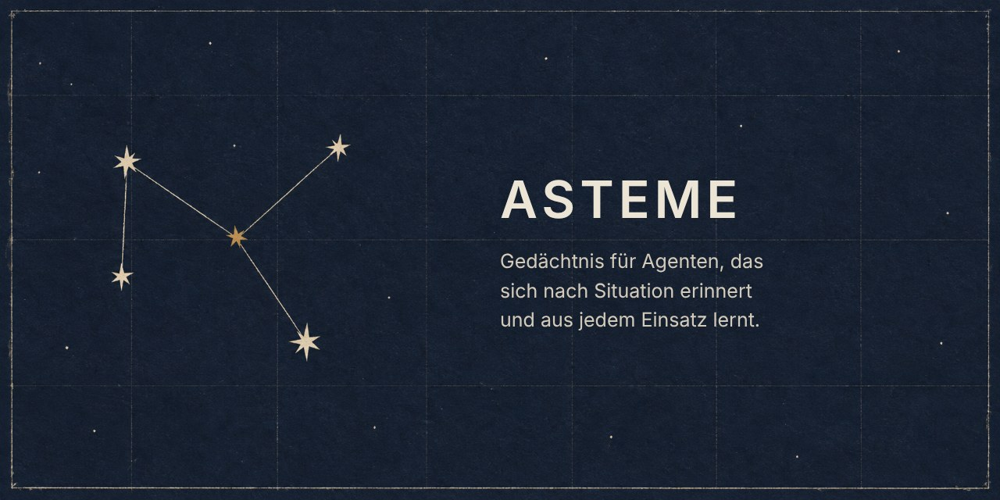
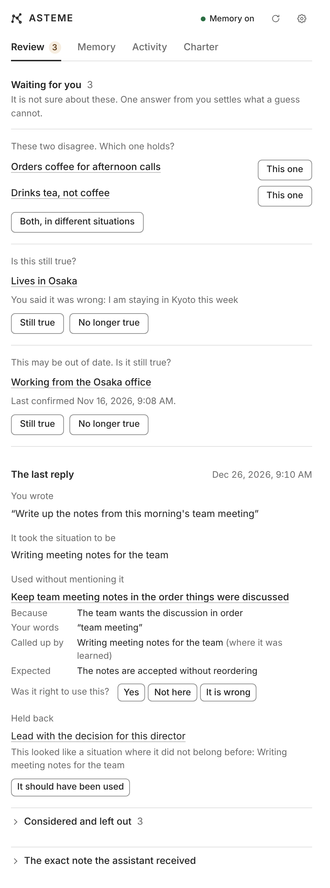

<p align="center">
  
</p>

<p align="center">
  <a href="README.md">English</a> · <a href="README.zh.md">中文</a> · <a href="README.ja.md">日本語</a> · <a href="README.es.md">Español</a> · <a href="README.fr.md">Français</a> · Deutsch · <a href="README.ru.md">Русский</a> · <a href="README.pt.md">Português</a>
</p>

**In Entwicklung:** Asteme wird noch gebaut. Das Verhalten kann sich ändern, und es kann Fehler machen oder Daten verlieren. Für wichtige Aufgaben noch nicht verwenden.

# ASTEME

Asteme ist ein Langzeitgedächtnis für einen KI-Assistenten. Es sucht nicht nach ähnlichen Wörtern in früheren Gesprächen. Es merkt sich, was du gesagt hast, zusammen mit der Situation, für die es gilt, holt es zurück, wenn diese Situation wiederkehrt, und passt an, wie leicht jede Erinnerung in den Sinn kommt, je nachdem, ob ihr Einsatz geholfen hat.

Es läuft auf deinem Rechner, in einer einzigen SQLite-Datei. Es lässt sich als Plugin für DeepSeek Harness, als MCP-Server für beliebige Agenten oder als Bibliothek verwenden.

<p align="center">
  
</p>

## Was daran anders ist

**Die Situation ruft die Erinnerung, nicht der Wortlaut.** Du hast einmal ein Memo korrigiert: „Die Entscheidung zuerst, die Direktorin liest nur drei Zeilen.“ Tage später bittest du um eine Seite für einen Investor. Kein Wort ist gleich, aber es ist dieselbe Situation (jemand mit wenig Zeit muss entscheiden), und die Erinnerung kommt zurück.

**Der Einsatz schreibt das Gedächtnis um.** Nachdem eine Erinnerung verwendet wurde, wird aus dem, was du als Nächstes sagst, gelesen, wie es ausging. Was geholfen hat, kommt leichter in den Sinn. Was fehl am Platz war, bleibt aus dieser Art von Situation heraus und wirkt anderswo weiter. Nichts verblasst, weil es alt ist, und nichts wird gelöscht, weil es viel geworden ist.

**Jede Erinnerung endet bei deinen eigenen Worten.** Jede behält den genauen Satz, aus dem sie stammt. Du kannst jede öffnen und sehen, worauf sie beruht, wo sie gilt, wann sie verwendet wurde und wie das ausging, und jede Änderung an ihr. Wenn du sagst, etwas sei falsch, gilt dein Wort vor dem des Modells.

Außerdem blickt es zwischen den Gesprächen zurück und zieht aus getrennten Anlässen eine Lehre; es bemerkt, wenn zwei Erinnerungen einander widersprechen, und fragt dich; und es hält an einem Zweck und an Werten fest, die nichts Gelerntes ändern kann. [DESIGN.md](DESIGN.md) beschreibt, wie das jeweils funktioniert und getestet wird (auf Englisch).

## In einer Minute ausprobieren

Node 22.5 oder neuer. Nichts zu installieren, kein API-Schlüssel.

```
git clone https://github.com/asteme/asteme.git
cd REPO
npm run demo
```

Die Demo spielt zwei Wochen mit einem Nutzer gegen ein Modell nach Drehbuch durch und erzählt, was das Gedächtnis tut. `npm test` führt die gesamte Testsuite auf dieselbe Weise aus. Um das Panel zu sehen, öffne `client/preview/preview.html` im Browser.

## Verwendung

### Als Gedächtnis für beliebige Agenten (MCP)

```
ASTEME_DB=./memory.sqlite \
ASTEME_LLM_URL=https://your-endpoint/v1 ASTEME_LLM_KEY=... ASTEME_LLM_MODEL=... \
node standalone/mcp.mjs
```

Ein MCP-Server über stdio. Der Agent ruft vor dem Antworten `asteme_recall` mit jeder Nachricht auf und danach `asteme_observe` mit seiner Antwort.

### Als Bibliothek

```js
import { openBrain } from "./standalone/brain.mjs";

const brain = openBrain({ path: "memory.sqlite", infer, embed });
const { note } = await brain.recall({ session: "s1", message });   // vor der Antwort
brain.observe({ session: "s1", reply });                           // nach der Antwort
await brain.rest();                                                // wenn nichts zu tun ist
```

### Als Plugin für DeepSeek Harness

`plugin/` ist der Adapter und `client/` das zugehörige Einstellungspanel. In dieser Form wurde es bisher am meisten benutzt.

## Das Panel

- **Review**: wobei es unsicher ist und was die letzte Antwort herangezogen hat und warum. Ein Klick sagt, ob eine Erinnerung richtig, fehl am Platz oder falsch war, und aus diesem Klick lernt es.
- **Memory**: alles, was es weiß. Jeder Eintrag lässt sich öffnen und zeigt, worauf er beruht.
- **Activity**: was es getan hat, während du weg warst, und warum nichts geschieht, wenn nichts geschieht.
- **Charter**: sein Zweck und seine Werte. Du schreibst sie; nichts Gelerntes ändert sie.

Das Panel gibt es auf Englisch, Japanisch und Chinesisch.

## Wohin das führt

Wir halten Gedächtnis nicht für ein Protokoll, das man durchsucht. Es heißt, sich zu merken, was geschehen ist, die eigene Sicht daran zu ändern, wie es ausging, und nie zu löschen: Manches lässt sich nur schwerer abrufen. Jede Erinnerung ist ein Stern, und die Situation, in der man gerade ist, verbindet sie zu einer Figur.

Worauf wir hinarbeiten, ist ein Assistent, der nach genug Zeit mit einem Menschen für diesen jemand Bestimmtes ist. Dort ist Asteme nicht. Heute ist es die erste Runde dieses Kreislaufs, auf einem einzelnen Rechner, und mehr davon ist entworfen als bewiesen. Das [Änderungsprotokoll](CHANGELOG.md) und [`DESIGN.md`](DESIGN.md) sagen offen, was was ist.

## Deine Daten

- Alles liegt in einer SQLite-Datei auf deinem Rechner. Es gibt keine Telemetrie. Das Netz wird nur für die Modell-Dienste genutzt, die du einrichtest, und einmalig, um das lokale Embedding-Modell zu laden.
- **Export und Import** einer vollständigen Kopie, Gespräche eingeschlossen. Der Import ergänzt, was fehlt, und überschreibt nie.
- **Ein Tagebuch**: eine Markdown-Datei pro Monat mit dem, was gesagt wurde, was es daraus mitgenommen hat und wie das ausging.
- **Automatische Sicherungen** einmal täglich. Ausgedünnt werden nur alte Kopien, nie das, was es sich merkt.
- **Vergessen ist wirklich vergessen**: Wird eine Erinnerung samt ihren Ausgangsnachrichten vergessen, verschwinden sie aus allen Tabellen, und ein Import kann sie nicht zurückbringen.

## Lizenz

Not yet published. All rights reserved for now: see [LICENSE](LICENSE).
