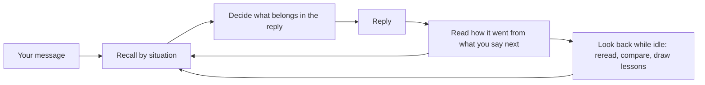

<p align="center">
  
</p>

<p align="center">
  <a href="https://github.com/asteme/asteme/actions/workflows/test.yml"></a>
  <a href="LICENSE"></a>
  
</p>

<p align="center">
  <a href="README.md">English</a> · <a href="README.zh.md">中文</a> · <a href="README.ja.md">日本語</a> · <a href="README.es.md">Español</a> · <a href="README.fr.md">Français</a> · Deutsch · <a href="README.ru.md">Русский</a> · <a href="README.pt.md">Português</a>
</p>

**Status: in Entwicklung.** Asteme wird noch gebaut. Das Verhalten kann sich ändern, und es kann versagen oder Daten verlieren. Verlasse dich noch nicht für etwas Wichtiges darauf.

# ASTEME

Asteme ist jemand, mit dem du sprichst, und jedes Mal derselbe. Es merkt sich, was du ihm sagst, zusammen mit der Situation, für die es gilt, holt eine Erinnerung zurück, wenn diese Situation wiederkehrt, und ändert, was ihm in den Sinn kommt, danach, wie der Gebrauch ausgegangen ist.

Es läuft auf deinem Computer. Alles, was es sich merkt, liegt in einer einzigen SQLite-Datei; was du ihm übergibst, wird neben dieser Datei aufbewahrt.

Heute hat es zwei Gestalten:

- **Im DeepSeek Harness**, als Plugin: das Gespräch ist ein Bildschirm im Harness, und ein Einstellungs-Panel sitzt daneben.
- **Auf eigenen Füßen**, als Gehirn: eine Seite auf diesem Computer, ausgeliefert von `brain/cli.mjs`.

Beide sprechen, erinnern sich und halten Versprechen, auf derselben Maschinerie. Jede hat einen Speicher für sich: das Plugin nutzt den Speicher des Harness-Profils, und das eigenständige Gehirn nutzt den Speicher aus seiner Einstellungsdatei, oder einen Speicher pro Person mit `--person <name>`. `export` und `import` schreiben eine ganze Person und holen sie zurück, sodass eine Person zwischen den beiden bewegt werden kann. Ansonsten sehen sie die Speicher des jeweils anderen nicht.

## Was daran anders ist

**Die Situation ruft, nicht der Wortlaut.** Du hast einmal ein Memo korrigiert: „Die Entscheidung zuerst, die Direktorin liest nur drei Zeilen.“ Tage später bittest du um einen Einseiter für einen Investor. Kein Wort ist gemeinsam, aber es ist dieselbe Situation (ein Leser mit wenig Zeit, der entscheiden muss), und die Erinnerung kommt zurück.

**Gebrauch schreibt Erinnerung um.** Nachdem eine Erinnerung benutzt wurde, wird das, was du als Nächstes sagst, daraufhin gelesen, wie es ausging. Eine, die geholfen hat, kommt leichter in den Sinn. Eine, die fehl am Platz war, bleibt aus dieser Art von Situation heraus und wirkt anderswo weiter. Nichts verblasst, weil es alt ist, und nichts wird gelöscht, weil der Speicher gewachsen ist.

**Jede Erinnerung endet bei deinen eigenen Worten.** Jede behält den genauen Satz, aus dem sie stammt. Öffne eine Erinnerung, und du siehst, worauf sie beruht, wo sie gilt, jedes Mal, wenn sie benutzt wurde und wie das ausging, und jede Änderung, die an ihr gemacht wurde. Wenn du sagst, etwas sei falsch, steht dein Wort über dem des Modells.

**Es hält Versprechen.** „Frag mich im Juni noch einmal“ wird zu einem Versprechen, das Asteme selbst hält, einmalig oder wiederkehrend, und es spricht zuerst, wenn die Zeit gekommen ist.

**Es zeigt, was es sich merkt.** Jede Erinnerung ist ein Stern an einem Himmel hinter dem Gespräch, heller, wenn sie leicht in den Sinn kommt. Fasse den leeren Himmel an, und du bist mitten unter ihnen.

## In einer Minute ausprobieren

Node 22.5 oder neuer. Nichts zu installieren, kein API-Schlüssel.

```
git clone https://github.com/asteme/asteme.git
cd asteme
npm run demo
```

Die Demo spielt zwei Wochen mit einem Nutzer gegen ein Modell nach Drehbuch durch und erzählt, was das Gedächtnis tut:

```
Day 1. The user corrects a memo.
  stored as a case; the exchange stood out (salience 0.55) because it was a correction
Day 3. A request with none of the memo's words: a one-pager for an investor.
  recalled by the scene: "Writing a memo for the director"
  it helped; accessibility 0.7453
Day 4. The same memory is used where it does not belong: notes for the team.
  marked out of place there; accessibility 0.605
Night. Sleep.
  integrate: one lesson drawn from two cases
```

Die Tests laufen genauso: `npm test`.

Um das Gespräch ohne Modell anzusehen, starte die eigene Vorschau der Seite:

```
DEMO=1 ALL=900 node brain/preview.mjs 4173 de
```

Öffne dann `http://127.0.0.1:4173/?token=preview` auf diesem Computer (in PowerShell zuerst die beiden Variablen setzen: `$env:DEMO=1; $env:ALL=900`). Nichts darin ist jemandes echtes Gespräch.

## Verwenden

### Im DeepSeek Harness

Installiere das Plugin `dsh-asteme` (Plugins → Add plugin). DSH installiert und aktualisiert es über npm. Bei der Installation fragt DSH, ob es die Installationsskripte von drei Abhängigkeiten (`onnxruntime-node`, `protobufjs` und `sharp`) ausführen darf. Erlaube das, damit die Installation weiterläuft. **ASTEME** erscheint dann in der Seitenleiste.

- Das Gespräch füllt den Bildschirm, Erinnerungen öffnen sich daneben. **Einstellungen** oben im Gespräch betreffen nur das Gespräch: das Aussehen, Asteme selbst (Name, Bild, Sprechweise und Stimmung) sowie Stimme und Denkweise.
- Unter **Erinnerungen**, ebenfalls oben im Gespräch, findest du die Suche und den Sternenhimmel. In DSH gelangst du von dort auch zur Liste der Erinnerungen, zur Überprüfung der letzten Antwort, zur Aktivität, zur Charta und zu den **Einstellungen des Gedächtnisses**. Dieselbe Ansicht findest du in DSH unter **Einstellungen → Asteme**.
- Die eigenen Gespräche des Harness bleiben unverändert: Sie sind Agenten, die in einer Sitzung Arbeit tun. Asteme ist ein Gespräch, das über alle hinweg weitergeht, und es kann zuerst sprechen.

### Auf eigenen Füßen

```
npm run brain
```

Einstellungen werden aus `~/.asteme/brain.json` gelesen (oder aus dem Pfad in `ASTEME_CONFIG`). Ein Schlüssel wird nie in die Datei geschrieben; `keyEnv` nennt die Umgebungsvariable, die ihn enthält.

```json
{ "model": { "url": "https://your-endpoint/v1", "name": "your-model", "keyEnv": "YOUR_KEY_ENV" },
  "judge": { "keyEnv": "YOUR_JUDGE_KEY_ENV" },
  "workers": { "dsh": { "command": "dsh", "args": ["acp"], "about": "an agent with files and a shell" } },
  "store": "~/.asteme/memory.sqlite", "port": 4170, "language": "de" }
```

Die Seite antwortet nur auf diesem Computer und nur mit dem Token in der ausgegebenen Adresse. Ein Worker ist ein Agent, der Worte annimmt und in Worten über das Agent Client Protocol antwortet; DSH ist im Harness immer zur Hand, und andere lassen sich in der Datei hinzufügen.

Eine OpenAI-kompatible Stimme lässt sich auf dieselbe Weise ausleihen, mit `voice: { url, model, voices, keyEnv }`.

### Als Gedächtnis für jeden Agenten (MCP)

```
ASTEME_DB=./memory.sqlite \
ASTEME_LLM_URL=https://your-endpoint/v1 ASTEME_LLM_KEY=... ASTEME_LLM_MODEL=... \
node standalone/mcp.mjs
```

Ein MCP-Server über stdio. Der Agent ruft vor dem Antworten `asteme_recall` mit jeder Nutzernachricht auf und danach `asteme_observe` mit seiner Antwort.

### Als Bibliothek

```js
import { openBrain } from "./standalone/brain.mjs";

const brain = openBrain({ path: "memory.sqlite", infer, embed });
const { note } = await brain.recall({ session: "s1", message });   // before the agent answers
brain.observe({ session: "s1", reply });                           // after it answered
await brain.rest();                                                // when idle
```

## Das Gespräch

- **Der Anfang.** Ein neuer Speicher, oder ein geleerter, hat noch niemanden. Ein einziges Mal, vor dem Gespräch, fragt er nach einem Namen, danach, wie er dich nennen soll, und wie er mit dir sprechen soll (alles darf leer bleiben oder ganz übersprungen werden), und dann wird er geweckt. Geweckt und benannt zu werden ist seine erste Erinnerung: Dieser Stern fällt in den leeren Himmel, bleibt in seiner Mitte als der hellste, und danach spricht er zuerst.
- **Sterne.** Ein Stern ist eine Erinnerung; die neueste ist nahe der Mitte, die älteste weit draußen, und die, die leicht in den Sinn kommen, leuchten am hellsten. Zieh am leeren Himmel, kneif ihn oder doppelklick ihn, um hineinzugehen; ziehen bewegt, das Rad zoomt, Shift-Ziehen dreht. Wie weit er auch gedreht wurde, ein Ziehen bewegt immer noch, was unter der Hand liegt; `0` oder „Level the sky“ stellt ihn wieder richtig auf. Etwas neu Gelerntes fällt als Sternschnuppe in den Himmel (das lässt sich abschalten).
- **Suche.** Tippe in das Suchfeld, und die Sterne, die passen, kommen einer nach dem anderen zu ihm in einen lockeren Bogen. Rad oder ↑↓ bewegt durch sie, Enter oder ein Klick öffnet einen, und die übrigen bleiben blass im Himmel.
- **Eine Erinnerung.** Öffne einen Stern, um seine Worte zu sehen, worauf er beruht, wann er gelernt wurde, und um zu sagen, dass er noch gilt, nicht mehr gilt, ihn zu pausieren oder ihn mit seinen Quellen zu vergessen.
- **Versprechen.** Ein Versprechen ist eine Zeile unter der Antwort, die es gab, das nächste Mal in der Kopfzeile, und es lässt sich absagen, indem du es sagst.
- **Antworten und Reaktionen.** Jede Nachricht lässt sich an Ort und Stelle beantworten; Asteme kann ein Emoji auf deine setzen, und du kannst eines auf seine setzen.
- **Lesemarken.** Jede Seite kann sehen, wann die andere gelesen hat. Beide Richtungen lassen sich abschalten.
- **Eine Nachricht zurücknehmen.** Eine deiner Nachrichten lässt sich zurücknehmen; was Asteme als Antwort gesagt hat, geht mit, und Arbeit, die es dafür vergeben hat, wird zurückgerufen.
- **Dateien.** Füge bis zu sechs Dateien in einer Nachricht hinzu, füge sie ein oder zieh sie hinein. Textdateien werden gelesen. Bilder werden dem Modell gezeigt, sofern es Bilder verarbeiten kann. PDFs und andere Dateitypen gehen bei Bedarf an einen Worker.
- **Stimme.** Antworten können von DeepSeeks Stimme vorgelesen werden, wenn der Harness einen DeepSeek-Schlüssel hat; die gelesenen Wörter werden an DeepSeek gesendet. Gelesen werden die Wörter, nicht IDs oder lange Codes.
- **Während du woanders warst.** Wenn Asteme etwas gesagt hat, das du nicht gesehen hast, leuchtet ein Stern seines Symbols in der Seitenleiste des Harness, und ein Browser-Tab zählt es in seinem Titel. Asteme zu öffnen kann zum Gespräch führen oder zu dem, was im Gedächtnis wartet; das wird in den Einstellungen des Panels gewählt.

## Wie es funktioniert



Vor einer Antwort ruft die Nachricht Erinnerungen nach Bedeutung ab, und ein Modellaufruf liest die Situation und entscheidet, welche dazugehören. Nach der Antwort wird der Austausch ins Gedächtnis gelesen, wobei dein Satz als Grund für alles Gelernte erhalten bleibt. Später wird das, was du als Nächstes schreibst, daraufhin gelesen, wie jede benutzte Erinnerung ausging, und das ändert, was beim nächsten Mal abgerufen wird. Im Leerlauf liest es Austausche erneut, die herausstanden (eine Korrektur, eine Überraschung, ein Versprechen), vergleicht Erinnerungen, die nicht übereinstimmen könnten, und zieht Lehren aus getrennten Anlässen.

Der Code entscheidet nie, was etwas bedeutet. Er prüft Struktur: dass ein Zitat genau ist, dass eine ID existiert, dass eine Revision sich nicht bewegt hat. Die Bedeutung bleibt dem Modell überlassen, und alles, was das Modell schreibt, muss auf einen gespeicherten Datensatz zeigen.

**Wiederkehrende Arbeit ist aufgeteilt.** Ein wiederkehrendes Versprechen von Asteme selbst („jeden Morgen“, „jeden Freitag um fünf“) wird von Asteme gehalten, mit der Zeit in seinem eigenen Speicher: Es ist nicht in den geplanten Aufgaben von DeepSeek Harness eingetragen und erscheint nicht in deren Liste. Der Harness wird nur gefragt, wenn zu dieser Zeit tatsächliche Arbeit geschehen muss. Wenn ein solches Versprechen wartet, startet Asteme zusammen mit dem Harness, sodass die Zeit auch dann ankommt, wenn seine Seite nie geöffnet wurde.

## Deine Daten

- Alles liegt in einer SQLite-Datei auf deiner Maschine; Dateien, die du übergibst, werden daneben aufbewahrt. Es gibt keine Telemetrie. Es geht nur für die Modell-Endpunkte, die du einrichtest, für einen optionalen Judge oder eine Stimme und einmal zum Herunterladen des lokalen Embedding-Modells ins Netz.
- **Export und Import** einer vollständigen Kopie, Gespräche eingeschlossen. Der Import ergänzt, was fehlt, und überschreibt nie.
- **Ein Tagebuch**: eine Markdown-Datei pro Monat mit dem, was gesagt wurde, was es daraus mitgenommen hat und wie das ausging.
- **Automatische Sicherungen** einmal am Tag. Ausgedünnt werden nur alte Kopien, nie das, was es sich merkt.
- **Vergessen ist echt**: Eine Erinnerung mit ihren Ausgangsnachrichten zu vergessen entfernt sie aus jeder Tabelle, und ein Import kann sie nicht zurückbringen.
- **Ein privates Gespräch** wird als Reihenfolge und Zählungen gemerkt, ohne die Worte; nichts darin wird ins Gedächtnis gelesen oder in es hereingeholt.
- **Projekte** können das, was in ihnen gelernt wird, für sich behalten, und eine Erinnerung kann auf ihr Projekt beschränkt bleiben.

## Grenzen, heute

- 0.11 ist die erste öffentliche Version. Das Projekt steht noch am Anfang, und das Verhalten kann sich von Version zu Version ändern.
- Eine Antwort kann auf das Gedächtnis warten: Die Situation zu lesen und daraus auszuwählen ist ein Modellaufruf, und mit einem Reasoning-Modell hat das zehn bis zwanzig Sekunden gedauert, manchmal mehr. Ein kleines Entscheidungsmodell (der Judge) kann diese Stelle einnehmen, wenn eines eingerichtet ist, und dann wartet die Antwort nicht mehr darauf.
- Bilder im Gespräch werden betrachtet, wenn das Modell Bilder verarbeiten kann. Andere Dateien, die keine Textdateien sind (etwa PDFs oder Tonaufnahmen), liest Asteme nicht selbst: Müssen sie für eine Aufgabe geöffnet werden, übergibt es sie samt Dateipfad an DSH.
- Vorlesen nutzt nur eine geliehene Stimme (die auf dem Computer installierten Stimmen werden nicht verwendet). Ein eigener Stimmdienst (OpenAI-kompatibel oder ein lokaler Server) wird in der Einstellungsdatei festgelegt; einen Bildschirm dafür gibt es noch nicht.
- Die CI führt die Tests aus und baut das Plugin unter Windows, macOS und Linux. Unter Windows wurde Asteme praktisch eingesetzt, unter Linux manuell geprüft; unter macOS steht eine manuelle Prüfung noch aus.
- Die Seite ist nur für diesen Computer; es gibt keinen Zugang vom Telefon.

## Wie es weitergeht

Heute geht es ums Gedächtnis: Asteme ist jemand, der sich erinnert und den du korrigieren kannst. Als Nächstes bekommt Asteme Hände: Es bleibt dasselbe Asteme, kann aber mit Werkzeugen auf deinem Computer etwas erledigen und fragt dich vorher, wenn sich etwas nicht rückgängig machen lässt. Das Gedächtnis kommt zuerst, weil alles andere darauf aufbaut. Auch wenn das Modell besser wird, behält es dasselbe Gedächtnis und erkennt dich weiterhin wieder.

## Dokumente

- [docs/BRAIN.md](docs/BRAIN.md): das Gehirn — ein Gespräch, Hände, eine Uhr, wach und schlafend
- [DESIGN.md](DESIGN.md): das Gedächtnismodell, warum es so funktioniert, was getestet ist
- [docs/IMPLEMENTATION.md](docs/IMPLEMENTATION.md): Entscheidungen, die in der Implementierung getroffen wurden
- [CHANGELOG.md](CHANGELOG.md): was sich in jeder Version geändert hat
- [HANDOFF.md](HANDOFF.md): der Stand der Entwicklung und was als Nächstes kommt
- [CONTRIBUTING.md](CONTRIBUTING.md): wie man es startet, der Aufbau, die Regeln für Änderungen

## Lizenz

Der Code steht unter der Lizenz [Apache-2.0](LICENSE), mit einer [NOTICE](NOTICE). Der Name und die Marke des Projekts sind davon nicht erfasst; siehe [TRADEMARKS.md](TRADEMARKS.md).
