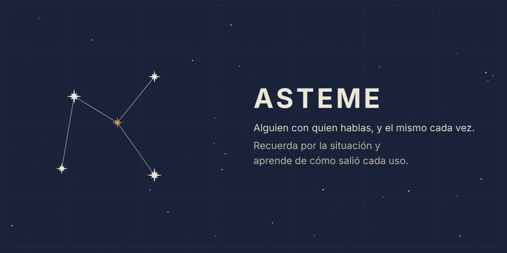
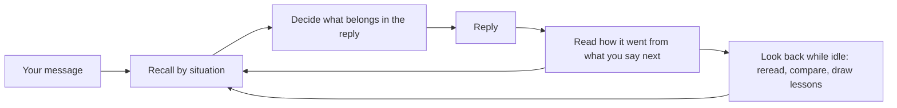

<p align="center">
  
</p>

<p align="center">
  <a href="https://github.com/asteme/asteme/actions/workflows/test.yml"></a>
  <a href="LICENSE"></a>
  
</p>

<p align="center">
  <a href="README.md">English</a> · <a href="README.zh.md">中文</a> · <a href="README.ja.md">日本語</a> · Español · <a href="README.fr.md">Français</a> · <a href="README.de.md">Deutsch</a> · <a href="README.ru.md">Русский</a> · <a href="README.pt.md">Português</a>
</p>

https://github.com/user-attachments/assets/f3d6ef2a-0eee-491c-b3e8-9dd5756be9ca

**Estado: en desarrollo.** Asteme todavía se está construyendo. El comportamiento puede cambiar, y puede fallar o perder datos. Todavía no te apoyes en él para nada importante.

# ASTEME

Asteme es alguien con quien hablas, y el mismo cada vez. Recuerda lo que le dices junto con la situación a la que se aplica, trae un recuerdo de vuelta cuando esa situación se vuelve a presentar, y cambia lo que te viene a la mente según lo que dio usarlo.

Funciona en tu ordenador. Todo lo que recuerda está en un solo archivo SQLite; lo que le entregas se guarda junto a ese archivo.

Hoy tiene dos formas:

- **Dentro de DeepSeek Harness**, como plugin: la conversación es una pantalla del harness, y un panel de ajustes se sienta a su lado.
- **Por su cuenta**, como cerebro: una página en este ordenador, servida por `brain/cli.mjs`.

Los dos hablan, recuerdan y cumplen promesas sobre la misma maquinaria. Cada uno tiene su propio almacén: el plugin usa el almacén del perfil del harness, y el cerebro independiente usa el almacén de su archivo de ajustes, o un almacén por persona con `--person <name>`. `export` e `import` escriben y devuelven una persona completa, de modo que una persona se puede trasladar entre los dos. Fuera de eso, no ven el almacén del otro.

## Qué tiene de distinto

**Lo que recuerda es la situación, no las palabras.** Una vez corregiste un memorando: «pon la decisión primero, la directora solo lee tres líneas». Días después pides una página para un inversor. No comparten ninguna palabra, pero es la misma situación (un lector con poco tiempo que tiene que decidir), y el recuerdo vuelve.

**El uso reescribe la memoria.** Después de usar un recuerdo, se lee lo que dices a continuación para saber cómo fue. El que ayudó viene a la mente con más facilidad. El que estuvo fuera de lugar no vuelve a aparecer en ese tipo de situación y sigue sirviendo en las demás. Nada se desvanece por ser antiguo, y nada se borra porque el almacén haya crecido.

**Cada recuerdo termina en tus propias palabras.** Cada uno conserva la frase exacta de la que salió. Abre un recuerdo y ves en qué se apoya, dónde se aplica, cada vez que se usó y cómo fue, y cada cambio que se le hizo. Si dices que algo está mal, tu palabra pesa más que la del modelo.

**Cumple promesas.** «Pregúntame otra vez en junio» se convierte en una promesa que Asteme sostiene por sí mismo, una sola vez o repetida, y habla primero cuando llega el momento.

**Muestra lo que recuerda.** Cada recuerdo es una estrella en un cielo detrás de la conversación, más brillante cuanto más fácil viene a la mente. Agarra el cielo vacío y estarás entre ellas.

## Pruébalo en un minuto

Node 22.5 o posterior. Nada que instalar, ninguna clave de API.

```
git clone https://github.com/asteme/asteme.git
cd asteme
npm run demo
```

La demo reproduce dos semanas con un usuario frente a un modelo guionizado y narra lo que hace la memoria:

```
Day 1. The user corrects a memo.
  stored as a case; the exchange stood out (salience 0.55) because it was a correction
Day 3. A request with none of the memo's words: a one-pager for an investor.
  recalled by the scene: "Writing a memo for the director"
  it helped; accessibility 0.7453
Day 4. The same memory is used where it does not belong: notes for the team.
  marked out of place there; accessibility 0.605
Night. Sleep.
  integrate: one lesson drawn from two cases
```

Las pruebas se ejecutan de la misma manera: `npm test`.

Para ver la conversación sin un modelo, ejecuta la vista previa de la propia página:

```
DEMO=1 ALL=900 node brain/preview.mjs 4173 ja
```

Luego abre `http://127.0.0.1:4173/?token=preview` en este ordenador (en PowerShell, define antes las dos variables: `$env:DEMO=1; $env:ALL=900`). Nada de lo que hay dentro es la conversación real de nadie.

## Cómo usarlo

### Dentro de DeepSeek Harness

Instala el plugin `dsh-asteme` (Plugins → Añadir plugin; viene de npm, y DSH lo actualiza desde ahí). Durante la instalación, DSH pide permiso para ejecutar los scripts de instalación de tres paquetes de los que depende (onnxruntime-node, protobufjs, sharp); dáselo y continúa. Después **ASTEME** aparece en la barra lateral.

- La conversación llena la pantalla. Los recuerdos se abren al lado; «Ajustes» trata de la conversación: cómo se ve, Asteme en sí (nombre, rostro, forma de hablar, ánimo), voz y pensamiento. «Memoria» trata de todo lo que recuerda: la búsqueda, las estrellas y, dentro de DSH, cada lugar donde se cuida la memoria. Los ajustes de memoria también están en los ajustes propios de DSH, dentro de Asteme.
- El panel guarda lo que no pertenece a la conversación: revisión, memoria, actividad, carta, ajustes.
- Las conversaciones propias del harness no cambian: son agentes haciendo trabajo en una sesión. Asteme es una conversación que sigue a través de todas ellas, y puede hablar primero.

### Por su cuenta

```
npm run brain
```

Los ajustes se leen de `~/.asteme/brain.json` (o de la ruta en `ASTEME_CONFIG`). Una clave nunca se escribe en el archivo; `keyEnv` nombra la variable de entorno que la contiene.

```json
{ "model": { "url": "https://your-endpoint/v1", "name": "your-model", "keyEnv": "YOUR_KEY_ENV" },
  "judge": { "keyEnv": "YOUR_JUDGE_KEY_ENV" },
  "workers": { "dsh": { "command": "dsh", "args": ["acp"], "about": "an agent with files and a shell" } },
  "store": "~/.asteme/memory.sqlite", "port": 4170, "language": "en" }
```

La página responde solo en este ordenador y solo con el token de la dirección que se imprime. Un trabajador (worker) es un agente que recibe palabras y responde con palabras por el Agent Client Protocol; DSH siempre está a mano dentro del harness, y se pueden añadir otros en el archivo.

Una voz compatible con OpenAI se puede prestar de la misma manera con `voice: { url, model, voices, keyEnv }`.

### Como memoria para cualquier agente (MCP)

```
ASTEME_DB=./memory.sqlite \
ASTEME_LLM_URL=https://your-endpoint/v1 ASTEME_LLM_KEY=... ASTEME_LLM_MODEL=... \
node standalone/mcp.mjs
```

Un servidor MCP sobre stdio. El agente llama a `asteme_recall` con cada mensaje del usuario antes de responder y a `asteme_observe` con su respuesta después.

### Como biblioteca

```js
import { openBrain } from "./standalone/brain.mjs";

const brain = openBrain({ path: "memory.sqlite", infer, embed });
const { note } = await brain.recall({ session: "s1", message });   // before the agent answers
brain.observe({ session: "s1", reply });                           // after it answered
await brain.rest();                                                // when idle
```

## La conversación

- **El principio.** Un almacén nuevo, o uno borrado del todo, todavía no tiene a nadie dentro. Una vez, antes de la conversación, pide un nombre, cómo llamarte y cómo hablarte (cualquiera de las tres cosas puede quedarse vacía, o saltarse todo) y entonces se le despierta. Que lo despierten y le den un nombre es su primer recuerdo: esa estrella cae en el cielo vacío, se queda en su centro como la más brillante, y después habla primero.
- **Estrellas.** Una estrella es un recuerdo; los más nuevos están cerca del centro, los más antiguos lejos, y los que vienen fácil a la mente brillan más. Arrastra el cielo vacío, pellizca o haz doble clic para entrar; arrastra para mover, usa la rueda para acercar y Mayús+arrastrar para girar. Por mucho que se haya girado, un tirón sigue moviendo lo que está bajo la mano; `0` o «Nivelar el cielo» lo pone derecho otra vez. Lo que se aprende de nuevo cae al cielo como una estrella fugaz (esto se puede desactivar).
- **Búsqueda.** Escribe en el cuadro de búsqueda y las estrellas que coinciden vienen hacia él, de una en una, en un arco suelto. La rueda o ↑↓ avanza entre ellas, Intro o un clic abre una, y el resto se queda tenue en el cielo.
- **Un recuerdo.** Abre una estrella para ver sus palabras, en qué se apoya, cuándo se aprendió, y para decir que sigue siendo cierto, que ya no lo es, ponerlo en pausa u olvidarlo con sus fuentes.
- **Promesas.** Una promesa es una línea bajo la respuesta que la hizo, la próxima vez en la cabecera, y se puede cancelar diciéndolo.
- **Respuestas y reacciones.** Cualquier mensaje se puede responder en el sitio; Asteme puede poner un emoji en el tuyo, y tú puedes poner uno en el suyo.
- **Marcas de lectura.** Cada lado puede ver cuándo lo leyó el otro. Se pueden desactivar en ambos sentidos.
- **Retirar un mensaje.** Un mensaje tuyo se puede retirar; lo que Asteme dijo en respuesta se va con él, y el trabajo que encargó por causa de él se reclama.
- **Archivos.** Añade, pega o suelta hasta seis archivos en un mensaje. Los archivos de texto se leen; una imagen se mira cuando el modelo puede ver imágenes; un PDF o cualquier otra cosa se pasa a un trabajador cuando hace falta.
- **Voz.** Las respuestas se pueden leer en voz alta con la voz de DeepSeek cuando el harness tiene una clave de DeepSeek; las palabras leídas se envían a DeepSeek. Lo que se lee son las palabras, no los id ni los códigos largos.
- **Mientras estabas en otra parte.** Cuando Asteme ha dicho algo que no has visto, se enciende una estrella de su icono en la barra lateral del harness, y una pestaña del navegador lo cuenta en su título. Abrir Asteme puede llevar a la conversación o a lo que espera en la memoria; eso se elige en los ajustes del panel.

## Cómo funciona



Antes de una respuesta, el mensaje llama a los recuerdos por significado, y una llamada al modelo lee la situación y decide cuáles corresponden. Después de la respuesta, el intercambio se lee hacia la memoria, y tu frase se guarda como base de lo que se aprenda. Más tarde, lo que escribes a continuación se lee para ver cómo salió cada recuerdo usado, y eso cambia lo que se recordará la próxima vez. Cuando está libre, relee los intercambios que destacaron (una corrección, una sorpresa, una promesa), compara recuerdos que pueden contradecirse y saca lecciones de ocasiones distintas.

El código nunca decide qué significa algo. Comprueba la estructura: que una cita sea exacta, que un id exista, que una revisión no se haya movido. El significado queda para el modelo, y todo lo que el modelo escribe tiene que apuntar a un registro guardado.

**El trabajo recurrente está separado.** Una promesa repetida de Asteme («cada mañana», «cada viernes a las cinco») la sostiene Asteme, con la hora guardada en su propio almacén: no se registra en las tareas programadas de DeepSeek Harness y no aparece en la lista del harness. Solo se le pide al harness cuando de verdad hay que hacer trabajo a esa hora. Cuando una promesa así está esperando, Asteme arranca junto con el harness, de modo que la hora llega aunque su página no se abra nunca.

## Tus datos

- Todo está en un archivo SQLite en tu máquina; los archivos que entregas se guardan junto a él. No hay telemetría. Solo llega a la red para los puntos de conexión de modelo que configures, para un juez o una voz opcionales, y una vez para descargar el modelo local de embeddings.
- **Exportar e importar** una copia completa, conversaciones incluidas. Importar añade lo que falta y nunca sobrescribe.
- **Un diario**: un archivo Markdown por mes con lo que se dijo, lo que sacó de ello y cómo fue.
- **Copias de seguridad automáticas** una vez al día. Solo se adelgazan las copias antiguas, nunca lo que recuerda.
- **Olvidar es de verdad**: olvidar un recuerdo con sus mensajes de origen los quita de todas las tablas, y una importación no puede traerlos de vuelta.
- **Una conversación privada** se recuerda como orden y recuentos, con las palabras fuera; nada de ella se lee hacia la memoria ni se trae desde ella.
- **Los proyectos** pueden guardar para sí lo que se aprende en ellos, y un solo recuerdo se puede limitar a su proyecto.

## Límites, hoy

- Temprano: 0.11, la primera versión publicada. El comportamiento todavía puede cambiar entre versiones.
- Una respuesta puede esperar a la memoria: leer la situación y elegir de ella es una llamada al modelo, y con un modelo de razonamiento tarda de diez a veinte segundos, a veces más. Un modelo de decisión pequeño (el juez) puede ocupar ese lugar cuando se configura, y entonces la respuesta ya no lo espera.
- Una imagen entregada a la conversación se mira cuando el modelo puede ver imágenes; los demás archivos que no son texto (un PDF, una grabación) no los lee Asteme mismo: se los pasa a DSH con su ruta cuando el trabajo necesita abrirlos.
- Leer en voz alta usa solo una voz prestada (las voces instaladas en el ordenador no se usan). Un servicio de voz propio (uno compatible con OpenAI, o un servidor local) se ajusta en el archivo de ajustes; todavía no hay pantalla para ello.
- Las pruebas y la compilación del plugin se ejecutan en Windows, macOS y Linux en CI. A ojo, se ha usado en Windows y se ha revisado en Linux; macOS todavía no lo ha mirado una persona.
- La página es solo para este ordenador; no hay acceso desde el teléfono.

## Hacia dónde va

Hoy es memoria: alguien que recuerda, y a quien puedes corregir. Después vienen las manos: el mismo Asteme pidiendo a las herramientas de tu ordenador que hagan cosas, y preguntándote antes de cualquier cosa que no se pueda deshacer. La memoria va primero porque el resto se construye sobre ella; un modelo que mejora conserva la misma memoria y la misma persona.

## Documentos

- [docs/BRAIN.md](docs/BRAIN.md): el cerebro — una conversación, manos, un reloj, despierto y dormido
- [CHANGELOG.md](CHANGELOG.md): qué cambió en cada versión
- [CONTRIBUTING.md](CONTRIBUTING.md): cómo ejecutarlo, la estructura, las reglas para los cambios
- [MAINTAINING.md](MAINTAINING.md): quién decide qué, y cómo viaja un cambio

<a href='https://ko-fi.com/wsl043'></a>

## Licencia

[Apache-2.0](LICENSE), con un [NOTICE](NOTICE). La licencia cubre el código; el nombre y la marca son de este proyecto: véase [TRADEMARKS.md](TRADEMARKS.md).
