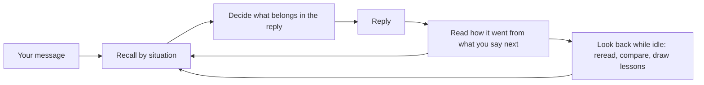

<p align="center">
  
</p>

<p align="center">
  <a href="https://github.com/asteme/asteme/actions/workflows/test.yml"></a>
  <a href="LICENSE"></a>
  
</p>

<p align="center">
  <a href="README.md">English</a> · <a href="README.zh.md">中文</a> · <a href="README.ja.md">日本語</a> · Español · <a href="README.fr.md">Français</a> · <a href="README.de.md">Deutsch</a> · <a href="README.ru.md">Русский</a> · <a href="README.pt.md">Português</a>
</p>

**Estado: en desarrollo.** Asteme todavía se está construyendo. El comportamiento puede cambiar, y puede fallar o perder datos. Todavía no confíes en él para nada importante.

# ASTEME

Asteme es alguien con quien hablas, y el mismo cada vez. Recuerda lo que le dices junto con la situación a la que se aplica, trae un recuerdo de vuelta cuando esa situación vuelve a darse, y cambia lo que se le viene a la mente según cómo resultó usarlo.

Funciona en tu ordenador. Todo lo que recuerda está en un solo archivo SQLite; lo que le entregas se guarda junto a ese archivo.

Hoy tiene dos formas:

- **Dentro de DeepSeek Harness**, como plugin: la conversación es una pantalla en el harness, y un panel de ajustes está a su lado.
- **Por su cuenta**, como cerebro: una página en este ordenador, servida por `brain/cli.mjs`.

Ambos hablan, recuerdan y cumplen promesas, con la misma maquinaria. Cada uno tiene su propio almacén: el plugin usa el almacén del perfil del harness, y el cerebro independiente usa el almacén de su archivo de ajustes, o un almacén por persona con `--person <name>`. `export` e `import` escriben y recuperan una persona entera, así que una persona se puede mover entre los dos. Por lo demás, no ven los almacenes del otro.

## Qué tiene de distinto

**Recuerda la situación, no las palabras.** Una vez corregiste un memorando: «pon la decisión primero, el director solo lee tres líneas». Días después pides una página de presentación para un inversor. No comparten ninguna palabra, pero es la misma situación (alguien con poco tiempo que tiene que decidir), y el recuerdo vuelve.

**El uso reescribe la memoria.** Después de que se usa un recuerdo, se lee lo que dices a continuación para ver cómo fue. El que ayudó viene a la mente con más facilidad. El que estuvo fuera de lugar se queda fuera de ese tipo de situación y sigue funcionando en otras. Nada se desvanece por ser antiguo, y nada se borra porque el almacén haya crecido.

**Cada recuerdo termina en tus propias palabras.** Cada uno conserva la frase exacta de la que salió. Abre un recuerdo y ves en qué se apoya, dónde se aplica, cada vez que se usó y cómo fue, y cada cambio que se le hizo. Si dices que algo está mal, tu palabra prevalece sobre la del modelo.

**Cumple promesas.** «Pregúntame otra vez en junio» se convierte en una promesa que Asteme guarda por su cuenta, una vez o repetida, y habla primero cuando llega el momento.

**Muestra lo que recuerda.** Cada recuerdo es una estrella en un cielo detrás de la conversación, más brillante cuando viene a la mente con facilidad. Agarra el cielo vacío y estás entre ellas.

## Pruébalo en un minuto

Node 22.5 o posterior. Nada que instalar, ninguna clave de API.

```
git clone https://github.com/asteme/asteme.git
cd asteme
npm run demo
```

La demo reproduce dos semanas con un usuario frente a un modelo guionizado y narra lo que hace la memoria:

```
Day 1. The user corrects a memo.
  stored as a case; the exchange stood out (salience 0.55) because it was a correction
Day 3. A request with none of the memo's words: a one-pager for an investor.
  recalled by the scene: "Writing a memo for the director"
  it helped; accessibility 0.7453
Day 4. The same memory is used where it does not belong: notes for the team.
  marked out of place there; accessibility 0.605
Night. Sleep.
  integrate: one lesson drawn from two cases
```

Las pruebas se ejecutan de la misma manera: `npm test`.

Para ver la conversación sin un modelo, ejecuta la vista previa propia de la página:

```
DEMO=1 ALL=900 node brain/preview.mjs 4173 es
```

Luego abre `http://127.0.0.1:4173/?token=preview` en este ordenador (en PowerShell, define primero las dos variables: `$env:DEMO=1; $env:ALL=900`). Nada de lo que hay en ella es la conversación real de nadie.

## Úsalo

### En DeepSeek Harness

Instala el plugin `dsh-asteme` (Plugins → Add plugin). DSH lo instala y lo actualiza desde npm. Durante la instalación, DSH te pide permiso para ejecutar los scripts de instalación de tres dependencias (`onnxruntime-node`, `protobufjs` y `sharp`). Autorízalos para continuar. **ASTEME** aparece entonces en la barra lateral.

- La conversación ocupa toda la pantalla y los recuerdos se abren a su lado. En la parte superior, **Ajustes** solo se refiere a la conversación: la apariencia, Asteme en sí (nombre, imagen, forma de hablar y ánimo), la voz y la forma de pensar.
- **Memoria**, también en la parte superior, da acceso a la búsqueda y al cielo de estrellas. En DSH también permite abrir la lista de recuerdos, revisar la última respuesta, consultar la actividad y el estatuto, y abrir **Ajustes de la memoria**. Esta última vista también está en **Ajustes → Asteme** dentro de DSH.
- Las conversaciones propias del harness no cambian: son agentes haciendo trabajo en una sesión. Asteme es una conversación que continúa a través de todas ellas, y puede hablar primero.

### Por su cuenta

```
npm run brain
```

Los ajustes se leen de `~/.asteme/brain.json` (o la ruta en `ASTEME_CONFIG`). Nunca se escribe una clave en el archivo; `keyEnv` nombra la variable de entorno que la contiene.

```json
{ "model": { "url": "https://your-endpoint/v1", "name": "your-model", "keyEnv": "YOUR_KEY_ENV" },
  "judge": { "keyEnv": "YOUR_JUDGE_KEY_ENV" },
  "workers": { "dsh": { "command": "dsh", "args": ["acp"], "about": "an agent with files and a shell" } },
  "store": "~/.asteme/memory.sqlite", "port": 4170, "language": "es" }
```

La página responde solo en este ordenador y solo con el token de la dirección que se imprime. Un worker es un agente que recibe palabras y responde con palabras mediante el Agent Client Protocol; DSH siempre está disponible dentro del harness, y se pueden añadir otros en el archivo.

Una voz compatible con OpenAI se puede prestar de la misma manera con `voice: { url, model, voices, keyEnv }`.

### Como memoria para cualquier agente (MCP)

```
ASTEME_DB=./memory.sqlite \
ASTEME_LLM_URL=https://your-endpoint/v1 ASTEME_LLM_KEY=... ASTEME_LLM_MODEL=... \
node standalone/mcp.mjs
```

Un servidor MCP por stdio. El agente llama a `asteme_recall` con cada mensaje del usuario antes de responder y a `asteme_observe` con su respuesta después.

### Como biblioteca

```js
import { openBrain } from "./standalone/brain.mjs";

const brain = openBrain({ path: "memory.sqlite", infer, embed });
const { note } = await brain.recall({ session: "s1", message });   // before the agent answers
brain.observe({ session: "s1", reply });                           // after it answered
await brain.rest();                                                // when idle
```

## La conversación

- **El comienzo.** Un almacén nuevo, o uno borrado por completo, todavía no tiene a nadie. Una sola vez, antes de la conversación, pide un nombre, cómo llamarte y cómo hablarte (todo puede quedar vacío, o saltarse entero), y entonces se despierta. Que la despierten y le den un nombre es su primer recuerdo: esa estrella cae en el cielo vacío, se queda en el centro como la más brillante, y después habla primero.
- **Estrellas.** Una estrella es un recuerdo; el más reciente está cerca del centro, el más antiguo lejos, y los que vienen a la mente con facilidad brillan más. Arrastra el cielo vacío, pellízcalo o haz doble clic en él para entrar; arrastra para mover, usa la rueda para acercar y alejar, y Shift+arrastrar para girar. Por mucho que haya girado, un tirón sigue moviendo lo que está bajo la mano; `0` o «Level the sky» lo vuelve a poner derecho. Algo recién aprendido cae en el cielo como una estrella fugaz (esto se puede desactivar).
- **Búsqueda.** Escribe en el cuadro de búsqueda y las estrellas que coinciden vienen hacia él, una a una, en un arco suelto. La rueda o ↑↓ se mueve entre ellas, Intro o un clic abre una, y el resto se queda tenue en el cielo.
- **Un recuerdo.** Abre una estrella para ver sus palabras, en qué se apoya, cuándo se aprendió, y para decir que sigue siendo cierto, que ya no lo es, para pausarlo o para olvidarlo junto con sus fuentes.
- **Promesas.** Una promesa es una línea bajo la respuesta que la hizo, la próxima vez en el encabezado, y se puede cancelar diciéndolo.
- **Respuestas y reacciones.** Cualquier mensaje se puede responder en el mismo sitio; Asteme puede poner un emoji en los tuyos, y tú puedes poner uno en los suyos.
- **Marcas de lectura.** Cada lado puede ver cuándo lo leyó el otro. Ambas direcciones se pueden desactivar.
- **Retirar un mensaje.** Un mensaje tuyo se puede retirar; lo que Asteme dijo en respuesta se va con él, y el trabajo que repartió por él se cancela.
- **Archivos.** Añade, pega o suelta hasta seis archivos en un mensaje. Los archivos de texto se leen. Las imágenes se muestran al modelo si este puede procesarlas. Los PDF y otros tipos de archivo se pasan a un worker cuando hace falta.
- **Voz.** Las respuestas se pueden leer en voz alta con la voz de DeepSeek cuando el harness tiene una clave de DeepSeek; las palabras leídas se envían a DeepSeek. Lo que se lee son las palabras, no ids ni códigos largos.
- **Mientras estabas en otra parte.** Cuando Asteme ha dicho algo que no has visto, una estrella de su icono en la barra lateral del harness está encendida, y una pestaña del navegador lo cuenta en su título. Abrir Asteme puede llevar a la conversación o a lo que espera en la memoria; eso se elige en los ajustes del panel.

## Cómo funciona



Antes de una respuesta, el mensaje llama a los recuerdos por significado, y una llamada al modelo lee la situación y decide cuáles pertenecen. Después de la respuesta, el intercambio se lee hacia la memoria, y tu frase se conserva como base de todo lo aprendido. Más tarde, lo que escribes a continuación se lee para ver cómo resultó cada recuerdo usado, y eso cambia lo que se recuerda la próxima vez. Mientras está inactivo, relee los intercambios que destacaron (una corrección, una sorpresa, una promesa), compara recuerdos que pueden contradecirse y saca lecciones de ocasiones separadas.

El código nunca decide qué significa algo. Comprueba la estructura: que una cita sea exacta, que exista un id, que una revisión no se haya movido. El significado queda para el modelo, y todo lo que el modelo escribe tiene que apuntar a un registro almacenado.

**El trabajo recurrente está dividido.** Una promesa repetida de Asteme («cada mañana», «cada viernes a las cinco») la guarda Asteme, con la hora en su propio almacén: no se registra en las tareas programadas de DeepSeek Harness ni aparece en la lista del harness. Solo se le pide al harness cuando tiene que ocurrir trabajo real a esa hora. Cuando una promesa así está esperando, Asteme arranca junto con el harness, así que la hora llega incluso si su página nunca se abre.

## Tus datos

- Todo está en un único archivo SQLite en tu máquina; los archivos que entregas se guardan junto a él. No hay telemetría. Solo llega a la red para los endpoints de modelo que configures, para un juez o una voz opcionales, y una vez para descargar el modelo de embeddings local.
- **Exportar e importar** una copia completa, conversaciones incluidas. Importar añade lo que falta y nunca sobrescribe.
- **Un diario**: un archivo Markdown por mes con lo que se dijo, lo que sacó de ello y cómo fue.
- **Copias automáticas** una vez al día. Solo se eliminan copias antiguas, nunca lo que recuerda.
- **Olvidar es de verdad**: olvidar un recuerdo junto con sus mensajes de origen los elimina de todas las tablas, y una importación no puede traerlos de vuelta.
- **Una conversación privada** se recuerda como orden y recuentos, sin las palabras; nada de ella se lee hacia la memoria ni se trae a ella.
- **Los proyectos** pueden guardar para sí lo que se aprende en ellos, y un recuerdo se puede limitar a su proyecto.

## Límites, hoy

- 0.11 es la primera versión pública y el proyecto aún está en sus inicios. El comportamiento puede cambiar entre versiones.
- Una respuesta puede esperar a la memoria: leer la situación y elegir de ella es una llamada al modelo, y con un modelo de razonamiento ha tardado de diez a veinte segundos, a veces más. Un modelo de decisión pequeño (el juez) puede ocupar ese lugar cuando hay uno configurado, y entonces la respuesta ya no espera por él.
- Las imágenes enviadas en una conversación se muestran al modelo si este puede procesarlas. Asteme no lee por sí mismo los demás archivos que no sean de texto (por ejemplo, PDF o grabaciones): si una tarea requiere abrirlos, se los pasa a DSH junto con su ruta.
- La lectura en voz alta usa solo una voz prestada (no se usan las voces instaladas en el ordenador). Un servicio de voz propio (compatible con OpenAI, o un servidor local) se configura en el archivo de ajustes; todavía no hay pantalla para ello.
- La integración continua (CI) ejecuta las pruebas y compila el plugin en Windows, macOS y Linux. Asteme se ha usado en la práctica en Windows y se ha comprobado manualmente en Linux; en macOS aún no se ha comprobado de forma manual.
- La página es solo para este ordenador; no hay acceso desde el teléfono.

## Hacia dónde va

Hoy es memoria: alguien que recuerda y a quien puedes corregir. Lo siguiente es darle manos: el mismo Asteme usará las herramientas de tu equipo para hacer cosas y te pedirá permiso antes de hacer nada que no se pueda deshacer. La memoria viene primero porque todo lo demás se construye sobre ella. Aunque el modelo mejore, conservará la misma memoria y seguirá reconociéndote.

## Documentos

- [docs/BRAIN.md](docs/BRAIN.md): el cerebro: una conversación, manos, un reloj, despierto y dormido
- [DESIGN.md](DESIGN.md): el modelo de memoria, por qué funciona así, qué se prueba
- [docs/IMPLEMENTATION.md](docs/IMPLEMENTATION.md): decisiones tomadas en la implementación
- [CHANGELOG.md](CHANGELOG.md): qué cambió en cada versión
- [HANDOFF.md](HANDOFF.md): el estado del desarrollo y lo que viene después
- [CONTRIBUTING.md](CONTRIBUTING.md): cómo ejecutarlo, la disposición, las reglas para los cambios

## Licencia

El código se distribuye bajo la licencia [Apache-2.0](LICENSE), con un [NOTICE](NOTICE). La licencia no cubre el nombre ni la marca del proyecto; consulta [TRADEMARKS.md](TRADEMARKS.md).
