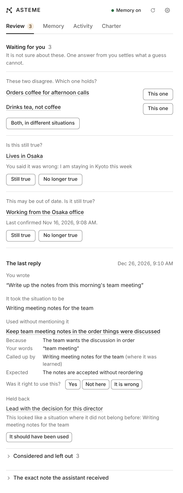

<p align="center">
  
</p>

<p align="center">
  <a href="README.md">English</a> · <a href="README.zh.md">中文</a> · <a href="README.ja.md">日本語</a> · Español · <a href="README.fr.md">Français</a> · <a href="README.de.md">Deutsch</a> · <a href="README.ru.md">Русский</a> · <a href="README.pt.md">Português</a>
</p>

**En desarrollo:** Asteme sigue en construcción. El comportamiento puede cambiar y puede fallar o perder datos. No lo uses todavía para nada importante.

# ASTEME

Asteme es memoria a largo plazo para un asistente de IA. No busca palabras parecidas en conversaciones pasadas. Recuerda lo que dijiste junto con la situación a la que se aplica, lo trae de vuelta cuando esa situación se repite y cambia la facilidad con que cada recuerdo viene a la mente según si usarlo ayudó.

Funciona en tu equipo, con un solo archivo SQLite. Se usa como plugin de DeepSeek Harness, como servidor MCP para cualquier agente o como biblioteca.

<p align="center">
  
</p>

## Qué tiene de distinto

**Recuerda la situación, no las palabras.** Una vez corregiste un memorando: «pon la decisión primero, la directora solo lee tres líneas». Días después pides una página para un inversor. No comparten ninguna palabra, pero es la misma situación (alguien con poco tiempo que debe decidir), y el recuerdo vuelve.

**El uso reescribe la memoria.** Después de usar un recuerdo, se lee lo que dices a continuación para saber cómo fue. El que ayudó viene a la mente con más facilidad. El que estuvo fuera de lugar deja de aparecer en ese tipo de situación y sigue sirviendo en las demás. Nada se desvanece por ser antiguo y nada se borra porque haya muchos.

**Cada recuerdo termina en tus propias palabras.** Cada uno conserva la frase exacta de la que salió. Puedes abrir cualquiera y ver en qué se apoya, dónde se aplica, cada vez que se usó y cómo fue, y cada cambio que tuvo. Si dices que algo está mal, tu palabra pesa más que la del modelo.

Además, repasa entre conversaciones y saca una lección de ocasiones distintas; nota cuando dos recuerdos se contradicen y te pregunta; y mantiene un propósito y unos valores que nada de lo aprendido puede cambiar. [DESIGN.md](DESIGN.md) explica cómo funciona y cómo se prueba cada cosa (en inglés).

## Pruébalo en un minuto

Node 22.5 o posterior. No hay nada que instalar ni hace falta clave de API.

```
git clone https://github.com/asteme/asteme.git
cd REPO
npm run demo
```

La demo reproduce dos semanas con un usuario frente a un modelo guionizado y va contando lo que hace la memoria. `npm test` ejecuta toda la batería de pruebas de la misma manera. Para ver el panel, abre `client/preview/preview.html` en un navegador.

## Cómo usarlo

### Como memoria para cualquier agente (MCP)

```
ASTEME_DB=./memory.sqlite \
ASTEME_LLM_URL=https://your-endpoint/v1 ASTEME_LLM_KEY=... ASTEME_LLM_MODEL=... \
node standalone/mcp.mjs
```

Un servidor MCP por stdio. El agente llama a `asteme_recall` con cada mensaje antes de responder y a `asteme_observe` con su respuesta después.

### Como biblioteca

```js
import { openBrain } from "./standalone/brain.mjs";

const brain = openBrain({ path: "memory.sqlite", infer, embed });
const { note } = await brain.recall({ session: "s1", message });   // antes de responder
brain.observe({ session: "s1", reply });                           // después de responder
await brain.rest();                                                // cuando no hay nada que hacer
```

### Como plugin de DeepSeek Harness

`plugin/` es el adaptador y `client/` su panel de ajustes. Es la forma en que más se ha usado.

## El panel

- **Revisión**: lo que no tiene claro, y qué usó la última respuesta y por qué. Con un clic dices si un recuerdo fue acertado, estuvo fuera de lugar o es falso, y de ese clic aprende.
- **Memoria**: todo lo que sabe. Cada elemento se puede abrir para ver en qué se apoya.
- **Actividad**: lo que hizo mientras no estabas, y por qué no pasa nada cuando no pasa nada.
- **Carta**: su propósito y sus valores. Los escribes tú; nada de lo aprendido los cambia.

El panel está disponible en inglés, japonés y chino.

## Hacia dónde va

No creemos que la memoria sea un registro en el que se busca. Es recordar lo que pasó, cambiar de opinión según cómo terminó y no borrar nunca: solo que algunas cosas cuestan más de recordar. Cada recuerdo es una estrella, y la situación en la que estás es lo que las une en una figura.

Trabajamos hacia un asistente que, tras suficiente tiempo con una persona, sea alguien en particular para ella. Asteme no ha llegado ahí. Hoy es la primera vuelta de ese ciclo, en una sola máquina, con más diseñado que demostrado. El [registro de cambios](CHANGELOG.md) y [`DESIGN.md`](DESIGN.md) dicen con claridad qué es cada cosa.

## Tus datos

- Todo está en un archivo SQLite en tu equipo. No hay telemetría. Solo usa la red para los servicios de modelo que configures y, una vez, para descargar el modelo local de embeddings.
- **Exportar e importar** una copia completa, conversaciones incluidas. Importar añade lo que falta y nunca sobrescribe.
- **Un diario**: un archivo Markdown por mes con lo que se dijo, lo que sacó de ello y cómo fue.
- **Copias automáticas** una vez al día. Solo se eliminan copias antiguas, nunca lo que recuerda.
- **Olvidar es de verdad**: olvidar un recuerdo junto con sus mensajes de origen los quita de todas las tablas, y una importación no puede devolverlos.

## Licencia

Not yet published. All rights reserved for now: see [LICENSE](LICENSE).


