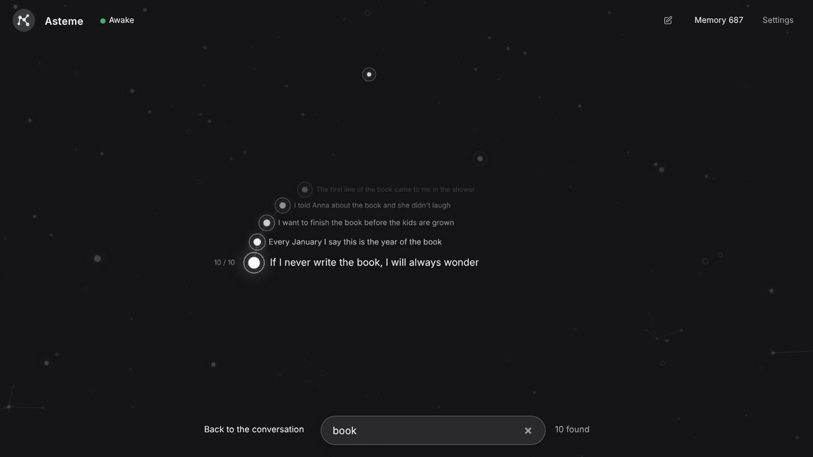

<p align="center">
  
</p>

<p align="center">
  <a href="README.md">English</a> · <a href="README.zh.md">中文</a> · <a href="README.ja.md">日本語</a> · <a href="README.es.md">Español</a> · Français · <a href="README.de.md">Deutsch</a> · <a href="README.ru.md">Русский</a> · <a href="README.pt.md">Português</a>
</p>

[](public/media/asteme-en.mp4)

**En développement :** Asteme est encore en construction. Le comportement peut changer, et il peut échouer ou perdre des données. Ne l'utilisez pas encore pour quelque chose d'important.

# ASTEME

Asteme est une mémoire à long terme pour un assistant IA. Elle ne cherche pas des mots ressemblants dans les conversations passées. Elle retient ce que vous avez dit avec la situation à laquelle cela s’applique, le fait revenir quand cette situation se représente, et ajuste la facilité avec laquelle chaque souvenir revient selon que son usage a aidé ou non.

Elle fonctionne sur votre machine, dans un seul fichier SQLite. Elle s’utilise comme plugin pour DeepSeek Harness, comme serveur MCP pour n’importe quel agent, ou comme bibliothèque.

<p align="center">
  
</p>

## Ce qui la distingue

**C’est la situation qui rappelle, pas les mots.** Vous avez un jour corrigé une note : « mets la décision en premier, la directrice ne lit que trois lignes ». Quelques jours plus tard, vous demandez une page pour un investisseur. Aucun mot en commun, mais c’est la même situation (un lecteur pressé qui doit décider), et le souvenir revient.

**L’usage réécrit la mémoire.** Après l’emploi d’un souvenir, ce que vous dites ensuite est lu pour savoir comment cela s’est passé. Celui qui a aidé revient plus facilement. Celui qui était hors de propos ne revient plus dans ce genre de situation et continue de servir ailleurs. Rien ne s’efface parce que c’est ancien, et rien n’est supprimé parce qu’il y en a beaucoup.

**Chaque souvenir aboutit à vos propres mots.** Chacun garde la phrase exacte dont il vient. Vous pouvez ouvrir n’importe lequel et voir sur quoi il repose, où il s’applique, chaque emploi et son résultat, et chaque modification. Si vous dites qu’une chose est fausse, votre parole l’emporte sur celle du modèle.

Elle fait aussi le point entre les conversations et tire une leçon d’occasions distinctes ; elle remarque quand deux souvenirs se contredisent et vous pose la question ; elle garde un but et des valeurs que rien de ce qu’elle apprend ne peut changer. [DESIGN.md](DESIGN.md) décrit le fonctionnement et les tests de chaque point (en anglais).

## L’essayer en une minute

Node 22.5 ou plus récent. Rien à installer, aucune clé d’API.

```
git clone https://github.com/asteme/asteme.git
cd REPO
npm run demo
```

La démo rejoue deux semaines avec un utilisateur face à un modèle scripté et raconte ce que fait la mémoire. `npm test` lance toute la suite de la même manière. Pour voir le panneau, ouvrez `client/preview/preview.html` dans un navigateur.

## L’utiliser

### Comme mémoire pour n’importe quel agent (MCP)

```
ASTEME_DB=./memory.sqlite \
ASTEME_LLM_URL=https://your-endpoint/v1 ASTEME_LLM_KEY=... ASTEME_LLM_MODEL=... \
node standalone/mcp.mjs
```

Un serveur MCP sur stdio. L’agent appelle `asteme_recall` avec chaque message avant de répondre, puis `asteme_observe` avec sa réponse.

### Comme bibliothèque

```js
import { openBrain } from "./standalone/brain.mjs";

const brain = openBrain({ path: "memory.sqlite", infer, embed });
const { note } = await brain.recall({ session: "s1", message });   // avant de répondre
brain.observe({ session: "s1", reply });                           // après avoir répondu
await brain.rest();                                                // quand il n’y a rien à faire
```

### Comme plugin DeepSeek Harness

`plugin/` est l’adaptateur et `client/` son panneau de réglages. C’est sous cette forme qu’elle a été le plus utilisée.

## Le panneau

- **Revue** : ce dont elle n’est pas sûre, et ce que la dernière réponse a utilisé et pourquoi. Un clic indique si un souvenir était juste, hors de propos ou faux, et c’est de ce clic qu’elle apprend.
- **Mémoire** : tout ce qu’elle sait. Chaque élément s’ouvre pour montrer sur quoi il repose.
- **Activité** : ce qu’elle a fait en votre absence, et pourquoi il ne se passe rien quand il ne se passe rien.
- **Charte** : son but et ses valeurs. C’est vous qui les écrivez ; rien de ce qu’elle apprend ne les change.

Le panneau est disponible en anglais, en japonais et en chinois.

## Où va ce projet

Nous ne pensons pas que la mémoire soit un registre que l'on interroge. C'est se souvenir de ce qui s'est passé, changer d'avis selon la façon dont cela a tourné, et ne jamais effacer : certaines choses deviennent seulement plus difficiles à rappeler. Chaque souvenir est une étoile, et la situation présente est ce qui les relie en une figure.

Ce vers quoi nous travaillons, c'est un assistant qui, après assez de temps passé avec une personne, devient quelqu'un de particulier pour elle. Asteme n'y est pas. Aujourd'hui, c'est le premier tour de cette boucle, sur une seule machine, avec davantage de choses conçues que prouvées. Le [journal des modifications](CHANGELOG.md) et [`DESIGN.md`](DESIGN.md) disent clairement ce qui relève de l'un et de l'autre.

## Vos données

- Tout tient dans un fichier SQLite sur votre machine. Aucune télémétrie. Le réseau ne sert que pour les services de modèle que vous configurez et, une fois, pour télécharger le modèle local d’embeddings.
- **Exporter et importer** une copie complète, conversations comprises. L’import ajoute ce qui manque et n’écrase jamais rien.
- **Un journal** : un fichier Markdown par mois avec ce qui a été dit, ce qu’elle en a retenu et comment cela s’est passé.
- **Des copies automatiques** une fois par jour. Seules les anciennes copies sont éliminées, jamais ce qu’elle retient.
- **Oublier, c’est vraiment oublier** : oublier un souvenir avec ses messages d’origine les retire de toutes les tables, et un import ne peut pas les ramener.

## Licence

Not yet published. All rights reserved for now: see [LICENSE](LICENSE).


