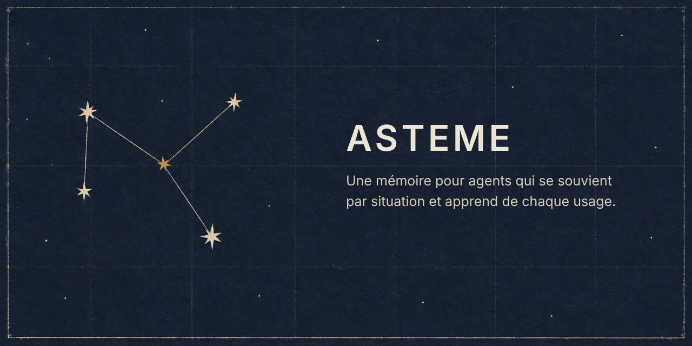
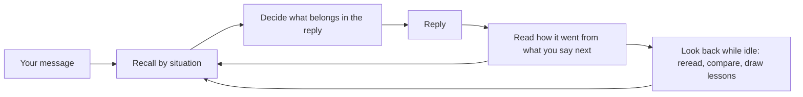

<p align="center">
  
</p>

<p align="center">
  <a href="https://github.com/asteme/asteme/actions/workflows/test.yml"></a>
  <a href="LICENSE"></a>
  
</p>

<p align="center">
  <a href="README.md">English</a> · <a href="README.zh.md">中文</a> · <a href="README.ja.md">日本語</a> · <a href="README.es.md">Español</a> · Français · <a href="README.de.md">Deutsch</a> · <a href="README.ru.md">Русский</a> · <a href="README.pt.md">Português</a>
</p>

**État : en développement.** Asteme est encore en construction. Le comportement peut changer, et il peut échouer ou perdre des données. Ne comptez pas encore sur lui pour quelque chose d'important.

# ASTEME

Asteme est quelqu'un à qui vous parlez, et le même à chaque fois. Il retient ce que vous lui dites avec la situation à laquelle cela s'applique, ramène un souvenir quand cette situation se présente de nouveau, et modifie ce qui lui vient à l'esprit selon l'issue de chaque usage.

Il tourne sur votre ordinateur. Tout ce qu'il retient est dans un seul fichier SQLite ; ce que vous lui confiez est gardé à côté de ce fichier.

Aujourd'hui, il a deux formes :

- **Dans DeepSeek Harness**, comme plugin : la conversation est un écran du harness, et un panneau de réglages se tient à côté.
- **Seul**, comme cerveau : une page sur cet ordinateur, servie par `brain/cli.mjs`.

Les deux parlent, retiennent et tiennent leurs promesses, sur la même machinerie. Chacun a son propre magasin : le plugin utilise le magasin du profil du harness, et le cerveau autonome utilise le magasin de son fichier de réglages, ou un magasin par personne avec `--person <name>`. `export` et `import` écrivent et ramènent une personne entière, de sorte qu'une personne peut être déplacée entre les deux. Autrement, ils ne voient pas le magasin de l'autre.

## Ce qui le distingue

**C'est la situation qui rappelle, pas les mots.** Vous avez un jour corrigé une note : « mettez la décision en premier, le directeur ne lit que trois lignes ». Des jours plus tard, vous demandez une page pour un investisseur. Aucun mot en commun, mais c'est la même situation (un lecteur qui a peu de temps et doit décider), et le souvenir revient.

**L'usage réécrit la mémoire.** Après qu'un souvenir a été utilisé, ce que vous dites ensuite est lu pour savoir comment cela s'est passé. Celui qui a aidé vient plus facilement à l'esprit. Celui qui était hors de propos reste hors de ce genre de situation et continue de servir ailleurs. Rien ne s'efface parce que c'est ancien, et rien n'est supprimé parce que le magasin a grossi.

**Chaque souvenir aboutit à vos propres mots.** Chacun garde la phrase exacte dont il vient. Ouvrez un souvenir et vous voyez sur quoi il repose, où il s'applique, chaque fois qu'il a été utilisé et comment cela s'est passé, et chaque modification qui lui a été faite. Si vous dites que quelque chose est faux, votre parole l'emporte sur celle du modèle.

**Il tient ses promesses.** « Redemande-moi en juin » devient une promesse qu'Asteme se tient à lui-même, une fois ou de façon répétée, et il parle le premier quand le moment arrive.

**Il montre ce dont il se souvient.** Chaque souvenir est une étoile sur un ciel derrière la conversation, plus brillante quand elle vient facilement à l'esprit. Prenez le ciel vide et vous êtes parmi elles.

## L'essayer en une minute

Node 22.5 ou plus récent. Rien à installer, aucune clé d'API.

```
git clone https://github.com/asteme/asteme.git
cd asteme
npm run demo
```

La démo rejoue deux semaines avec un utilisateur face à un modèle scripté et raconte ce que fait la mémoire :

```
Day 1. The user corrects a memo.
  stored as a case; the exchange stood out (salience 0.55) because it was a correction
Day 3. A request with none of the memo's words: a one-pager for an investor.
  recalled by the scene: "Writing a memo for the director"
  it helped; accessibility 0.7453
Day 4. The same memory is used where it does not belong: notes for the team.
  marked out of place there; accessibility 0.605
Night. Sleep.
  integrate: one lesson drawn from two cases
```

Les tests se lancent de la même façon : `npm test`.

Pour regarder la conversation sans modèle, lancez l'aperçu de la page elle-même :

```
DEMO=1 ALL=900 node brain/preview.mjs 4173 fr
```

Ouvrez ensuite `http://127.0.0.1:4173/?token=preview` sur cet ordinateur (dans PowerShell, définissez d'abord les deux variables : `$env:DEMO=1; $env:ALL=900`). Rien n'y est la vraie conversation de qui que ce soit.

## L'utiliser

### Dans DeepSeek Harness

Installez le plugin `dsh-asteme` (Plugins → Add plugin). DSH l’installe et le met à jour depuis npm. Pendant l’installation, DSH vous demande d’autoriser l’exécution des scripts d’installation de trois dépendances (`onnxruntime-node`, `protobufjs` et `sharp`). Autorisez-les pour poursuivre. **ASTEME** apparaît alors dans la barre latérale.

- La conversation occupe tout l’écran et les souvenirs s’ouvrent à côté. En haut de la conversation, **Réglages** ne concerne que celle-ci : l’apparence, Asteme lui-même (nom, image, façon de parler et humeur), la voix et la façon de réfléchir.
- **Mémoire**, également en haut de la conversation, donne accès à la recherche et au ciel étoilé. Dans DSH, on y accède aussi à la liste des souvenirs, à l’examen de la dernière réponse, à l’activité, à la charte et aux **Réglages de la mémoire**. Ces derniers sont également accessibles dans DSH via **Réglages → Asteme**.
- Les conversations propres au harness ne changent pas : ce sont des agents qui font du travail dans une session. Asteme est une conversation qui se poursuit à travers toutes, et il peut parler le premier.

### Seul

```
npm run brain
```

Les réglages sont lus dans `~/.asteme/brain.json` (ou le chemin indiqué dans `ASTEME_CONFIG`). Une clé n'est jamais écrite dans le fichier ; `keyEnv` nomme la variable d'environnement qui la contient.

```json
{ "model": { "url": "https://your-endpoint/v1", "name": "your-model", "keyEnv": "YOUR_KEY_ENV" },
  "judge": { "keyEnv": "YOUR_JUDGE_KEY_ENV" },
  "workers": { "dsh": { "command": "dsh", "args": ["acp"], "about": "an agent with files and a shell" } },
  "store": "~/.asteme/memory.sqlite", "port": 4170, "language": "fr" }
```

La page ne répond que sur cet ordinateur et uniquement avec le jeton de l'adresse imprimée. Un worker est un agent qui prend des mots et répond par des mots au moyen de l'Agent Client Protocol ; DSH est toujours à portée à l'intérieur du harness, et d'autres peuvent être ajoutés dans le fichier.

Une voix compatible OpenAI peut être prêtée de la même façon avec `voice: { url, model, voices, keyEnv }`.

### Comme mémoire pour n'importe quel agent (MCP)

```
ASTEME_DB=./memory.sqlite \
ASTEME_LLM_URL=https://your-endpoint/v1 ASTEME_LLM_KEY=... ASTEME_LLM_MODEL=... \
node standalone/mcp.mjs
```

Un serveur MCP sur stdio. L'agent appelle `asteme_recall` avec chaque message de l'utilisateur avant de répondre, et `asteme_observe` avec sa réponse ensuite.

### Comme bibliothèque

```js
import { openBrain } from "./standalone/brain.mjs";

const brain = openBrain({ path: "memory.sqlite", infer, embed });
const { note } = await brain.recall({ session: "s1", message });   // before the agent answers
brain.observe({ session: "s1", reply });                           // after it answered
await brain.rest();                                                // when idle
```

## La conversation

- **Le commencement.** Un stock neuf, ou un stock effacé, n'a encore personne. Une seule fois, avant la conversation, il demande un nom, comment vous appeler et comment vous parler (tout peut rester vide, ou être entièrement passé), puis il est réveillé. Être réveillé et nommé est son premier souvenir : cette étoile tombe dans le ciel vide, y reste au centre comme la plus brillante, puis il parle le premier.
- **Étoiles.** Une étoile est un souvenir ; le plus récent est près du centre, le plus ancien loin, et ceux qui viennent facilement à l'esprit brillent le plus. Faites glisser le ciel vide, pincez, ou double-cliquez dessus pour entrer ; faites glisser pour déplacer, tournez la molette pour zoomer, Maj-glisser pour tourner. Quel que soit le nombre de tours effectués, un glissement déplace encore ce qui est sous la main ; `0` ou « Remettre le ciel d'aplomb » le remet dans le bon sens. Ce qui est nouvellement appris tombe dans le ciel comme une étoile filante (cela peut être désactivé).
- **Recherche.** Tapez dans le champ de recherche et les étoiles qui correspondent viennent à lui, une à une, en un arc lâche. La molette ou ↑↓ les parcourt, Entrée ou un clic en ouvre une, et les autres restent pâles dans le ciel.
- **Un souvenir.** Ouvrez une étoile pour voir ses mots, sur quoi elle repose, quand elle a été apprise, et pour dire qu'elle est encore vraie, qu'elle n'est plus vraie, la mettre en pause, ou l'oublier avec ses sources.
- **Promesses.** Une promesse est une ligne sous la réponse qui l'a faite, la prochaine fois dans l'en-tête, et elle peut être annulée en le disant.
- **Réponses et réactions.** Tout message peut recevoir une réponse à sa place ; Asteme peut mettre un emoji sur le vôtre, et vous pouvez en mettre un sur les siens.
- **Marques de lecture.** Chaque côté peut voir quand l'autre l'a lu. Les deux sens peuvent être désactivés.
- **Reprendre un message.** Un de vos messages peut être repris ; ce qu'Asteme a dit en réponse part avec, et le travail qu'il a distribué pour lui est rappelé.
- **Fichiers.** Ajoutez, collez ou déposez jusqu'à six fichiers dans un message. Les fichiers texte sont lus. Les images sont montrées au modèle s’il sait les traiter. Les PDF et les autres types de fichiers sont transmis à un worker si nécessaire.
- **Voix.** Les réponses peuvent être lues à voix haute par la voix de DeepSeek quand le harness détient une clé DeepSeek ; les mots lus sont envoyés à DeepSeek. Ce qui est lu, ce sont les mots, pas des identifiants ni de longs codes.
- **Pendant que vous étiez ailleurs.** Quand Asteme a dit quelque chose que vous n'avez pas vu, une étoile de son icône dans la barre latérale du harness s'allume, et un onglet de navigateur le compte dans son titre. Ouvrir Asteme peut mener à la conversation ou à ce qui attend dans la mémoire ; cela se choisit dans les réglages du panneau.

## Comment cela fonctionne



Avant une réponse, le message appelle des souvenirs par le sens, et un appel au modèle lit la situation et décide lesquels conviennent. Après la réponse, l'échange est lu dans la mémoire, votre phrase gardée comme fondement de tout ce qui est appris. Plus tard, ce que vous écrivez ensuite est lu pour savoir comment chaque souvenir utilisé s'est comporté, et cela change ce qui sera rappelé la fois suivante. Quand il est inactif, il relit les échanges qui se sont distingués (une correction, une surprise, une promesse), compare des souvenirs qui peuvent être en désaccord, et tire des leçons d'occasions distinctes.

Le code ne décide jamais de ce que quelque chose veut dire. Il vérifie la structure : qu'une citation est exacte, qu'un identifiant existe, qu'une révision n'a pas bougé. Le sens est laissé au modèle, et tout ce que le modèle écrit doit pointer vers un enregistrement stocké.

**Le travail récurrent est séparé.** Une promesse répétée propre à Asteme (« chaque matin », « chaque vendredi à cinq heures ») est tenue par Asteme, l'heure étant conservée dans son propre magasin : elle n'est pas enregistrée dans les tâches planifiées de DeepSeek Harness et n'apparaît pas dans la liste du harness. Le harness n'est sollicité que lorsqu'un travail réel doit avoir lieu à ce moment-là. Quand une telle promesse attend, Asteme démarre en même temps que le harness, de sorte que le moment arrive même si sa page n'est jamais ouverte.

## Vos données

- Tout est dans un seul fichier SQLite sur votre machine ; les fichiers que vous remettez sont conservés à côté. Il n'y a aucune télémétrie. Il n'atteint le réseau que pour les points de terminaison de modèle que vous configurez, pour un juge ou une voix facultatif, et une fois pour télécharger le modèle d'embedding local.
- **Exporter et importer** une copie complète, conversations comprises. L'import ajoute ce qui manque et n'écrase jamais.
- **Un journal** : un fichier Markdown par mois avec ce qui a été dit, ce qu'il en a retenu et comment cela s'est passé.
- **Des sauvegardes automatiques** une fois par jour. Seules les anciennes copies sont réduites, jamais ce qu'il retient.
- **Oublier est réel** : oublier un souvenir avec ses messages sources les retire de toutes les tables, et un import ne peut pas les ramener.
- **Une conversation privée** est retenue comme ordre et comme nombres, les mots étant laissés de côté ; rien en elle n'est lu dans la mémoire ni n'y est ramené.
- **Les projets** peuvent garder pour eux ce qui y est appris, et un souvenir peut être gardé dans son seul projet.

## Limites, aujourd'hui

- La 0.11 est la première version publique. Le projet en est encore à ses débuts et son comportement peut changer d’une version à l’autre.
- Une réponse peut attendre la mémoire : lire la situation et choisir parmi elle est un appel au modèle, et avec un modèle de raisonnement cela prend dix à vingt secondes, parfois plus. Un petit modèle de décision (le juge) peut prendre cette place quand il y en a un de configuré, et la réponse n'attend alors plus.
- Les images jointes à une conversation sont montrées au modèle s’il sait les traiter. Asteme ne lit pas lui-même les autres fichiers non textuels (PDF, enregistrements, etc.) : si une tâche nécessite de les ouvrir, il les transmet à DSH avec leur chemin d’accès.
- La lecture à voix haute n'utilise qu'une voix prêtée (les voix installées sur l'ordinateur ne sont pas utilisées). Un service de voix personnel (compatible OpenAI, ou un serveur local) se règle dans le fichier de réglages ; il n'y a pas encore d'écran pour cela.
- L’intégration continue (CI) exécute les tests et compile le plugin sous Windows, macOS et Linux. Asteme a été utilisé en conditions réelles sous Windows et vérifié manuellement sous Linux ; aucune vérification manuelle n’a encore été menée sous macOS.
- La page est réservée à cet ordinateur ; il n'y a pas d'accès depuis un téléphone.

## La suite

Aujourd’hui, c’est une mémoire : quelqu’un qui se souvient et que vous pouvez corriger. Ensuite viendront les mains : ce sera toujours le même Asteme, mais il pourra se servir des outils de votre ordinateur et vous demandera votre accord avant toute action irréversible. La mémoire vient d’abord, car tout le reste repose sur elle. Même si le modèle s’améliore, il gardera la même mémoire et continuera de vous reconnaître.

## Documents

- [docs/BRAIN.md](docs/BRAIN.md) : le cerveau — une conversation, des mains, une horloge, éveillé et endormi
- [DESIGN.md](DESIGN.md) : le modèle de mémoire, pourquoi il fonctionne ainsi, ce qui est testé
- [docs/IMPLEMENTATION.md](docs/IMPLEMENTATION.md) : décisions prises dans l'implémentation
- [CHANGELOG.md](CHANGELOG.md) : ce qui a changé dans chaque version
- [HANDOFF.md](HANDOFF.md) : l'état du développement et ce qui vient ensuite
- [CONTRIBUTING.md](CONTRIBUTING.md) : comment le lancer, l'organisation, les règles pour les changements

## Licence

Le code est sous licence [Apache-2.0](LICENSE), avec un fichier [NOTICE](NOTICE). Cette licence ne couvre ni le nom ni la marque du projet ; voir [TRADEMARKS.md](TRADEMARKS.md).
