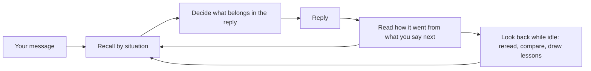

<p align="center">
  
</p>

<p align="center">
  <a href="https://github.com/asteme/asteme/actions/workflows/test.yml"></a>
  <a href="LICENSE"></a>
  
</p>

<p align="center">
  <a href="README.md">English</a> · <a href="README.zh.md">中文</a> · <a href="README.ja.md">日本語</a> · <a href="README.es.md">Español</a> · Français · <a href="README.de.md">Deutsch</a> · <a href="README.ru.md">Русский</a> · <a href="README.pt.md">Português</a>
</p>

https://github.com/user-attachments/assets/f3d6ef2a-0eee-491c-b3e8-9dd5756be9ca

**Statut : en développement.** Asteme est encore en construction. Le comportement peut changer, et il peut échouer ou perdre des données. Ne vous appuyez pas encore sur lui pour quoi que ce soit d'important.

# ASTEME

Asteme est quelqu'un à qui vous parlez, et le même à chaque fois. Elle retient ce que vous lui dites avec la situation à laquelle cela s'applique, fait revenir un souvenir quand cette situation se représente, et change ce qui vient à l'esprit selon ce que son usage a donné.

Elle tourne sur votre ordinateur. Tout ce qu'elle retient tient dans un seul fichier SQLite ; ce que vous lui confiez est gardé à côté de ce fichier.

Aujourd'hui, elle a deux formes :

- **Dans DeepSeek Harness**, comme plugin : la conversation est un écran du harness, et un panneau de réglages se tient à côté.
- **Seule**, comme cerveau : une page sur cet ordinateur, servie par `brain/cli.mjs`.

Les deux parlent, retiennent et tiennent parole, sur la même machinerie. Chacune a son propre magasin : le plugin utilise le magasin du profil du harness, et le cerveau autonome utilise le magasin de son fichier de réglages, ou un magasin par personne avec `--person <name>`. `export` et `import` écrivent et ramènent une personne entière, de sorte qu'une personne peut passer de l'un à l'autre. Sinon, ils ne voient pas le magasin de l'autre.

## Ce qui la distingue

**C'est la situation qui rappelle, pas les mots.** Vous avez un jour corrigé une note : « mets la décision en premier, la directrice ne lit que trois lignes ». Des jours plus tard, vous demandez une page pour un investisseur. Aucun mot en commun, mais c'est la même situation (un lecteur pressé qui doit décider), et le souvenir revient.

**L'usage réécrit la mémoire.** Une fois un souvenir utilisé, ce que vous dites ensuite est lu pour savoir comment cela s'est passé. Celui qui a aidé revient plus facilement. Celui qui était hors de propos ne revient plus dans ce genre de situation et continue de servir ailleurs. Rien ne s'efface parce que c'est ancien, et rien n'est supprimé parce que le magasin a grossi.

**Chaque souvenir aboutit à vos propres mots.** Chacun garde la phrase exacte dont il vient. Ouvrez un souvenir et vous voyez sur quoi il repose, où il s'applique, chaque fois qu'il a été utilisé et ce que cela a donné, et chaque modification qui lui a été faite. Si vous dites que quelque chose est faux, votre parole l'emporte sur celle du modèle.

**Elle tient parole.** « Redemande-moi en juin » devient une promesse qu'Asteme porte lui-même, une seule fois ou répétée, et elle parle la première quand le moment arrive.

**Elle montre ce qu'elle retient.** Chaque souvenir est une étoile dans un ciel derrière la conversation, plus brillante quand il revient facilement à l'esprit. Saisissez le ciel vide et vous êtes parmi elles.

## L'essayer en une minute

Node 22.5 ou plus récent. Rien à installer, aucune clé d'API.

```
git clone https://github.com/asteme/asteme.git
cd asteme
npm run demo
```

La démo rejoue deux semaines avec un utilisateur face à un modèle scripté et raconte ce que fait la mémoire :

```
Day 1. The user corrects a memo.
  stored as a case; the exchange stood out (salience 0.55) because it was a correction
Day 3. A request with none of the memo's words: a one-pager for an investor.
  recalled by the scene: "Writing a memo for the director"
  it helped; accessibility 0.7453
Day 4. The same memory is used where it does not belong: notes for the team.
  marked out of place there; accessibility 0.605
Night. Sleep.
  integrate: one lesson drawn from two cases
```

Les tests se déroulent de la même manière : `npm test`.

Pour regarder la conversation sans modèle, lancez l'aperçu de la page elle-même :

```
DEMO=1 ALL=900 node brain/preview.mjs 4173 ja
```

Ouvrez ensuite `http://127.0.0.1:4173/?token=preview` sur cet ordinateur (dans PowerShell, définissez d'abord les deux variables : `$env:DEMO=1; $env:ALL=900`). Rien de ce qu'elle contient n'est la vraie conversation de qui que ce soit.

## L'utiliser

### Dans DeepSeek Harness

Installez le plugin `dsh-asteme` (Plugins → Ajouter un plugin ; il vient de npm, et DSH le met à jour depuis là). Pendant l'installation, DSH demande d'autoriser les scripts d'installation de trois paquets dont il dépend (onnxruntime-node, protobufjs, sharp) ; autorisez-les et il continue. **ASTEME** apparaît alors dans la barre latérale.

- La conversation occupe tout l'écran. Les souvenirs s'ouvrent à côté ; « Réglages » concerne la conversation : son apparence, Asteme elle-même (nom, visage, façon de parler, humeur), la voix et la réflexion. « Mémoire » concerne tout ce qu'elle retient : la recherche, les étoiles et, dans DSH, chaque endroit où la mémoire est entretenue. Les réglages de mémoire sont aussi dans les réglages propres à DSH, sous Asteme.
- Le panneau garde ce qui n'a pas sa place dans la conversation : revue, mémoire, activité, charte, réglages.
- Les conversations propres au harness ne changent pas : ce sont des agents qui font du travail dans une session. Asteme est une conversation qui se poursuit à travers toutes, et elle peut parler la première.

### Seule

```
npm run brain
```

Les réglages sont lus dans `~/.asteme/brain.json` (ou le chemin indiqué par `ASTEME_CONFIG`). Une clé n'est jamais écrite dans le fichier ; `keyEnv` nomme la variable d'environnement qui la contient.

```json
{ "model": { "url": "https://your-endpoint/v1", "name": "your-model", "keyEnv": "YOUR_KEY_ENV" },
  "judge": { "keyEnv": "YOUR_JUDGE_KEY_ENV" },
  "workers": { "dsh": { "command": "dsh", "args": ["acp"], "about": "an agent with files and a shell" } },
  "store": "~/.asteme/memory.sqlite", "port": 4170, "language": "en" }
```

La page ne répond que sur cet ordinateur et seulement avec le jeton de l'adresse affichée. Un travailleur (worker) est un agent qui reçoit des mots et répond par des mots via l'Agent Client Protocol ; DSH est toujours à portée de main dans le harness, et d'autres peuvent être ajoutés dans le fichier.

Une voix compatible OpenAI peut être prêtée de la même façon avec `voice: { url, model, voices, keyEnv }`.

### Comme mémoire pour n'importe quel agent (MCP)

```
ASTEME_DB=./memory.sqlite \
ASTEME_LLM_URL=https://your-endpoint/v1 ASTEME_LLM_KEY=... ASTEME_LLM_MODEL=... \
node standalone/mcp.mjs
```

Un serveur MCP sur stdio. L'agent appelle `asteme_recall` avec chaque message de l'utilisateur avant de répondre, puis `asteme_observe` avec sa réponse.

### Comme bibliothèque

```js
import { openBrain } from "./standalone/brain.mjs";

const brain = openBrain({ path: "memory.sqlite", infer, embed });
const { note } = await brain.recall({ session: "s1", message });   // before the agent answers
brain.observe({ session: "s1", reply });                           // after it answered
await brain.rest();                                                // when idle
```

## La conversation

- **Le début.** Un magasin neuf, ou vidé, n'a encore personne dedans. Une fois, avant la conversation, elle demande un nom, comment vous appeler et comment vous parler (chacun peut rester vide, ou tout être passé), puis elle est réveillée. Être réveillée et nommée est son premier souvenir : cette étoile tombe dans le ciel vide, y reste au centre comme la plus brillante, puis elle parle la première.
- **Les étoiles.** Une étoile est un souvenir ; les plus récents sont près du centre, les plus anciens au loin, et ceux qui reviennent facilement brillent le plus. Faites glisser le ciel vide, pincez ou double-cliquez pour y entrer ; glissez pour déplacer, molette pour zoomer, Maj+glisser pour tourner. Quel que soit le nombre de tours, un tirage déplace toujours ce qui est sous la main ; `0` ou « Remettre le ciel d'aplomb » le remet dans le bon sens. Ce qui est nouvellement appris tombe dans le ciel comme une étoile filante (cela peut être désactivé).
- **Recherche.** Tapez dans le champ de recherche et les étoiles qui correspondent viennent vers lui, une par une, en un arc lâche. La molette ou ↑↓ les parcourt, Entrée ou un clic en ouvre une, et les autres restent pâles dans le ciel.
- **Un souvenir.** Ouvrez une étoile pour voir ses mots, sur quoi il repose, quand il a été appris, et pour dire qu'il est toujours vrai, qu'il ne l'est plus, le mettre en pause, ou l'oublier avec ses sources.
- **Les promesses.** Une promesse est une ligne sous la réponse qui l'a faite, la prochaine fois dans l'en-tête, et elle peut être annulée en le disant.
- **Réponses et réactions.** Tout message peut recevoir une réponse sur place ; Asteme peut mettre un emoji sur le vôtre, et vous pouvez en mettre un sur le sien.
- **Marques de lecture.** Chaque côté voit quand l'autre l'a lu. Les deux sens peuvent être désactivés.
- **Retirer un message.** Un de vos messages peut être retiré ; ce qu'Asteme a dit en réponse s'en va avec lui, et le travail qu'elle avait confié pour lui est rappelé.
- **Fichiers.** Ajoutez, collez ou déposez jusqu'à six fichiers dans un message. Les fichiers texte sont lus ; une image est regardée quand le modèle peut voir les images ; un PDF ou autre chose est transmis à un travailleur quand il le faut.
- **Voix.** Les réponses peuvent être lues à voix haute par la voix de DeepSeek quand le harness détient une clé DeepSeek ; les mots lus sont envoyés à DeepSeek. Ce qui est lu, ce sont les mots, pas les identifiants ni les longs codes.
- **Pendant que vous étiez ailleurs.** Quand Asteme a dit quelque chose que vous n'avez pas vu, une étoile de son icône s'allume dans la barre latérale du harness, et un onglet de navigateur le compte dans son titre. Ouvrir Asteme peut mener à la conversation ou à ce qui attend dans la mémoire ; cela se choisit dans les réglages du panneau.

## Comment cela marche



Avant une réponse, le message rappelle les souvenirs par le sens, et un appel au modèle lit la situation et décide lesquels y ont leur place. Après la réponse, l'échange est lu vers la mémoire, votre phrase gardée comme fondement de ce qui est appris. Plus tard, ce que vous écrivez ensuite est lu pour savoir ce que chaque souvenir utilisé a donné, et cela change ce qui sera rappelé la fois suivante. Quand elle est libre, elle relit les échanges qui se sont démarqués (une correction, une surprise, une promesse), compare des souvenirs qui peuvent se contredire et tire des leçons d'occasions distinctes.

Le code ne décide jamais de ce que quelque chose veut dire. Il vérifie la structure : qu'une citation soit exacte, qu'un identifiant existe, qu'une révision n'ait pas bougé. Le sens est laissé au modèle, et tout ce que le modèle écrit doit pointer vers un enregistrement gardé.

**Le travail répétitif est séparé.** Une promesse répétée d'Asteme (« chaque matin », « chaque vendredi à cinq heures ») est portée par Asteme, l'heure gardée dans son propre magasin : elle n'est pas enregistrée dans les tâches planifiées de DeepSeek Harness et n'apparaît pas dans la liste du harness. Le harness n'est sollicité que quand un vrai travail doit avoir lieu à cette heure-là. Quand une telle promesse attend, Asteme démarre avec le harness, de sorte que l'heure arrive même si sa page n'est jamais ouverte.

## Vos données

- Tout est dans un seul fichier SQLite sur votre machine ; les fichiers que vous confiez sont gardés à côté. Il n'y a pas de télémétrie. Elle ne va sur le réseau que pour les points de terminaison de modèle que vous configurez, pour un juge ou une voix facultatifs, et une fois pour télécharger le modèle d'embeddings local.
- **Exporter et importer** une copie complète, conversations comprises. L'import ajoute ce qui manque et n'écrase jamais rien.
- **Un journal** : un fichier Markdown par mois avec ce qui a été dit, ce qu'elle en a retiré et ce que cela a donné.
- **Des copies de sauvegarde automatiques** une fois par jour. Seules les anciennes copies sont éclaircies, jamais ce qu'elle retient.
- **Oublier, c'est vraiment oublier** : oublier un souvenir avec ses messages d'origine les retire de toutes les tables, et un import ne peut pas les ramener.
- **Une conversation privée** est retenue comme ordre et comptages, les mots laissés de côté ; rien n'en est lu vers la mémoire ni ramené depuis elle.
- **Les projets** peuvent garder pour eux ce qui y est appris, et un seul souvenir peut être cantonné à son projet.

## Limites, aujourd'hui

- Tôt : 0.11, la première version publiée. Le comportement peut encore changer d'une version à l'autre.
- Une réponse peut attendre la mémoire : lire la situation et y choisir est un appel au modèle, et avec un modèle de raisonnement cela prend dix à vingt secondes, parfois plus. Un petit modèle de décision (le juge) peut prendre cette place quand il est configuré, et la réponse ne l'attend alors plus.
- Une image confiée à la conversation est regardée quand le modèle peut voir les images ; les autres fichiers qui ne sont pas du texte (un PDF, un enregistrement) ne sont pas lus par Asteme elle-même : elle les remet à DSH avec leur chemin quand le travail a besoin de les ouvrir.
- La lecture à voix haute n'utilise qu'une voix prêtée (les voix installées sur l'ordinateur ne sont pas utilisées). Un service de voix à vous (compatible OpenAI, ou un serveur local) se règle dans le fichier de réglages ; il n'y a pas encore d'écran pour cela.
- Les tests et la construction du plugin tournent sous Windows, macOS et Linux dans la CI. À l'œil, elle a été utilisée sous Windows et vérifiée sous Linux ; macOS n'a pas encore été regardé par une personne.
- La page n'est que pour cet ordinateur ; il n'y a pas d'accès depuis un téléphone.

## Où va ce projet

Aujourd'hui, c'est la mémoire : quelqu'un qui se souvient, et que vous pouvez corriger. Ensuite viennent les mains : le même Asteme demandant aux outils de votre ordinateur de faire des choses, et vous demandant d'abord avant tout ce qui ne peut pas être défait. La mémoire vient d'abord parce que le reste se construit sur elle ; un modèle qui s'améliore garde la même mémoire et la même personne.

## Documents

- [docs/BRAIN.md](docs/BRAIN.md) : le cerveau — une conversation, des mains, une horloge, éveillé et endormi
- [CHANGELOG.md](CHANGELOG.md) : ce qui a changé à chaque version
- [CONTRIBUTING.md](CONTRIBUTING.md) : comment le lancer, la disposition, les règles pour les changements
- [MAINTAINING.md](MAINTAINING.md) : qui décide quoi, et comment un changement voyage

<a href='https://ko-fi.com/wsl043'></a>

## Licence

[Apache-2.0](LICENSE), avec un [NOTICE](NOTICE). La licence couvre le code ; le nom et la marque appartiennent à ce projet : voir [TRADEMARKS.md](TRADEMARKS.md).
