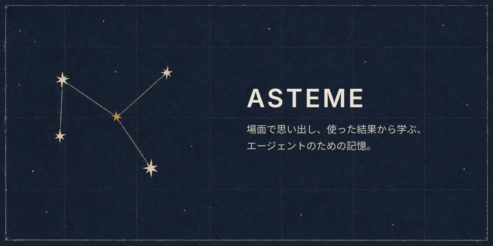
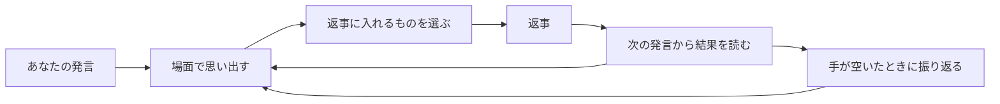

<p align="center">
  
</p>

<p align="center">
  <a href="README.md">English</a> · <a href="README.zh.md">中文</a> · 日本語 · <a href="README.es.md">Español</a> · <a href="README.fr.md">Français</a> · <a href="README.de.md">Deutsch</a> · <a href="README.ru.md">Русский</a> · <a href="README.pt.md">Português</a>
</p>

**開発中:** 現在も開発を続けています。動作が変わったり、誤動作やデータ損失が起きたりする可能性があります。重要な用途にはまだ使わないでください。

# ASTEME

Asteme は、話しかける相手です。いつも同じ一人です。あなたが言ったことを「それが当てはまる場面」と一緒に覚え、同じ場面がまた来たときに思い出し、使って役に立ったかどうかで思い出しやすさを変えていきます。

動くのはあなたのコンピューターの中です。覚えていることは SQLite ファイル 1 つに入り、渡したファイルはその隣に置かれます。

いまは 2 つの形があります。

- **DeepSeek Harness の中**で、プラグインとして。会話は Harness の中の 1 画面で、設定のパネルが横に付きます。
- **単体で**、頭脳として。`brain/cli.mjs` がこの PC の中だけで 1 ページを配ります。

どちらも同じ仕組みで話し、覚え、約束を守ります。ストアは別々です。プラグインは Harness のプロファイルのストアを使い、単体の頭脳は設定ファイルのストア、または `--person <名前>` で人ごとのストアを使います。`export` と `import` は人をまるごと書き出し・読み込みするので、その方法で二人のあいだを移せます。それ以外では、互いのストアは見えません。

## 何が違うか

**言葉ではなく、場面が思い出させる。** 以前「結論を先に。部長は最初の3行しか読まない」とメモを直したとします。数日後、投資家向けの1枚資料を頼む。共通する単語は1つもありませんが、場面は同じ（時間のない読み手が判断する）なので、その記憶が戻ってきます。

**使った結果が記憶を書き換える。** 記憶を使ったあと、あなたの次の発言から結果を読み取ります。役に立った記憶は思い出しやすくなり、場違いだった記憶はその種の場面では出なくなり、ほかの場面では働き続けます。古いからといって薄れず、増えたからといって消されません。

**すべての記憶はあなた自身の言葉に行き着く。** どの記憶も、もとになった発言をそのまま持っています。記憶を開けば、何を根拠にしているか、どこで当てはまるか、いつ使われてどうだったか、どう変わってきたかが見えます。あなたが「違う」と言えば、モデルの判断よりあなたの言葉が優先されます。

**約束を守る。** 「6月になったらまた聞いて」は、Asteme 自身が持つ約束（1回だけ、または繰り返し）になり、時刻が来たら向こうから話しかけます。

**覚えていることを見せる。** 記憶は 1 つが 1 つの星で、会話の後ろの空に並びます。思い出しやすいほど明るく、空をつかむとその中に入れます。

## 1分で試す

Node 22.5 以上。インストールも API キーも要りません。

```
git clone https://github.com/asteme/asteme.git
cd asteme
npm run demo
```

台本どおりに答えるモデルを相手に、ある利用者との2週間を再生し、記憶が何をしたかを順に表示します。

```
Day 1. The user corrects a memo.
  stored as a case; the exchange stood out (salience 0.55) because it was a correction
Day 3. A request with none of the memo's words: a one-pager for an investor.
  recalled by the scene: "Writing a memo for the director"
  it helped; accessibility 0.7453
Night. Sleep.
  integrate: one lesson drawn from two cases
```

テストも同じ形で走ります（`npm test`）。

モデルなしで画面だけ見るには、プレビューを使います。

```
DEMO=1 ALL=900 node brain/preview.mjs 4173 ja
```

この PC のブラウザーで `http://127.0.0.1:4173/?token=preview` を開きます（PowerShell では先に `$env:DEMO=1; $env:ALL=900`）。中身はすべて見本で、誰かの実際の会話ではありません。

## 使い方

### DeepSeek Harness の中で

プラグイン `dsh-asteme` を入れます（プラグイン → 追加。npm から入り、更新も DSH がそこから行います）。インストール中に、依存する 3 つのパッケージ（onnxruntime-node、protobufjs、sharp）のスクリプト実行の許可を求められます。許可すると続行し、サイドバーに **ASTEME** が出ます。

- 会話が画面いっぱいに出ます。記憶は横に開き、設定は 3 つ（見た目／Asteme 本人（名前・画像・話し方・気持ち）／声と考え方）に分かれます。
- 会話に属さないもの（確認・記憶・活動・憲章・設定）はパネルにあります。
- Harness 側の普通の会話はそのままです。あちらは 1 つのセッションで作業するエージェントで、話しかけたときだけ答えます。Asteme は全体をまたいで続く 1 本の会話で、自分で決めた時刻に向こうから話しかけます。

### 単体で

```
npm run brain
```

設定は `~/.asteme/brain.json`（または `ASTEME_CONFIG` のパス）から読みます。キーはファイルに書かず、`keyEnv` に環境変数の名前を書きます。

```json
{ "model": { "url": "https://your-endpoint/v1", "name": "your-model", "keyEnv": "YOUR_KEY_ENV" },
  "judge": { "keyEnv": "YOUR_JUDGE_KEY_ENV" },
  "workers": { "dsh": { "command": "dsh", "args": ["acp"], "about": "ファイルとシェルを持つ作業役" } },
  "store": "~/.asteme/memory.sqlite", "port": 4170, "language": "ja" }
```

ページはこの PC からだけ、表示されたアドレスのトークンがあるときだけ答えます。作業役は、言葉を受け取って言葉で返すエージェント（Agent Client Protocol）です。Harness の中では DSH が常に手元にあり、外部の作業役はファイルに足せます。

OpenAI 互換の読み上げ API も、`voice: { url, model, voices, keyEnv }` で貸せます。

### どのエージェントからも使う（MCP）

```
ASTEME_DB=./memory.sqlite \
ASTEME_LLM_URL=https://your-endpoint/v1 ASTEME_LLM_KEY=... ASTEME_LLM_MODEL=... \
node standalone/mcp.mjs
```

stdio の MCP サーバーです。エージェントは答える前に `asteme_recall`、答えたあとに `asteme_observe` を呼びます。

### ライブラリとして

```js
import { openBrain } from "./standalone/brain.mjs";

const brain = openBrain({ path: "memory.sqlite", infer, embed });
const { note } = await brain.recall({ session: "s1", message });   // 答える前
brain.observe({ session: "s1", reply });                           // 答えたあと
await brain.rest();                                                // 手が空いたとき
```

## 会話

- **はじまり。** 新しいストア、またはリセットしたあとのストアには、まだ誰もいません。会話の前に一度だけ、名前と、あなたの呼び方と、話し方を聞き（どれも空のままでよく、全部飛ばすこともできます）、それから起こします。起こされて名前をもらったことが最初の記憶になり、その星が空に落ちてきて、空の中心でいちばん明るい星として残ります。そのあと、向こうから最初のひとことを言います。
- **星。** 1 つが記憶 1 件です。新しいものは中心に、古いものは遠くに、思い出しやすいものほど明るく。空を引く・2本指で広げる・ダブルクリックのどれかで中に入り、引いて移動、ホイールで拡大縮小、Shift を押しながら引くと回せます。どれだけ回したあとでも、引いたとおりに動きます。`0` か「向きを戻す」で元の向きに戻ります。新しく覚えたことは流れ星で空に入ります（オフにできます）。
- **検索。** 検索欄に打つと、見つかった星が 1 つずつ弧に並びます。ホイールか ↑↓ で進み、Enter かクリックで開きます。残りは空に薄く残ります。
- **記憶 1 件。** 星を開くと、言葉・根拠・覚えた日が出て、その場で「今も正しい／もう違う／いまは使わない／忘れる」ができます。
- **約束。** 返事の下に「いつ」の行、ヘッダーに次の時刻。取り消したいときは言葉で言えば Asteme が消します。
- **返信とリアクション。** どちら側の発言にも返信でき、Asteme はあなたの吹き出しに絵文字を付け、あなたも Asteme の返事に付けられます。
- **既読。** どちらも、相手がいつ読んだかを見られます。両方向まとめてオフにできます。
- **送信の取り消し。** 自分の発言を取り消すと、それに対する Asteme の返事も一緒に消え、頼んでいた作業も呼び戻されます。
- **ファイル。** 1 通に 6 個まで、追加・貼り付け・ドロップで渡せます。テキストは読み、画像はモデルが対応していれば見ます。PDF などそれ以外は、必要なら作業役に渡します。
- **声。** Harness が DeepSeek のキーを持っていれば、返事を DeepSeek の声で読めます。読む言葉は DeepSeek に送られます。読むのは言葉だけで、ID や長いコードは読みません。
- **見ていないあいだ。** まだ見ていない発言があると、Harness のサイドバーで Asteme のアイコンの星がひとつ灯り、ブラウザーのタブではタイトルに件数が出ます。Asteme を開いたときに会話から始めるか、記憶の確認から始めるかは、パネルの設定で選べます。

## 仕組み



返事の前に、発言から意味で記憶を呼び、1 回のモデル呼び出しで場面を読み、どれを入れるかを決めます。返事のあと、やり取りは記憶として読まれ、学んだことの根拠としてあなたの発言が残ります。そのあと、次に書いた言葉から各記憶の結果を読み、それが次の想起を変えます。手が空いているときは、目立ったやり取り（訂正・驚き・約束）を読み直し、食い違う記憶を比べ、別々の出来事から教訓を引き出します。

コードは意味を決めません。見るのは構造です。引用が原文と一致するか、ID が存在するか、改訂が動いていないか。意味はモデルに任せ、モデルが書いたものは必ず保存された記録を指します。

**繰り返しの仕事は分けています。** Asteme 自身の繰り返しの約束（「毎朝」「毎週金曜の5時」）は Asteme が持ち、時刻は自分のストアに置きます。DeepSeek Harness の自動化タスクには登録せず、Harness 側の一覧にも出ません。Harness に頼むのは、その時刻に実際の作業が要るときだけです。そういう約束が待っているときは、ページを一度も開かなくても時刻が来るよう、Asteme は Harness と一緒に起動します。

## あなたのデータ

- すべてあなたのコンピューターの SQLite ファイル 1 つに入り、渡したファイルはその隣に置かれます。テレメトリーはありません。ネットワークを使うのは、設定したモデルの接続先、任意の判定役や声、最初の 1 回の埋め込みモデルのダウンロードだけです。
- **エクスポートとインポート**: 会話を含む完全な写し。取り込みは足りないものを足すだけで、上書きしません。
- **日記**: 月ごとの Markdown。何を話し、何を受け取り、それがどうだったか。
- **自動バックアップ**: 1 日 1 回。間引くのは古い写しだけで、記憶そのものは消しません。
- **忘れることは本当に忘れる**: 根拠の発言ごと忘れると、すべての表から消え、取り込んでも戻りません。
- **プライベートな会話**は、順番と件数だけが残り、言葉は残りません。記憶への読み込みも、記憶の差し込みもしません。
- **プロジェクト**ごとに学んだことを閉じ込められ、記憶 1 件だけをそのプロジェクトに限定することもできます。

## いまの限界

- まだ初期です（0.11、最初の公開版）。版ごとに挙動が変わることがあります。
- 返事が記憶を待つことがあります。場面を読み、選ぶのに 1 回のモデル呼び出しが要り、考えるモデルでは 10〜20 秒、ときにそれ以上かかります。判定役を設定して任せると、返事はそれを待たなくなります。
- 会話に渡した画像は、モデルが画像に対応していれば見ます。テキスト以外のファイル（PDF、録音など）は Asteme 自身は読まず、開く必要があるときに DSH へパスごと渡します。
- 読み上げは外部の声だけです（端末に入っている声は使いません）。自分の読み上げサービス（OpenAI 互換、またはローカルのサーバー）は設定ファイルで指定します。画面からの設定はまだありません。
- テストとプラグインのビルドは、CI で Windows・macOS・Linux を通しています。目で見て使ったのは Windows と Linux で、macOS はまだ人が見ていません。
- ページはこの PC のためだけのもので、スマホからは使えません。

## これから

いまは記憶です。覚えていて、間違いを直せる相手。次は手です。同じ Asteme が、あなたの PC の道具に仕事を頼み、取り返しのつかないことの前には必ずあなたに聞きます。記憶が先なのは、ほかがその上に建つからです。モデルが賢くなっても、記憶とあなたとの関係はそのまま続きます。

## 文書

- [docs/BRAIN.md](docs/BRAIN.md): 頭脳（1 本の会話・手・時計・起きている／眠っている）
- [DESIGN.md](DESIGN.md): 記憶のモデル、なぜそうしたか、何をテストしたか
- [docs/IMPLEMENTATION.md](docs/IMPLEMENTATION.md): 実装で決めたこと
- [CHANGELOG.md](CHANGELOG.md): 版ごとの変更
- [HANDOFF.md](HANDOFF.md): 開発の現在地と次にやること
- [CONTRIBUTING.md](CONTRIBUTING.md): 動かし方、構成、変更の規則

## ライセンス

[Apache-2.0](LICENSE) です（[NOTICE](NOTICE) つき）。ライセンスが及ぶのはコードです。名前とマークはこのプロジェクトのものです（[TRADEMARKS.md](TRADEMARKS.md)）。
