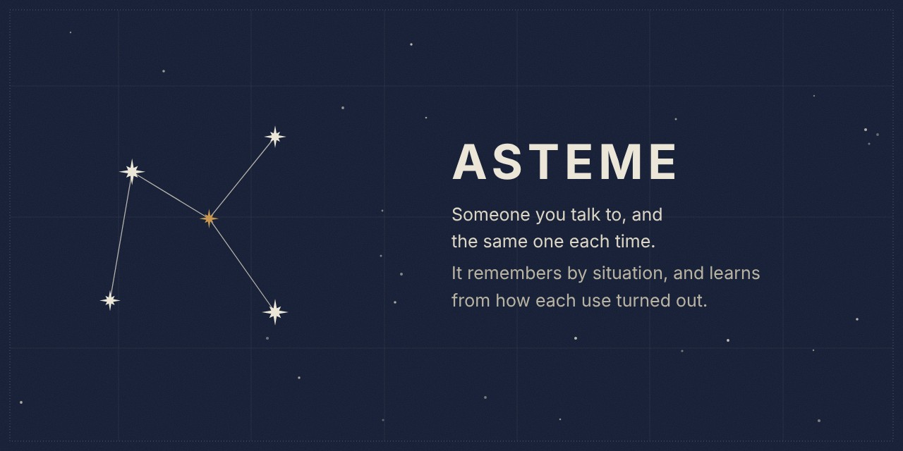
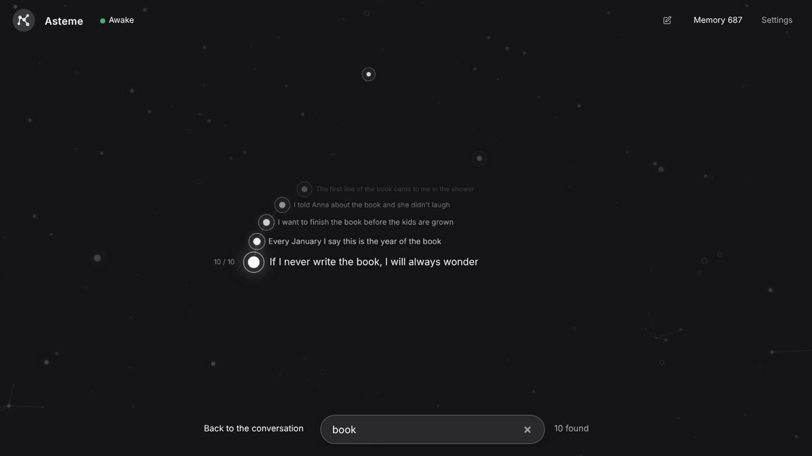
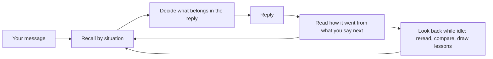

<p align="center">
  
</p>

<p align="center">
  <a href="https://github.com/asteme/asteme/actions/workflows/test.yml"></a>
  <a href="LICENSE"></a>
  
</p>

<p align="center">
  English · <a href="README.zh.md">中文</a> · <a href="README.ja.md">日本語</a> · <a href="README.es.md">Español</a> · <a href="README.fr.md">Français</a> · <a href="README.de.md">Deutsch</a> · <a href="README.ru.md">Русский</a> · <a href="README.pt.md">Português</a>
</p>

[](public/media/asteme-en.mp4)

**Status: in development.** Asteme is still being built. Behavior may change, and it may fail or lose data. Do not rely on it for anything important yet.

# ASTEME

Asteme is someone you talk to, and the same one each time. It remembers what you tell it together with the situation it applies to, brings a memory back when that situation comes up again, and changes what comes to mind from how using it turned out.

It runs on your computer. Everything it remembers is in one SQLite file; what you hand it is kept beside that file.

Today it has two shapes:

- **Inside DeepSeek Harness**, as a plugin: the conversation is one screen in the harness, and a settings panel sits beside it.
- **On its own**, as a brain: one page on this computer, served by `brain/cli.mjs`.

Both talk, remember and keep promises, on the same machinery. Each has a store of its own: the plugin uses the harness profile's store, and the standalone brain uses the store in its settings file, or one store per person with `--person <name>`. `export` and `import` write and bring back a whole person, so a person can be moved between the two. They do not see each other's stores otherwise.

## What is different about it

**The situation recalls, not the wording.** You once corrected a memo: "put the decision first, the director only reads three lines." Days later you ask for a one-page pitch for an investor. No word is shared, but it is the same situation (a reader with little time who has to decide), and the memory comes back.

**Use rewrites memory.** After a memory is used, what you say next is read for how it went. One that helped comes to mind more easily. One that was out of place stays out of that kind of situation and keeps working elsewhere. Nothing fades because it is old, and nothing is deleted because the store grew.

**Every memory ends at your own words.** Each one keeps the exact sentence it came from. Open a memory and you see what it rests on, where it applies, every time it was used and how that went, and every change made to it. If you say something is wrong, your word stands over the model's.

**It keeps promises.** "Ask me again in June" becomes a promise Asteme holds itself, once or repeating, and it speaks first when the time comes.

**It shows what it remembers.** Every memory is one star on a sky behind the conversation, brighter when it comes to mind easily. Take hold of the empty sky and you are among them.

## Try it in a minute

Node 22.5 or newer. Nothing to install, no API key.

```
git clone https://github.com/asteme/asteme.git
cd asteme
npm run demo
```

The demo plays two weeks with one user against a scripted model and narrates what memory does:

```
Day 1. The user corrects a memo.
  stored as a case; the exchange stood out (salience 0.55) because it was a correction
Day 3. A request with none of the memo's words: a one-pager for an investor.
  recalled by the scene: "Writing a memo for the director"
  it helped; accessibility 0.7453
Day 4. The same memory is used where it does not belong: notes for the team.
  marked out of place there; accessibility 0.605
Night. Sleep.
  integrate: one lesson drawn from two cases
```

The tests run the same way: `npm test`.

To look at the conversation without a model, run the page's own preview:

```
DEMO=1 ALL=900 node brain/preview.mjs 4173 ja
```

Then open `http://127.0.0.1:4173/?token=preview` on this computer (in PowerShell, set the two variables first: `$env:DEMO=1; $env:ALL=900`). Nothing in it is anyone's real conversation.

## Use it

### In DeepSeek Harness

Install the plugin `dsh-asteme` (Plugins → Add plugin; it comes from npm, and DSH updates it from there). During installation DSH asks to allow install scripts for three packages it depends on (onnxruntime-node, protobufjs, sharp); allow them and it continues. **ASTEME** then appears in the sidebar.

- The conversation fills the screen. Memories open beside it; "Settings" is about the conversation: how it looks, Asteme itself (name, face, way of speaking, mood), voice and thinking. "Memory" is about everything it remembers: search, the stars, and inside DSH each place where memory is looked after. The memory settings are also in DSH's own settings, under Asteme.
- The panel keeps what does not belong in the conversation: review, memory, activity, charter, settings.
- The harness's own conversations are unchanged: they are agents doing work in one session. Asteme is one conversation that goes on across all of them, and it can speak first.

### On its own

```
npm run brain
```

Settings are read from `~/.asteme/brain.json` (or the path in `ASTEME_CONFIG`). A key is never written in the file; `keyEnv` names the environment variable that holds it.

```json
{ "model": { "url": "https://your-endpoint/v1", "name": "your-model", "keyEnv": "YOUR_KEY_ENV" },
  "judge": { "keyEnv": "YOUR_JUDGE_KEY_ENV" },
  "workers": { "dsh": { "command": "dsh", "args": ["acp"], "about": "an agent with files and a shell" } },
  "store": "~/.asteme/memory.sqlite", "port": 4170, "language": "en" }
```

The page answers only on this computer and only with the token in the printed address. A worker is an agent that takes words and answers in words over the Agent Client Protocol; DSH is always at hand inside the harness, and others can be added in the file.

An OpenAI-compatible voice can be lent the same way with `voice: { url, model, voices, keyEnv }`.

### As memory for any agent (MCP)

```
ASTEME_DB=./memory.sqlite \
ASTEME_LLM_URL=https://your-endpoint/v1 ASTEME_LLM_KEY=... ASTEME_LLM_MODEL=... \
node standalone/mcp.mjs
```

An MCP server over stdio. The agent calls `asteme_recall` with each user message before answering and `asteme_observe` with its reply afterwards.

### As a library

```js
import { openBrain } from "./standalone/brain.mjs";

const brain = openBrain({ path: "memory.sqlite", infer, embed });
const { note } = await brain.recall({ session: "s1", message });   // before the agent answers
brain.observe({ session: "s1", reply });                           // after it answered
await brain.rest();                                                // when idle
```

## The conversation

- **The beginning.** A new store, or one wiped clean, has nobody in it yet. Once, before the conversation, it asks for a name, what to call you and how to speak to you (any of it can be left empty, or all of it skipped), and then it is woken. Being woken and named is its first memory: that star falls into the empty sky, stays at the middle of it as the brightest, and then it speaks first.
- **Stars.** One star is one memory; the newest is near the centre, the oldest far out, and the ones that come to mind easily shine brightest. Drag empty sky, pinch, or double-click it to go in; drag to move, wheel to zoom, Shift-drag to turn. However far it has been turned, a pull still moves what is under the hand; `0` or "Level the sky" puts it the right way up again. Something newly learned falls into the sky as a shooting star (this can be turned off).
- **Search.** Type in the search box and the stars that match come to it, one at a time, into a loose arc. Wheel or ↑↓ moves through them, Enter or a click opens one, and the rest stay faint in the sky.
- **One memory.** Open a star to see its words, what it rests on, when it was learned, and to say it is still true, no longer true, to pause it, or to forget it with its sources.
- **Promises.** A promise is a line under the reply that made it, the next time in the header, and it can be cancelled by saying so.
- **Replies and reactions.** Any message can be answered in place; Asteme can put an emoji on yours, and you can put one on its.
- **Read marks.** Each side can see when the other read it. Both directions can be turned off.
- **Taking a message back.** A message of yours can be taken back; what Asteme said in answer goes with it, and work it handed out for it is called back.
- **Files.** Add, paste or drop up to six files in one message. Text files are read; a picture is looked at when the model can see pictures; a PDF or anything else is passed on to a worker when needed.
- **Voice.** Replies can be read aloud by DeepSeek's voice when the harness holds a DeepSeek key; the words read are sent to DeepSeek. What is read is the words, not ids or long codes.
- **While you were elsewhere.** When Asteme has said something you have not seen, one star of its icon in the harness's sidebar is lit, and a browser tab counts it in its title. Opening Asteme can lead to the conversation or to what is waiting in memory; that is chosen in the panel's settings.

## How it works



Before a reply, the message calls memories up by meaning, and one model call reads the situation and decides which belong. After the reply, the exchange is read into memory, your sentence kept as the ground for anything learned. Later, what you write next is read for how each used memory turned out, and that changes what is recalled next time. While idle, it rereads exchanges that stood out (a correction, a surprise, a promise), compares memories that may disagree, and draws lessons from separate occasions.

The code never decides what something means. It checks structure: that a quote is exact, that an id exists, that a revision has not moved. Meaning is left to the model, and everything the model writes has to point at a stored record.

**Recurring work is split.** A repeating promise of Asteme's own ("every morning", "every Friday at five") is held by Asteme, with the time kept in its own store: it is not registered in DeepSeek Harness's scheduled tasks and does not appear in the harness's list. The harness is asked only when actual work has to happen at that time. When such a promise is waiting, Asteme starts together with the harness, so the time arrives even with its page never opened.

## Your data

- Everything is in one SQLite file on your machine; files you hand over are kept beside it. There is no telemetry. It reaches the network only for the model endpoints you configure, for an optional judge or voice, and once to download the local embedding model.
- **Export and import** a complete copy, conversations included. Importing adds what is missing and never overwrites.
- **A diary**: one Markdown file per month of what was said, what it took from it and how that went.
- **Automatic backups** once a day. Only old copies are thinned out, never what it remembers.
- **Forgetting is real**: forgetting a memory with its source messages removes them from every table, and an import cannot bring them back.
- **A private conversation** is remembered as order and counts, with the words left out; nothing in it is read into memory or brought into it.
- **Projects** can keep what is learned in them to themselves, and one memory can be kept to its project.

## Limits, today

- Early: 0.11, the first published version. Behavior can still change between versions.
- A reply may wait for memory: reading the situation and choosing from it is one model call, and with a reasoning model that has taken ten to twenty seconds, sometimes more. A small decision model (the judge) can take that place when one is configured, and then the reply no longer waits for it.
- A picture given to the conversation is looked at when the model can see pictures; other files that are not text (a PDF, a recording) are not read by Asteme itself: it hands them to DSH with their path when the work needs them opened.
- Reading aloud uses a lent voice only (the voices installed on the computer are not used). A voice service of your own (an OpenAI-compatible one, or a local server) is set in the settings file; there is no screen for it yet.
- Tests and the plugin build run on Windows, macOS and Linux in CI. By eye, it has been used on Windows and checked on Linux; macOS has not been looked at by a person yet.
- The page is for this computer only; there is no phone access.

## Where it is going

Today it is memory: someone who remembers, and whom you can correct. Next come hands: the same Asteme asking tools on your computer to do things, and asking you first before anything that cannot be undone. The memory comes first because the rest is built on it; a model that gets better keeps the same memory and the same you.

## Documents

- [docs/BRAIN.md](docs/BRAIN.md): the brain — one conversation, hands, a clock, awake and asleep
- [DESIGN.md](DESIGN.md): the memory model, why it works that way, what is tested
- [docs/IMPLEMENTATION.md](docs/IMPLEMENTATION.md): decisions taken in the implementation
- [CHANGELOG.md](CHANGELOG.md): what changed in each version
- [HANDOFF.md](HANDOFF.md): the state of development and what is next
- [CONTRIBUTING.md](CONTRIBUTING.md): how to run it, the layout, the rules for changes

## License

[Apache-2.0](LICENSE), with a [NOTICE](NOTICE). The license covers the code; the name and the mark are this project's: see [TRADEMARKS.md](TRADEMARKS.md).
