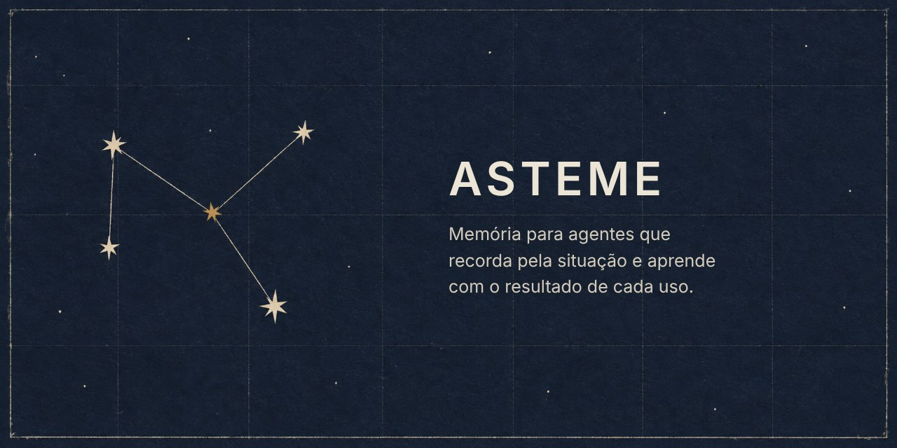
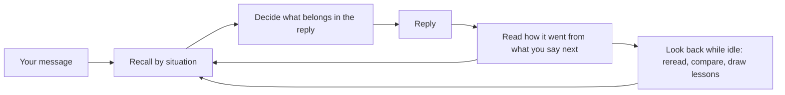

<p align="center">
  
</p>

<p align="center">
  <a href="https://github.com/asteme/asteme/actions/workflows/test.yml"></a>
  <a href="LICENSE"></a>
  
</p>

<p align="center">
  <a href="README.md">English</a> · <a href="README.zh.md">中文</a> · <a href="README.ja.md">日本語</a> · <a href="README.es.md">Español</a> · <a href="README.fr.md">Français</a> · <a href="README.de.md">Deutsch</a> · <a href="README.ru.md">Русский</a> · Português
</p>

**Estado: em desenvolvimento.** O Asteme ainda está sendo construído. O comportamento pode mudar, e ele pode falhar ou perder dados. Ainda não confie nele para nada importante.

# ASTEME

O Asteme é alguém com quem você conversa, e o mesmo a cada vez. Ele lembra o que você diz junto com a situação a que aquilo se aplica, traz uma lembrança de volta quando essa situação surge outra vez, e muda o que vem à mente conforme como o uso de cada lembrança resultou.

Ele roda no seu computador. Tudo o que ele lembra está em um único arquivo SQLite; o que você entrega a ele fica guardado ao lado desse arquivo.

Hoje ele tem duas formas:

- **Dentro do DeepSeek Harness**, como plugin: a conversa é uma tela no harness, e um painel de configurações fica ao lado dela.
- **Por conta própria**, como cérebro: uma página neste computador, servida por `brain/cli.mjs`.

Os dois conversam, lembram e cumprem promessas, com a mesma maquinaria. Cada um tem seu próprio armazenamento: o plugin usa o armazenamento do perfil do harness, e o cérebro independente usa o armazenamento do seu arquivo de configurações, ou um armazenamento por pessoa com `--person <name>`. `export` e `import` gravam e trazem de volta uma pessoa inteira, então uma pessoa pode ser movida entre os dois. Fora isso, eles não veem o armazenamento um do outro.

## O que ele tem de diferente

**Quem lembra é a situação, não as palavras.** Uma vez você corrigiu um memorando: “coloque a decisão primeiro, o diretor só lê três linhas”. Dias depois você pede um pitch de uma página para um investidor. Nenhuma palavra é compartilhada, mas é a mesma situação (um leitor com pouco tempo que precisa decidir), e a lembrança volta.

**O uso reescreve a memória.** Depois que uma lembrança é usada, o que você diz em seguida é lido para ver como foi. A que ajudou vem à mente com mais facilidade. A que estava fora de lugar fica fora desse tipo de situação e continua funcionando em outras. Nada se apaga por ser antigo, e nada é excluído porque o armazenamento cresceu.

**Toda lembrança termina nas suas próprias palavras.** Cada uma guarda a frase exata de onde veio. Abra uma lembrança e você vê em que ela se apoia, onde se aplica, cada vez que foi usada e como isso foi, e cada mudança feita nela. Se você diz que algo está errado, a sua palavra vale mais que a do modelo.

**Ele cumpre promessas.** “Pergunte de novo em junho” vira uma promessa que o Asteme mantém por conta própria, uma vez ou repetida, e ele fala primeiro quando chega a hora.

**Ele mostra o que lembra.** Cada lembrança é uma estrela em um céu atrás da conversa, mais brilhante quando vem à mente com facilidade. Segure o céu vazio e você fica entre elas.

## Experimente em um minuto

Node 22.5 ou mais recente. Nada para instalar, nenhuma chave de API.

```
git clone https://github.com/asteme/asteme.git
cd asteme
npm run demo
```

A demo reproduz duas semanas com um usuário diante de um modelo roteirizado e narra o que a memória faz:

```
Day 1. The user corrects a memo.
  stored as a case; the exchange stood out (salience 0.55) because it was a correction
Day 3. A request with none of the memo's words: a one-pager for an investor.
  recalled by the scene: "Writing a memo for the director"
  it helped; accessibility 0.7453
Day 4. The same memory is used where it does not belong: notes for the team.
  marked out of place there; accessibility 0.605
Night. Sleep.
  integrate: one lesson drawn from two cases
```

Os testes rodam do mesmo jeito: `npm test`.

Para ver a conversa sem um modelo, rode a prévia da própria página:

```
DEMO=1 ALL=900 node brain/preview.mjs 4173 pt
```

Depois abra `http://127.0.0.1:4173/?token=preview` neste computador (no PowerShell, defina as duas variáveis antes: `$env:DEMO=1; $env:ALL=900`). Nada ali é a conversa real de alguém.

## Como usar

### No DeepSeek Harness

Instale o plugin `dsh-asteme` (Plugins → Add plugin). O DSH o instala e atualiza pelo npm. Durante a instalação, o DSH pede autorização para executar os scripts de instalação de três dependências (`onnxruntime-node`, `protobufjs` e `sharp`). Autorize a execução para continuar. O **ASTEME** então aparece na barra lateral.

- A conversa ocupa toda a tela, e as lembranças abrem ao lado dela. No topo, **Definições** cuida só da conversa: aparência, o próprio Asteme (nome, imagem, jeito de falar e humor), voz e modo de pensar.
- **Memória**, também no topo da conversa, dá acesso à busca e ao céu estrelado. No DSH, você também pode abrir a lista de lembranças, a revisão da última resposta, a atividade, a carta de princípios e as **Configurações da memória**. Essa mesma tela também fica nas configurações do próprio DSH, na seção **Asteme**.
- As conversas do próprio harness não mudam: são agentes fazendo trabalho em uma sessão. O Asteme é uma conversa que continua por todas elas, e ele pode falar primeiro.

### Por conta própria

```
npm run brain
```

As configurações são lidas de `~/.asteme/brain.json` (ou do caminho em `ASTEME_CONFIG`). Uma chave nunca é gravada no arquivo; `keyEnv` nomeia a variável de ambiente que a contém.

```json
{ "model": { "url": "https://your-endpoint/v1", "name": "your-model", "keyEnv": "YOUR_KEY_ENV" },
  "judge": { "keyEnv": "YOUR_JUDGE_KEY_ENV" },
  "workers": { "dsh": { "command": "dsh", "args": ["acp"], "about": "an agent with files and a shell" } },
  "store": "~/.asteme/memory.sqlite", "port": 4170, "language": "pt" }
```

A página responde apenas neste computador e apenas com o token no endereço impresso. Um worker é um agente que recebe palavras e responde em palavras pelo Agent Client Protocol; o DSH está sempre à mão dentro do harness, e outros podem ser acrescentados no arquivo.

Uma voz compatível com OpenAI pode ser emprestada do mesmo jeito com `voice: { url, model, voices, keyEnv }`.

### Como memória para qualquer agente (MCP)

```
ASTEME_DB=./memory.sqlite \
ASTEME_LLM_URL=https://your-endpoint/v1 ASTEME_LLM_KEY=... ASTEME_LLM_MODEL=... \
node standalone/mcp.mjs
```

Um servidor MCP por stdio. O agente chama `asteme_recall` com cada mensagem do usuário antes de responder e `asteme_observe` com a resposta dele depois.

### Como biblioteca

```js
import { openBrain } from "./standalone/brain.mjs";

const brain = openBrain({ path: "memory.sqlite", infer, embed });
const { note } = await brain.recall({ session: "s1", message });   // before the agent answers
brain.observe({ session: "s1", reply });                           // after it answered
await brain.rest();                                                // when idle
```

## A conversa

- **O começo.** Um armazenamento novo, ou um apagado, ainda não tem ninguém. Uma única vez, antes da conversa, ele pede um nome, como chamar você e como falar com você (tudo pode ficar vazio, ou ser pulado por inteiro), e então é despertado. Ser despertado e nomeado é a primeira lembrança: essa estrela cai no céu vazio, fica no meio dele como a mais brilhante, e depois ele fala primeiro.
- **Estrelas.** Uma estrela é uma lembrança; a mais nova fica perto do centro, a mais antiga longe, e as que vêm à mente com facilidade brilham mais. Arraste o céu vazio, faça pinça ou clique duas vezes nele para entrar; arraste para mover, use a roda para ampliar, Shift+arrastar para girar. Por mais que ele tenha sido girado, um puxão ainda move o que está sob a mão; `0` ou “Level the sky” o coloca de pé outra vez. Algo recém-aprendido cai no céu como uma estrela cadente (isso pode ser desligado).
- **Busca.** Digite na caixa de busca e as estrelas que combinam vêm até ela, uma de cada vez, num arco solto. A roda ou ↑↓ percorrem elas, Enter ou um clique abre uma, e o resto fica fraco no céu.
- **Uma lembrança.** Abra uma estrela para ver as palavras dela, em que se apoia, quando foi aprendida, e para dizer que ainda é verdadeira, que não é mais, para pausá-la, ou para esquecê-la com as origens.
- **Promessas.** Uma promessa é uma linha abaixo da resposta que a fez, a próxima vez no cabeçalho, e ela pode ser cancelada dizendo isso.
- **Respostas e reações.** Qualquer mensagem pode ser respondida no lugar; o Asteme pode pôr um emoji na sua, e você pode pôr um na dele.
- **Marcas de leitura.** Cada lado pode ver quando o outro leu. As duas direções podem ser desligadas.
- **Retirar uma mensagem.** Uma mensagem sua pode ser retirada; o que o Asteme disse em resposta vai com ela, e o trabalho que ele distribuiu por ela é chamado de volta.
- **Arquivos.** Acrescente, cole ou solte até seis arquivos em uma mensagem. Os arquivos de texto são lidos. As imagens são mostradas ao modelo se ele for capaz de processá-las. PDFs e outros tipos de arquivo são repassados a um worker quando necessário.
- **Voz.** As respostas podem ser lidas em voz alta pela voz da DeepSeek quando o harness tem uma chave da DeepSeek; as palavras lidas são enviadas à DeepSeek. O que é lido são as palavras, não ids nem códigos longos.
- **Enquanto você estava em outro lugar.** Quando o Asteme disse algo que você não viu, uma estrela do ícone dele na barra lateral do harness fica acesa, e uma aba do navegador conta isso no título. Abrir o Asteme pode levar à conversa ou ao que espera na memória; isso é escolhido nas configurações do painel.

## Como funciona



Antes de uma resposta, a mensagem chama lembranças por significado, e uma chamada de modelo lê a situação e decide quais pertencem. Depois da resposta, a troca é lida para a memória, com a sua frase guardada como base de tudo o que for aprendido. Mais tarde, o que você escreve em seguida é lido para ver como cada lembrança usada se saiu, e isso muda o que é lembrado na próxima vez. Enquanto está ocioso, ele relê as trocas que se destacaram (uma correção, uma surpresa, uma promessa), compara lembranças que podem discordar e tira lições de ocasiões separadas.

O código nunca decide o que algo significa. Ele verifica estrutura: que uma citação é exata, que um id existe, que uma revisão não se moveu. O significado fica com o modelo, e tudo o que o modelo escreve tem de apontar para um registro guardado.

**Trabalho recorrente é separado.** Uma promessa repetida do próprio Asteme (“toda manhã”, “toda sexta às cinco”) é mantida pelo Asteme, com o horário guardado no armazenamento dele: ela não é registrada nas tarefas agendadas do DeepSeek Harness e não aparece na lista do harness. Só se pergunta ao harness quando trabalho real tem de acontecer naquele horário. Quando uma promessa dessas está esperando, o Asteme inicia junto com o harness, então o horário chega mesmo que a página dele nunca seja aberta.

## Seus dados

- Tudo está em um único arquivo SQLite na sua máquina; os arquivos que você entrega ficam guardados ao lado dele. Não há telemetria. Ele só chega à rede para os endpoints de modelo que você configurar, para um judge ou uma voz opcionais, e uma vez para baixar o modelo local de embeddings.
- **Exportar e importar** uma cópia completa, conversas incluídas. Importar acrescenta o que falta e nunca sobrescreve.
- **Um diário**: um arquivo Markdown por mês com o que foi dito, o que ele tirou disso e como isso foi.
- **Backups automáticos** uma vez por dia. Só cópias antigas são descartadas, nunca o que ele lembra.
- **Esquecer é de verdade**: esquecer uma lembrança junto com as mensagens de origem as remove de todas as tabelas, e uma importação não consegue trazê-las de volta.
- **Uma conversa privada** é lembrada como ordem e contagens, sem as palavras; nada dela é lido para a memória nem trazido para ela.
- **Projetos** podem guardar para si o que se aprende neles, e uma lembrança pode ficar restrita ao seu projeto.

## Limites, hoje

- A 0.11 é a primeira versão pública. O projeto ainda está no início, e o comportamento pode mudar de uma versão para outra.
- Uma resposta pode esperar pela memória: ler a situação e escolher a partir dela é uma chamada de modelo, e com um modelo de raciocínio isso tem levado de dez a vinte segundos, às vezes mais. Um modelo pequeno de decisão (o judge) pode ocupar esse lugar quando há um configurado, e então a resposta já não espera por ele.
- As imagens enviadas em uma conversa são mostradas ao modelo se ele for capaz de processá-las. O Asteme não lê por conta própria os demais arquivos que não sejam de texto (como PDFs e gravações): se uma tarefa exigir que sejam abertos, ele os encaminha ao DSH com o caminho de cada arquivo.
- A leitura em voz alta usa apenas uma voz emprestada (as vozes instaladas no computador não são usadas). Um serviço de voz próprio (compatível com OpenAI, ou um servidor local) é definido no arquivo de configurações; ainda não há tela para isso.
- A integração contínua (CI) executa os testes e compila o plugin no Windows, no macOS e no Linux. O Asteme foi usado na prática no Windows e verificado manualmente no Linux; no macOS, ainda não houve verificação manual.
- A página é só para este computador; não há acesso por celular.

## O que vem a seguir

Hoje, Asteme é memória: alguém que se lembra e que você pode corrigir. O próximo passo é dar mãos a ele: o mesmo Asteme vai usar as ferramentas do seu computador para fazer coisas e pedir sua autorização antes de fazer algo que não possa ser desfeito. A memória vem primeiro porque todo o resto se apoia nela. Mesmo quando o modelo melhorar, ele vai manter a mesma memória e continuar reconhecendo você.

## Documentos

- [docs/BRAIN.md](docs/BRAIN.md): o cérebro — uma conversa, mãos, um relógio, acordado e dormindo
- [DESIGN.md](DESIGN.md): o modelo de memória, por que funciona assim, o que é testado
- [docs/IMPLEMENTATION.md](docs/IMPLEMENTATION.md): decisões tomadas na implementação
- [CHANGELOG.md](CHANGELOG.md): o que mudou em cada versão
- [HANDOFF.md](HANDOFF.md): o estado do desenvolvimento e o que vem a seguir
- [CONTRIBUTING.md](CONTRIBUTING.md): como rodá-lo, a estrutura, as regras para mudanças

## Licença

O código é licenciado sob a licença [Apache-2.0](LICENSE), com um [NOTICE](NOTICE). Ela não abrange o nome nem a marca do projeto; veja [TRADEMARKS.md](TRADEMARKS.md).
