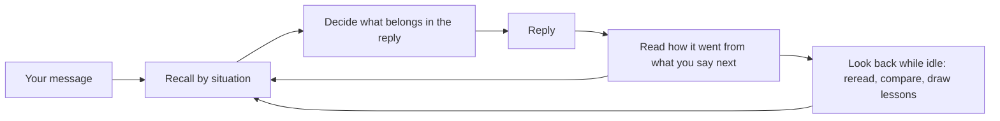

<p align="center">
  
</p>

<p align="center">
  <a href="https://github.com/asteme/asteme/actions/workflows/test.yml"></a>
  <a href="LICENSE"></a>
  
</p>

<p align="center">
  <a href="README.md">English</a> · <a href="README.zh.md">中文</a> · <a href="README.ja.md">日本語</a> · <a href="README.es.md">Español</a> · <a href="README.fr.md">Français</a> · <a href="README.de.md">Deutsch</a> · <a href="README.ru.md">Русский</a> · Português
</p>

<p align="center"><a href="https://asteme.github.io/asteme/pt/">Site</a></p>

https://github.com/user-attachments/assets/b20a3d7d-69fa-41f3-a4e0-5f9b14073b19

**Status: em desenvolvimento.** O Asteme ainda está sendo construído. O comportamento pode mudar, e ele pode falhar ou perder dados. Ainda não confie nele para nada importante.

# ASTEME

O Asteme é alguém com quem você conversa, e sempre a mesma pessoa. Ela lembra o que você lhe conta junto com a situação a que aquilo se aplica, traz uma lembrança de volta quando essa situação surge outra vez, e muda o que vem à mente conforme o resultado de cada uso.

Ela roda no seu computador. Tudo o que ela lembra fica em um único arquivo SQLite; o que você entrega a ela é guardado ao lado desse arquivo.

Hoje ela tem duas formas:

- **Dentro do DeepSeek Harness**, como plugin: a conversa é uma tela no harness, e um painel de configurações fica ao lado dela.
- **Sozinha**, como cérebro: uma página neste computador, servida por `brain/cli.mjs`.

As duas conversam, lembram e cumprem promessas, na mesma maquinaria. Cada uma tem seu próprio armazenamento: o plugin usa o armazenamento do perfil do harness, e o cérebro autônomo usa o armazenamento do seu arquivo de configurações, ou um armazenamento por pessoa com `--person <name>`. `export` e `import` gravam e trazem de volta uma pessoa inteira, então uma pessoa pode ser movida entre as duas. Fora isso, elas não veem o armazenamento uma da outra.

## O que ela tem de diferente

**Quem lembra é a situação, não as palavras.** Certa vez você corrigiu um memorando: “coloque a decisão primeiro, a diretora só lê três linhas”. Dias depois, você pede uma página de apresentação para um investidor. Nenhuma palavra em comum, mas é a mesma situação (um leitor com pouco tempo que precisa decidir), e a lembrança volta.

**O uso reescreve a memória.** Depois que uma lembrança é usada, o que você diz em seguida é lido para saber como foi. A que ajudou vem à mente com mais facilidade. A que ficou fora de lugar permanece fora desse tipo de situação e continua valendo em outros lugares. Nada se apaga por ser antigo, e nada é excluído porque o armazenamento cresceu.

**Toda lembrança termina nas suas próprias palavras.** Cada uma guarda a frase exata de onde veio. Abra uma lembrança e você vê em que ela se apoia, onde se aplica, cada vez que foi usada e como foi, e cada mudança feita nela. Se você diz que algo está errado, a sua palavra vale mais que a do modelo.

**Ela cumpre promessas.** “Pergunte de novo em junho” vira uma promessa que o Asteme mantém sozinha, uma vez ou repetida, e ela fala primeiro quando a hora chega.

**Ela fala por conta própria.** Algo que te incomodava fica na cabeça dela sem hora marcada. Quando voltas depois de um tempo, ela pode perguntar como foi, ou não dizer nada: é ela quem decide, e o que ela guarda fica à tua vista e podes retirar.

**Ela mostra o que lembra.** Cada lembrança é uma estrela num céu atrás da conversa, mais brilhante quando vem à mente com facilidade. Segure o céu vazio e você está entre elas.

## Experimente em um minuto

Node 22.5 ou mais recente. Nada para instalar, nenhuma chave de API.

```
git clone https://github.com/asteme/asteme.git
cd asteme
npm run demo
```

A demo reproduz duas semanas com um usuário diante de um modelo roteirizado e narra o que a memória faz:

```
Day 1. The user corrects a memo.
  stored as a case; the exchange stood out (salience 0.55) because it was a correction
Day 3. A request with none of the memo's words: a one-pager for an investor.
  recalled by the scene: "Writing a memo for the director"
  it helped; accessibility 0.7453
Day 4. The same memory is used where it does not belong: notes for the team.
  marked out of place there; accessibility 0.605
Night. Sleep.
  integrate: one lesson drawn from two cases
```

Os testes rodam do mesmo jeito: `npm test`.

Para ver a conversa sem modelo, rode a prévia da própria página:

```
DEMO=1 ALL=900 node brain/preview.mjs 4173 ja
```

Depois abra `http://127.0.0.1:4173/?token=preview` neste computador (no PowerShell, defina as duas variáveis antes: `$env:DEMO=1; $env:ALL=900`). Nada ali é a conversa real de alguém.

## Como usar

### No DeepSeek Harness

Instale o plugin `dsh-asteme` (Plugins → Adicionar plugin; ele vem do npm, e o DSH o atualiza de lá). Durante a instalação, o DSH pede para permitir scripts de instalação de três pacotes dos quais ele depende (onnxruntime-node, protobufjs, sharp); permita e ele continua. O **ASTEME** aparece então na barra lateral.

- A conversa ocupa a tela. As lembranças abrem ao lado; “Configurações” é sobre a conversa: como ela aparece, o próprio Asteme (nome, rosto, jeito de falar, humor), voz e pensamento. “Memória” é sobre tudo o que ela lembra: a busca, as estrelas e, dentro do DSH, cada lugar onde a memória é cuidada. As configurações de memória também estão nas configurações do próprio DSH, em Asteme.
- O painel guarda o que não pertence à conversa: revisão, memória, atividade, carta, configurações.
- As conversas do próprio harness não mudam: são agentes fazendo trabalho numa sessão. O Asteme é uma conversa que continua por cima de todas elas, e pode falar primeiro.

### Sozinha

```
npm run brain
```

As configurações são lidas de `~/.asteme/brain.json` (ou do caminho em `ASTEME_CONFIG`). Uma chave nunca é escrita no arquivo; `keyEnv` nomeia a variável de ambiente que a guarda.

```json
{ "model": { "url": "https://your-endpoint/v1", "name": "your-model", "keyEnv": "YOUR_KEY_ENV" },
  "judge": { "keyEnv": "YOUR_JUDGE_KEY_ENV" },
  "workers": { "dsh": { "command": "dsh", "args": ["acp"], "about": "an agent with files and a shell" } },
  "store": "~/.asteme/memory.sqlite", "port": 4170, "language": "en" }
```

A página responde só neste computador e só com o token do endereço impresso. Um worker é um agente que recebe palavras e responde em palavras pelo Agent Client Protocol; o DSH está sempre à mão dentro do harness, e outros podem ser acrescentados no arquivo.

Uma voz compatível com OpenAI pode ser emprestada do mesmo jeito, com `voice: { url, model, voices, keyEnv }`.

### Como memória para qualquer agente (MCP)

```
ASTEME_DB=./memory.sqlite \
ASTEME_LLM_URL=https://your-endpoint/v1 ASTEME_LLM_KEY=... ASTEME_LLM_MODEL=... \
node standalone/mcp.mjs
```

Um servidor MCP via stdio. O agente chama `asteme_recall` com cada mensagem do usuário antes de responder e `asteme_observe` com a resposta depois.

### Como biblioteca

```js
import { openBrain } from "./standalone/brain.mjs";

const brain = openBrain({ path: "memory.sqlite", infer, embed });
const { note } = await brain.recall({ session: "s1", message });   // before the agent answers
brain.observe({ session: "s1", reply });                           // after it answered
await brain.rest();                                                // when idle
```

## A conversa

- **O começo.** Um armazenamento novo, ou um apagado, ainda não tem ninguém dentro. Uma vez, antes da conversa, ela pergunta um nome, como chamar você e como falar com você (qualquer parte pode ficar vazia, ou tudo pode ser pulado), e então é despertada. Ser despertada e receber um nome é a primeira lembrança dela: essa estrela cai no céu vazio, fica no meio dele como a mais brilhante, e então ela fala primeiro.
- **Estrelas.** Uma estrela é uma lembrança; a mais nova fica perto do centro, a mais antiga longe, e as que vêm à mente com facilidade brilham mais. Arraste o céu vazio, faça pinça ou dê dois cliques para entrar; arrastar move, a roda avança por entre elas (e recua, até onde o céu vai), Shift+arrastar gira. Por mais que tenha sido girado, um puxão ainda move o que está sob a mão; `0` ou “Nivelar o céu” coloca tudo no lugar certo de novo. Algo recém-aprendido cai no céu como estrela cadente (isso pode ser desligado).
- **Busca.** Digite na caixa de busca e as estrelas que combinam vêm até ela, uma de cada vez, num arco solto. A roda ou ↑↓ passa por elas, Enter ou um clique abre uma, e as outras ficam fracas no céu.
- **Uma lembrança.** Abra uma estrela para ver suas palavras, em que ela se apoia, quando foi aprendida, e para dizer que ainda é verdadeira, que não é mais, pausá-la, ou esquecê-la com as fontes.
- **Promessas.** Uma promessa é uma linha embaixo da resposta que a fez, na próxima vez no cabeçalho, e pode ser cancelada dizendo isso.
- **Respostas e reações.** Qualquer mensagem pode ser respondida no lugar; o Asteme pode pôr um emoji na sua, e você pode pôr um na dela.
- **Marcas de leitura.** Cada lado pode ver quando o outro leu. As duas direções podem ser desligadas.
- **Retomar uma mensagem.** Uma mensagem sua pode ser retomada; o que o Asteme disse em resposta vai junto, e o trabalho que ele repassou por causa dela é chamado de volta.
- **Arquivos.** Acrescente, cole ou solte até seis arquivos numa mensagem. Arquivos de texto são lidos; uma imagem é olhada quando o modelo consegue ver imagens; um PDF ou qualquer outra coisa é repassado a um worker quando é preciso.
- **Voz.** As respostas podem ser lidas em voz alta pela voz da DeepSeek quando o harness tem uma chave da DeepSeek; as palavras lidas são enviadas à DeepSeek. O que é lido são as palavras, não ids ou códigos longos.
- **Enquanto você estava em outro lugar.** Quando o Asteme disse algo que você não viu, uma estrela do ícone dele na barra lateral do harness fica acesa, e uma aba do navegador conta isso no título. Abrir o Asteme pode levar à conversa ou ao que está esperando na memória; isso é escolhido nas configurações do painel.

## Como funciona



Antes de uma resposta, a mensagem chama lembranças pelo significado, e uma chamada de modelo lê a situação e decide quais pertencem a ela. Depois da resposta, a troca é lida para a memória, e a sua frase fica como base de tudo o que for aprendido. Mais tarde, o que você escreve em seguida é lido para saber como cada lembrança usada se saiu, e isso muda o que será trazido da próxima vez. Enquanto não há nada a fazer, ela relê trocas que se destacaram (uma correção, uma surpresa, uma promessa), compara lembranças que podem discordar ou dizer a mesma coisa duas vezes (e então fica com uma) e tira lições de ocasiões separadas.

O código nunca decide o que algo significa. Ele confere estrutura: que uma citação seja exata, que um id exista, que uma revisão não tenha se movido. O significado fica com o modelo, e tudo o que o modelo escreve tem de apontar para um registro guardado.

**O trabalho recorrente é separado.** Uma promessa repetida do próprio Asteme (“toda manhã”, “toda sexta às cinco”) é mantida pelo Asteme, com o horário guardado no armazenamento dele: ela não é registrada nas tarefas agendadas do DeepSeek Harness e não aparece na lista do harness. O harness só é chamado quando há trabalho de verdade a fazer naquele horário. Quando uma promessa assim está esperando, o Asteme inicia junto com o harness, para que a hora chegue mesmo que a página dele nunca seja aberta.

## Seus dados

- Tudo fica em um arquivo SQLite na sua máquina; os arquivos que você entrega são guardados ao lado dele. Não há telemetria. Ela só chega à rede para os endereços de modelo que você configurar, para um juiz ou uma voz opcionais, e uma vez para baixar o modelo local de embeddings.
- **Exportar e importar** uma cópia completa, com as conversas. Importar acrescenta o que falta e nunca sobrescreve.
- **Um diário**: um arquivo Markdown por mês com o que foi dito, o que ela tirou disso e como foi.
- **Cópias automáticas** uma vez por dia. Só cópias antigas são descartadas, nunca o que ela lembra.
- **Esquecer é de verdade**: esquecer uma lembrança com as mensagens de origem remove tudo de todas as tabelas, e uma importação não traz de volta.
- **Uma conversa privada** é lembrada como ordem e contagem, sem as palavras; nada dela é lido para a memória nem trazido para ela.
- **Projetos** podem guardar para si o que se aprende neles, e uma lembrança pode ficar presa ao seu projeto.

## Limites, hoje

- Cedo. O comportamento ainda pode mudar entre versões.
- Uma resposta pode esperar a memória: ler a situação e escolher a partir dela é uma chamada de modelo, e com um modelo de raciocínio isso leva de dez a vinte segundos, às vezes mais. Um modelo pequeno de decisão (o juiz) pode ocupar esse lugar quando há um configurado, e então a resposta deixa de esperar por ele.
- Uma imagem entregue à conversa é olhada quando o modelo consegue ver imagens; outros arquivos que não são texto (um PDF, uma gravação) não são lidos pelo próprio Asteme: ele os entrega ao DSH com o caminho quando o trabalho precisa que sejam abertos.
- A leitura em voz alta usa só uma voz emprestada (as vozes instaladas no computador não são usadas). Um serviço de voz seu (um compatível com OpenAI, ou um servidor local) é configurado no arquivo de configurações; ainda não há tela para isso.
- Os testes e o build do plugin rodam no CI em Windows, macOS e Linux. A olho, ele foi usado no Windows e conferido no Linux; o macOS ainda não foi olhado por uma pessoa.
- A página é só para este computador; não há acesso pelo telefone.

## Para onde vai

Começou como memória: alguém que lembra, e a quem você pode corrigir. Agora também tem mãos: passa trabalho a um agente no seu computador (DeepSeek Harness, ou qualquer agente que fale o Agent Client Protocol) e conta a você como foi. O que vem depois é construído do mesmo jeito, sobre a memória, porque todo o resto se apoia nela; um modelo que melhora mantém a mesma memória e o mesmo você.

## Documentos

- [docs/BRAIN.md](docs/BRAIN.md): o cérebro — uma conversa, mãos, um relógio, acordado e dormindo
- [CHANGELOG.md](CHANGELOG.md): o que mudou em cada versão
- [CONTRIBUTING.md](CONTRIBUTING.md): como rodar, a estrutura, as regras para mudanças
- [MAINTAINING.md](MAINTAINING.md): quem decide o quê, e como uma mudança viaja

<a href='https://ko-fi.com/wsl043'></a>

## Licença

[Apache-2.0](LICENSE), com um [NOTICE](NOTICE). A licença cobre o código; o nome e a marca são deste projeto: ver [TRADEMARKS.md](TRADEMARKS.md).
