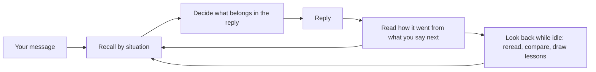

<p align="center">
  
</p>

<p align="center">
  <a href="https://github.com/asteme/asteme/actions/workflows/test.yml"></a>
  <a href="LICENSE"></a>
  
</p>

<p align="center">
  <a href="README.md">English</a> · <a href="README.zh.md">中文</a> · <a href="README.ja.md">日本語</a> · <a href="README.es.md">Español</a> · <a href="README.fr.md">Français</a> · <a href="README.de.md">Deutsch</a> · Русский · <a href="README.pt.md">Português</a>
</p>

<p align="center"><a href="https://asteme.github.io/asteme/ru/">Сайт</a></p>

**Локальный ИИ с долговременной памятью, с которым можно разговаривать.** Он работает на вашем компьютере с той языковой моделью, которую вы выберете, хранит всё, что помнит, в одном файле SQLite и используется как плагин для [DeepSeek Harness](https://github.com/deepseek-ai/deepseek-harness), как отдельная страница или как MCP-сервер памяти для любого агента.

Одна минута: сказанное давно возвращается, когда приходит его время, обещание выполняется, и небо показывает всё, что помнит Asteme. Если включить звук, фоном играет фортепиано. Ролик на английском.

https://github.com/user-attachments/assets/fb9aff91-1248-4deb-847e-577771f62fae

<details>
<summary>Что показано в ролике, словами</summary>

Вечер в день рождения: «Сегодня день рождения. Кажется, время уходит». Asteme отвечает фразой трёхлетней давности: «Если к сорока я так и не начну книгу, напомни мне, кем я был». Воспоминание открывается рядом с разговором: точная фраза, на которой оно держится, и день, когда она была сказана. Asteme говорит, что спросит в субботу утром, и в субботу утром заговаривает первым: «Как книга?» — «Две страницы. Плохие». — «Теперь есть две страницы. В твой день рождения не было ни одной». Затем небо: набирают одно слово, и всё, что когда-либо говорилось о книге, выходит из звёзд. Всё это выдумано; это не чей-то настоящий разговор.

</details>

# ASTEME

Asteme — это собеседник, и всегда один и тот же. Он запоминает сказанное вами вместе с ситуацией, к которой это относится, возвращает воспоминание, когда такая ситуация снова наступает, и меняет то, что приходит на ум, в зависимости от того, чем кончилось применение.

Он работает на вашем компьютере. Всё, что он помнит, лежит в одном файле SQLite; то, что вы ему передаёте, хранится рядом с этим файлом.

Сегодня у него две формы:

- **Внутри DeepSeek Harness**, как плагин: разговор — это один экран в Harness, а рядом с ним панель настроек.
- **Отдельно**, как мозг: одна страница на этом компьютере, которую отдаёт `brain/cli.mjs`.

Обе формы говорят, помнят и держат обещания на одном и том же механизме. У каждой своё хранилище: плагин использует хранилище профиля Harness, а отдельный мозг — хранилище из своего файла настроек или отдельное хранилище для человека при `--person <name>`. `export` и `import` записывают и возвращают человека целиком, так что человека можно перенести между ними. Иначе они не видят хранилища друг друга.

**Статус: в разработке.** Asteme всё ещё создаётся. Поведение может меняться, возможны сбои и потеря данных. Пока не полагайтесь на него в чём-то важном.

## Чем это отличается

Память для языковой модели — чаще всего поиск: находят текст, похожий на сообщение, и кладут его перед моделью. Asteme тоже начинает с этого, а отличается тем, что происходит вокруг.

**Вспоминает ситуация, а не формулировка.** Однажды вы поправили записку: «сначала решение, директор читает только три строки». Через несколько дней вы просите одностраничную презентацию для инвестора. Ни одно слово не совпадает, но ситуация та же (читатель, у которого мало времени и который должен решить), и воспоминание возвращается.

**Сказанное вами находится так, как вы это сказали.** Наряду с тем, что он усвоил, поиск идёт и по самим разговорам, на том языке, на котором они велись. Дата, число, порядок событий, то, что сам Asteme сказал вам в прошлом месяце: всё возвращается теми же словами, с указанием дня.

**То, чего вы просите придерживаться, всегда перед глазами.** «Когда я прошу рецепт, проверяй, нет ли в нём арахиса». «Если я собираюсь пообещать клиенту срок, напомни сначала спросить Миру». Такая просьба не оставляется на память: она стоит перед ним при каждом ответе, видна вам и перестаёт действовать, когда вы скажете.

**Память меняется от того, что вы говорите, а не от вашей реакции.** Скажите, что воспоминание неверно, — и оно будет рассмотрено заново. Скажите, что ему не место в определённого рода ситуациях, — и оно больше не появится в таких ситуациях. Если что-то было нужно, но не вспомнилось, он учится вспоминать это там. Резкость ничего не меняет: напоминание, о котором вы просили, не умолкает из-за того, что однажды пришлось не по душе. Ничто не тускнеет от старости, и ничто не удаляется из-за того, что хранилище выросло.

**Каждое воспоминание упирается в ваши собственные слова.** Каждое хранит точную фразу, из которой пришло. Откройте воспоминание — и увидите, на чём оно стоит, где применимо, каждый раз, когда его использовали и чем это кончилось, и каждое изменение в нём. Если вы говорите, что что-то неверно, ваше слово важнее слова модели.

**Он держит обещания.** «Спроси меня снова в июне» становится обещанием, которое Asteme держит сам, один раз или повторно, и он говорит первым, когда время приходит.

**Он говорит сам.** То, что вас беспокоило, остаётся у него в голове без назначенного времени. Когда вы возвращаетесь спустя время, он может спросить, как всё прошло, или промолчать: это решает он сам, а то, что он держит в мыслях, вам видно, и это можно отменить.

**Он показывает, что помнит.** Каждое воспоминание — одна звезда на небе за разговором, тем ярче, чем больше пользы оно принесло. Возьмитесь за пустое небо — и вы среди них.

## Попробовать за минуту

Node 22.13 или новее. Ничего устанавливать не нужно, ключ API не нужен.

```
git clone https://github.com/asteme/asteme.git
cd asteme
npm run demo
```

Демо проигрывает две недели с одним пользователем против модели, отвечающей по сценарию, и рассказывает, что делает память:

```
Day 1. The user corrects a memo.
  stored as a case; the exchange stood out (salience 0.55) because it was a correction
Day 3. A request with none of the memo's words: a one-pager for an investor.
  recalled by the scene: "Writing a memo for the director"
  the user said it helped; that is kept to be read, and changes nothing about what is recalled
Day 4. The same memory is used where it does not belong: notes for the team.
  the user said it does not belong there; it will stay out of scenes like that one
Night. Sleep.
  integrate: one lesson drawn from two cases
```

Тесты идут так же: `npm test`.

Чтобы посмотреть разговор без модели, запустите собственную страницу предпросмотра:

```
DEMO=1 ALL=900 node brain/preview.mjs 4173 ru
```

Затем откройте `http://127.0.0.1:4173/?token=preview` на этом компьютере (в PowerShell сначала задайте две переменные: `$env:DEMO=1; $env:ALL=900`). Ничего в нём не является чьим-то настоящим разговором.

## Как использовать

**Что нужно.** Node 22.13 или новее. Языковая модель: в DeepSeek Harness — та, которой вы там уже пользуетесь; отдельно или через MCP — любой эндпоинт, совместимый с OpenAI (URL, имя модели и ключ). Около 400 МБ зависимостей, а при первом использовании один раз скачивается модель эмбеддингов размером около 120 МБ (multilingual-e5-small; она хранится в `~/.cache/asteme/models` и работает на вашем компьютере). Для демо выше нужен только Node.

### В DeepSeek Harness

Установите плагин `dsh-asteme` (Плагины → Добавить плагин; он приходит из npm, и DSH обновляет его оттуда). Во время установки DSH спрашивает разрешение на скрипты установки для трёх пакетов, от которых зависит (onnxruntime-node, protobufjs, sharp); разрешите — и он продолжит. После этого **ASTEME** появляется на боковой панели.

- Разговор занимает весь экран. Воспоминания открываются рядом; «Настройки» — про разговор: как он выглядит, сам Asteme (имя, лицо, манера говорить, настроение), голос и мышление. «Память» — про всё, что он помнит: поиск, звёзды и внутри DSH каждое место, где за памятью следят. Настройки памяти есть и в собственных настройках DSH, в разделе Asteme.
- Панель держит то, что не относится к разговору: обзор, память, активность, устав, настройки.
- В собственных сессиях Harness агент делает свою работу как и раньше, своими инструментами, и говорит там тоже Asteme: то же имя, та же манера говорить, та же память. Исключение — сессия, которую Asteme открывает сам, чтобы поручить работу: она остаётся обычным DeepSeek Harness и не получает ничего от Asteme. Разговор с Asteme продолжается поверх них всех, и он может заговорить первым.

### Отдельно

```
npm run brain
```

Настройки читаются из `~/.asteme/brain.json` (или из пути в `ASTEME_CONFIG`). Ключ никогда не пишется в файл; `keyEnv` называет переменную окружения, в которой он лежит.

```json
{ "model": { "url": "https://your-endpoint/v1", "name": "your-model", "keyEnv": "YOUR_KEY_ENV" },
  "judge": { "keyEnv": "YOUR_JUDGE_KEY_ENV" },
  "workers": { "dsh": { "command": "dsh", "args": ["acp"], "about": "an agent with files and a shell" } },
  "store": "~/.asteme/memory.sqlite", "port": 4170, "language": "en" }
```

Страница отвечает только на этом компьютере и только с токеном из выведенного адреса. Воркер — это агент, который принимает слова и отвечает словами по Agent Client Protocol; DSH всегда под рукой внутри Harness, а других можно добавить в файл.

Голос, совместимый с OpenAI, можно одолжить так же, через `voice: { url, model, voices, keyEnv }`.

### Как память для любого агента (MCP)

```
ASTEME_DB=./memory.sqlite \
ASTEME_LLM_URL=https://your-endpoint/v1 ASTEME_LLM_KEY=... ASTEME_LLM_MODEL=... \
node standalone/mcp.mjs
```

Сервер MCP через stdio. Агент вызывает `asteme_recall` с каждым сообщением пользователя перед ответом и `asteme_observe` со своим ответом после.

### Как библиотека

```js
import { openBrain } from "./standalone/brain.mjs";

const brain = openBrain({ path: "memory.sqlite", infer, embed });
const { note } = await brain.recall({ session: "s1", message });   // before the agent answers
brain.observe({ session: "s1", reply });                           // after it answered
await brain.rest();                                                // when idle
```

## Разговор

- **Начало.** В новом хранилище, как и в очищенном, пока никого нет. Один раз, до разговора, он спрашивает имя, как вас называть и как с вами говорить (любое из этого можно оставить пустым или пропустить всё), и потом его будят. Пробуждение и имя — его первое воспоминание: эта звезда падает в пустое небо, остаётся в его середине самой яркой, и затем он говорит первым.
- **Звёзды.** Одна звезда — одно воспоминание; новые ближе к центру, старые дальше, а те, что принесли больше всего пользы, светят ярче. Потяните пустое небо, сведите или разведите пальцы, или дважды щёлкните, чтобы войти; перетаскивание двигает, колесо ведёт вперёд сквозь них (и назад, до самого края неба), Shift+перетаскивание поворачивает. Как бы далеко оно ни было повёрнуто, рывок всё равно двигает то, что под рукой; `0` или «Выровнять небо» ставит его правильно снова. Что-то новое, усвоенное, падает на небо как падающая звезда (это можно отключить).
- **Поиск.** Начните печатать в строке поиска, и подходящие звёзды подходят к ней по одной, в свободную дугу. Колесо или ↑↓ двигают по ним, Enter или щелчок открывает одну, а остальные остаются бледными на небе.
- **Одно воспоминание.** Откройте звезду, чтобы увидеть её слова, на чём она стоит, когда была усвоена, и чтобы сказать, что она всё ещё верна, больше не верна, приостановить её или забыть её вместе с источниками.
- **Обещания.** Обещание — это строка под ответом, который его дал, в следующий раз — в шапке, и его можно отменить, сказав об этом.
- **Ответы и реакции.** На любое сообщение можно ответить на месте; Asteme может поставить эмодзи на ваше, а вы — на его.
- **Отметки о прочтении.** Каждая сторона видит, когда другая прочитала. Оба направления можно отключить.
- **Отзыв сообщения.** Своё сообщение можно отозвать; сказанное Asteme в ответ уходит вместе с ним, а работа, которую он для него выдал, отзывается.
- **Файлы.** В одном сообщении можно добавить, вставить или перетащить до шести файлов. Текстовые файлы читаются; картинка просматривается, если модель умеет видеть картинки; PDF или что-то иное передаётся воркеру, когда это нужно.
- **Голос.** Ответы можно прочитать голосом DeepSeek, если у Harness есть ключ DeepSeek; прочитанные слова отправляются в DeepSeek. Читаются слова, а не id или длинные коды.
- **Пока вас не было.** Когда Asteme сказал что-то, чего вы не видели, одна звезда его значка на боковой панели Harness загорается, а вкладка браузера считает это в заголовке. Открытие Asteme может вести к разговору или к тому, что ждёт в памяти; это выбирается в настройках панели.

## Как это работает



Перед ответом сообщение вызывает самое близкое к нему по смыслу: воспоминания и обмены репликами из прежних разговоров в их исходных словах. Один вызов модели читает ситуацию и решает, что из этого подходит. После ответа обмен читается в память, а ваша фраза остаётся основанием для всего усвоенного. Позже в том, что вы напишете дальше, читается, что вы говорите об использованном воспоминании: что оно неверно или что ему здесь не место. Это его меняет; то, довольны ли вы, — нет. Пока делать нечего, он перечитывает обмены, которые чем-то выделились (поправка, неожиданность, обещание), сравнивает воспоминания, которые могут друг другу противоречить или дважды говорить одно и то же (и тогда оставляет одно из них), и выводит уроки из разных случаев.

Код никогда не решает, что что-то значит. Он проверяет структуру: что цитата точна, что id существует, что ревизия не сдвинулась. Смысл остаётся модели, и всё, что модель пишет, должно указывать на сохранённую запись.

**Повторяющаяся работа отделена.** Повторяющееся обещание самого Asteme («каждое утро», «каждую пятницу в пять») держит Asteme, а время хранится в его собственном хранилище: оно не регистрируется в запланированных задачах DeepSeek Harness и не появляется в списке Harness. Harness спрашивают только тогда, когда в это время действительно нужна работа. Когда такое обещание ждёт, Asteme запускается вместе с Harness, чтобы время наступило, даже если его страницу ни разу не открывали.

## Ваши данные

- Всё лежит в одном файле SQLite на вашем компьютере; файлы, которые вы передаёте, хранятся рядом с ним. Телеметрии нет. В сеть он выходит только для настроенных вами адресов моделей, для необязательного судьи или голоса, и один раз — чтобы скачать локальную модель эмбеддингов.
- **Экспорт и импорт** полной копии, включая разговоры. Импорт добавляет недостающее и никогда не перезаписывает.
- **Дневник**: по одному файлу Markdown на месяц — что было сказано, что он из этого взял и чем это кончилось.
- **Автоматические копии** раз в день. Прореживаются только старые копии, но никогда то, что он помнит.
- **Забывание настоящее**: если забыть воспоминание вместе с исходными сообщениями, они удаляются из всех таблиц, и импорт не может их вернуть.
- **Личный разговор** запоминается как порядок и количество, без слов; ничего из него не читается в память и не подмешивается в неё.
- **Проекты** могут оставлять усвоенное в них при себе, и одно воспоминание можно оставить за его проектом.

## Ограничения сегодня

- Рано. Поведение всё ещё может меняться между версиями.
- Ответ может ждать память: чтение ситуации и выбор из неё — это один вызов модели, а с рассуждающей моделью это десять-двадцать секунд, иногда больше. Маленькая модель для решений (судья) может занять это место, если она настроена, и тогда ответ её больше не ждёт.
- Картинка, переданная в разговор, просматривается, если модель умеет видеть картинки; другие файлы, которые не текст (PDF, запись), Asteme сам не читает: он передаёт их DSH вместе с путём, когда для работы их нужно открыть.
- Чтение вслух использует только одолженный голос (голоса, установленные на компьютере, не используются). Свой голосовой сервис (совместимый с OpenAI или локальный сервер) задаётся в файле настроек; экрана для него пока нет.
- Тесты и сборка плагина идут в CI на Windows, macOS и Linux. Глазами его использовали на Windows и проверяли на Linux; macOS ещё никто не смотрел.
- Страница только для этого компьютера; доступа с телефона нет.

## Куда это идёт

Всё началось с памяти: тот, кто помнит и кого можно поправить. Теперь есть и руки: Asteme поручает работу агенту на вашем компьютере (DeepSeek Harness или любому агенту, который говорит на Agent Client Protocol) и рассказывает, чем она закончилась. Дальнейшее строится так же, на памяти, потому что всё остальное держится на ней; модель, которая станет лучше, сохранит ту же память и того же вас.

## Документы

- [docs/BRAIN.md](docs/BRAIN.md): мозг — один разговор, руки, часы, бодрствование и сон
- [CHANGELOG.md](CHANGELOG.md): что изменилось в каждой версии
- [CONTRIBUTING.md](CONTRIBUTING.md): как его запускать, устройство, правила для изменений
- [MAINTAINING.md](MAINTAINING.md): кто что решает и как проходит изменение

<a href='https://ko-fi.com/wsl043'></a>

## Лицензия

[Apache-2.0](LICENSE), с [NOTICE](NOTICE). Лицензия распространяется на код; имя и знак принадлежат этому проекту: см. [TRADEMARKS.md](TRADEMARKS.md).
