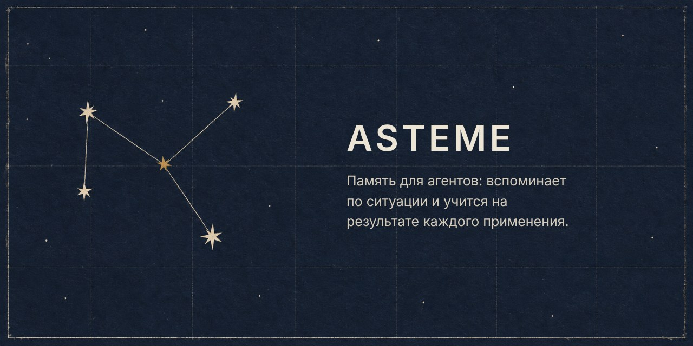
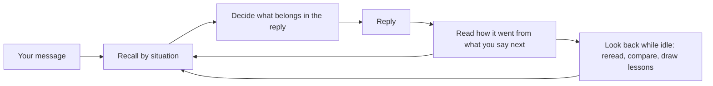

<p align="center">
  
</p>

<p align="center">
  <a href="https://github.com/asteme/asteme/actions/workflows/test.yml"></a>
  <a href="LICENSE"></a>
  
</p>

<p align="center">
  <a href="README.md">English</a> · <a href="README.zh.md">中文</a> · <a href="README.ja.md">日本語</a> · <a href="README.es.md">Español</a> · <a href="README.fr.md">Français</a> · <a href="README.de.md">Deutsch</a> · Русский · <a href="README.pt.md">Português</a>
</p>

**Статус: в разработке.** Asteme всё ещё создаётся. Поведение может меняться, он может сбоить или терять данные. Пока не полагайтесь на него ни в чём важном.

# ASTEME

Asteme — это тот, с кем вы разговариваете, и каждый раз один и тот же. Он помнит то, что вы ему говорите, вместе с ситуацией, к которой это относится, возвращает воспоминание, когда эта ситуация возникает снова, и меняет то, что приходит на ум, в зависимости от того, чем закончилось его использование.

Он работает на вашем компьютере. Всё, что он помнит, лежит в одном файле SQLite; то, что вы ему передаёте, хранится рядом с этим файлом.

Сегодня у него две формы:

- **Внутри DeepSeek Harness**, как плагин: разговор — это один экран в harness, а рядом с ним стоит панель настроек.
- **Отдельно**, как мозг: одна страница на этом компьютере, которую отдаёт `brain/cli.mjs`.

Обе говорят, помнят и держат обещания на одном и том же механизме. У каждой своё хранилище: плагин использует хранилище профиля harness, а отдельный мозг — хранилище из своего файла настроек или по одному хранилищу на человека с `--person <name>`. `export` и `import` записывают и возвращают человека целиком, так что человека можно перенести между этими двумя формами. Иначе хранилища друг друга они не видят.

## Чем он отличается

**Вспоминает ситуация, а не формулировка.** Однажды вы поправили записку: «решение — в начало, директор читает только три строки». Через несколько дней вы просите одностраничную презентацию для инвестора. Общих слов нет, но ситуация та же (читатель, у которого мало времени и который должен принять решение), и воспоминание возвращается.

**Использование переписывает память.** После того как воспоминание использовано, ваши следующие слова читаются на предмет того, как всё прошло. То, что помогло, приходит на ум легче. То, что было не к месту, перестаёт появляться в ситуациях такого рода и продолжает работать в других. Ничто не угасает от старости, и ничто не удаляется потому, что хранилище выросло.

**Каждое воспоминание упирается в ваши собственные слова.** Каждое хранит точную фразу, из которой оно возникло. Откройте воспоминание — и вы увидите, на чём оно основано, где применимо, сколько раз использовалось и как это прошло, и все изменения, внесённые в него. Если вы говорите, что что-то неверно, ваше слово стоит выше слова модели.

**Он держит обещания.** «Напомни мне в июне» становится обещанием, которое Asteme держит сам, однократным или повторяющимся, и, когда время приходит, он говорит первым.

**Он показывает то, что помнит.** Каждое воспоминание — одна звезда на небе за разговором, тем ярче, чем легче оно приходит на ум. Возьмитесь за пустое небо — и вы окажетесь среди них.

## Попробовать за минуту

Node 22.5 или новее. Ничего устанавливать не нужно, ключ API не нужен.

```
git clone https://github.com/asteme/asteme.git
cd asteme
npm run demo
```

Демо проигрывает две недели с одним пользователем против модели, отвечающей по сценарию, и рассказывает, что делает память:

```
Day 1. The user corrects a memo.
  stored as a case; the exchange stood out (salience 0.55) because it was a correction
Day 3. A request with none of the memo's words: a one-pager for an investor.
  recalled by the scene: "Writing a memo for the director"
  it helped; accessibility 0.7453
Day 4. The same memory is used where it does not belong: notes for the team.
  marked out of place there; accessibility 0.605
Night. Sleep.
  integrate: one lesson drawn from two cases
```

Тесты запускаются так же: `npm test`.

Чтобы посмотреть на разговор без модели, запустите собственный предпросмотр страницы:

```
DEMO=1 ALL=900 node brain/preview.mjs 4173 ru
```

Затем откройте `http://127.0.0.1:4173/?token=preview` на этом компьютере (в PowerShell сначала задайте две переменные: `$env:DEMO=1; $env:ALL=900`). Ничто в нём не является чьим-либо настоящим разговором.

## Как им пользоваться

### В DeepSeek Harness

Установите плагин `dsh-asteme` (Plugins → Add plugin). DSH устанавливает и обновляет его из npm. При установке DSH запросит разрешение на запуск установочных скриптов трёх зависимостей (`onnxruntime-node`, `protobufjs` и `sharp`). Разрешите их запуск, чтобы продолжить установку. После этого в боковой панели появится **ASTEME**.

- Разговор занимает весь экран, а воспоминания открываются рядом. Кнопка **Настройки** вверху разговора относится только к самому разговору: его оформлению, самому Asteme (имя, изображение, манера речи и настроение), голосу и режиму мышления.
- Кнопка **Память** вверху разговора открывает поиск и звёздное небо. В DSH оттуда же можно перейти к списку воспоминаний, проверке последнего ответа, активности, правилам и разделу **Настройки памяти**. Этот же раздел доступен в самом DSH по пути **Настройки → Asteme**.
- Собственные разговоры harness не меняются: это агенты, выполняющие работу в одной сессии. Asteme — это один разговор, который идёт сквозь них все, и он может заговорить первым.

### Отдельно

```
npm run brain
```

Настройки читаются из `~/.asteme/brain.json` (или из пути в `ASTEME_CONFIG`). Ключ никогда не записывается в файл; `keyEnv` называет переменную окружения, в которой он лежит.

```json
{ "model": { "url": "https://your-endpoint/v1", "name": "your-model", "keyEnv": "YOUR_KEY_ENV" },
  "judge": { "keyEnv": "YOUR_JUDGE_KEY_ENV" },
  "workers": { "dsh": { "command": "dsh", "args": ["acp"], "about": "an agent with files and a shell" } },
  "store": "~/.asteme/memory.sqlite", "port": 4170, "language": "ru" }
```

Страница отвечает только на этом компьютере и только по токену из напечатанного адреса. Worker — это агент, который принимает слова и отвечает словами по Agent Client Protocol; DSH всегда под рукой внутри harness, а других можно добавить в файле.

Голос, совместимый с OpenAI, можно предоставить таким же способом: `voice: { url, model, voices, keyEnv }`.

### Как память для любого агента (MCP)

```
ASTEME_DB=./memory.sqlite \
ASTEME_LLM_URL=https://your-endpoint/v1 ASTEME_LLM_KEY=... ASTEME_LLM_MODEL=... \
node standalone/mcp.mjs
```

MCP-сервер через stdio. Агент вызывает `asteme_recall` с каждым сообщением пользователя перед ответом и `asteme_observe` со своим ответом после.

### Как библиотека

```js
import { openBrain } from "./standalone/brain.mjs";

const brain = openBrain({ path: "memory.sqlite", infer, embed });
const { note } = await brain.recall({ session: "s1", message });   // before the agent answers
brain.observe({ session: "s1", reply });                           // after it answered
await brain.rest();                                                // when idle
```

## Разговор

- **Начало.** В новом хранилище, или в очищенном, ещё никого нет. Один раз, до разговора, он спрашивает имя, как вас называть и как с вами говорить (всё можно оставить пустым или пропустить целиком), и затем его будят. То, что его разбудили и дали имя, — первое воспоминание: эта звезда падает в пустое небо, остаётся в его середине самой яркой, и после этого он говорит первым.
- **Звёзды.** Одна звезда — одно воспоминание; самое новое ближе к центру, самое старое дальше всех, а те, что легко приходят на ум, светят ярче всех. Тяните пустое небо, щипните или дважды щёлкните по нему, чтобы войти внутрь; тяните, чтобы двигать, колесо — чтобы приближать, Shift+тяга — чтобы поворачивать. Как бы далеко его ни повернули, рывок всё равно двигает то, что под рукой; `0` или «Level the sky» снова ставит его правильно. Что-то только что усвоенное падает на небо как падающая звезда (это можно отключить).
- **Поиск.** Введите запрос в поле поиска, и подходящие звёзды подходят к нему по одной, выстраиваясь в свободную дугу. Колесо или ↑↓ перемещает по ним, Enter или щелчок открывает одну, а остальные остаются тусклыми на небе.
- **Одно воспоминание.** Откройте звезду, чтобы увидеть её слова, на чём она основана, когда она была усвоена, и сказать, что она всё ещё верна или больше не верна, приостановить её или забыть её вместе с источниками.
- **Обещания.** Обещание — это строка под ответом, в котором оно появилось, а следующий его срок — в заголовке; его можно отменить, сказав об этом.
- **Ответы и реакции.** На любое сообщение можно ответить на месте; Asteme может поставить эмодзи на ваше сообщение, а вы — на его.
- **Отметки о прочтении.** Каждая сторона видит, когда другая прочитала сообщение. Оба направления можно отключить.
- **Отзыв сообщения.** Ваше сообщение можно отозвать; то, что Asteme сказал в ответ на него, уходит вместе с ним, а работа, которую он на него передал, отзывается.
- **Файлы.** Добавьте, вставьте или перетащите до шести файлов в одно сообщение. Текстовые файлы читаются. Изображения показываются модели, если она умеет с ними работать. PDF и файлы других типов при необходимости передаются рабочему агенту (worker).
- **Голос.** Ответы можно читать вслух голосом DeepSeek, когда в harness есть ключ DeepSeek; прочитанные слова отправляются в DeepSeek. Читаются слова, а не идентификаторы и не длинные коды.
- **Пока вас не было.** Когда Asteme сказал что-то, чего вы не видели, одна звезда на его значке в боковой панели harness загорается, а вкладка браузера считает это в заголовке. Открытие Asteme может вести к разговору или к тому, что ждёт в памяти; это выбирается в настройках панели.

## Как это работает



Перед ответом сообщение вызывает воспоминания по смыслу, и один вызов модели читает ситуацию и решает, какие из них подходят. После ответа обмен читается в память, а ваша фраза сохраняется как основа для всего усвоенного. Позже то, что вы напишете дальше, читается на предмет того, чем закончилось использование каждого воспоминания, и это меняет то, что будет вызвано в следующий раз. В простое он перечитывает обмены, которые выделились (исправление, неожиданность, обещание), сравнивает воспоминания, которые могут расходиться, и выводит уроки из отдельных случаев.

Код никогда не решает, что что-то значит. Он проверяет структуру: что цитата точна, что id существует, что ревизия не сдвинулась. Смысл оставлен модели, и всё, что пишет модель, должно указывать на сохранённую запись.

**Повторяющаяся работа разделена.** Повторяющееся обещание самого Asteme («каждое утро», «каждую пятницу в пять») держит Asteme, а время хранится в его собственном хранилище: оно не регистрируется в запланированных задачах DeepSeek Harness и не появляется в списке harness. Harness спрашивают только тогда, когда в это время действительно должна произойти работа. Когда такое обещание ждёт своего часа, Asteme запускается вместе с harness, так что время наступает, даже если его страницу никогда не открывали.

## Ваши данные

- Всё лежит в одном файле SQLite на вашей машине; файлы, которые вы передаёте, хранятся рядом с ним. Телеметрии нет. В сеть он выходит только к настроенным вами эндпоинтам моделей, к необязательному судье или голосу и один раз — чтобы скачать локальную модель эмбеддингов.
- **Экспорт и импорт** полной копии, включая разговоры. Импорт добавляет недостающее и никогда не перезаписывает.
- **Дневник**: по одному файлу Markdown на месяц — что было сказано, что он из этого взял и как это прошло.
- **Автоматические резервные копии** раз в день. Прореживаются только старые копии, и никогда — то, что он помнит.
- **Забывание настоящее**: если забыть воспоминание вместе с исходными сообщениями, они удаляются из всех таблиц, и импорт не может их вернуть.
- **Приватный разговор** запоминается как порядок и количества, без слов; ничто из него не читается в память и не привносится в неё.
- **Проекты** могут оставлять усвоенное в них при себе, и одно воспоминание можно удержать в его проекте.

## Ограничения на сегодня

- Версия 0.11 — первая публичная версия. Проект ещё на ранней стадии, и поведение может меняться от версии к версии.
- Ответ может ждать память: чтение ситуации и выбор из неё — это один вызов модели, и с рассуждающей моделью это занимало от десяти до двадцати секунд, иногда больше. Небольшая модель решений (судья) может занять это место, когда она настроена, и тогда ответ больше её не ждёт.
- Изображения, отправленные в разговоре, показываются модели, если она умеет с ними работать. Остальные нетекстовые файлы (например, PDF и аудиозаписи) Asteme сам не читает: если для задачи их нужно открыть, он передаёт их в DSH вместе с путями к ним.
- Чтение вслух использует только заимствованный голос (голоса, установленные на компьютере, не используются). Свой голосовой сервис (совместимый с OpenAI или локальный сервер) задаётся в файле настроек; экрана для него пока нет.
- В CI тесты запускаются, а плагин собирается на Windows, macOS и Linux. На Windows Asteme использовали на практике, на Linux проверяли вручную, а на macOS ручной проверки ещё не было.
- Страница только для этого компьютера; доступа с телефона нет.

## Что дальше

Сегодня главное — память: Asteme помнит, и вы можете его поправить. Дальше у него появятся руки: всё тот же Asteme сможет поручать дела инструментам на вашем компьютере и будет спрашивать вашего разрешения перед любым действием, которое нельзя отменить. Память идёт первой, потому что на ней строится всё остальное. Даже если модель станет лучше, память останется прежней, и Asteme по-прежнему будет вас узнавать.

## Документы

- [docs/BRAIN.md](docs/BRAIN.md): мозг — один разговор, руки, часы, бодрствование и сон
- [DESIGN.md](DESIGN.md): модель памяти, почему она устроена так, что проверено
- [docs/IMPLEMENTATION.md](docs/IMPLEMENTATION.md): решения, принятые в реализации
- [CHANGELOG.md](CHANGELOG.md): что изменилось в каждой версии
- [HANDOFF.md](HANDOFF.md): состояние разработки и что дальше
- [CONTRIBUTING.md](CONTRIBUTING.md): как его запускать, устройство, правила для изменений

## Лицензия

Код распространяется по лицензии [Apache-2.0](LICENSE) с файлом [NOTICE](NOTICE). Она не распространяется на название и знак проекта; см. [TRADEMARKS.md](TRADEMARKS.md).
