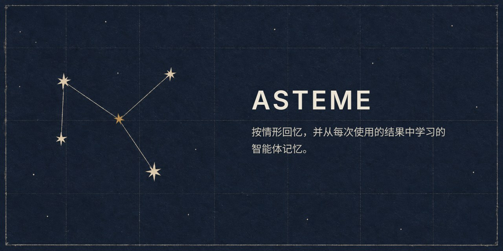
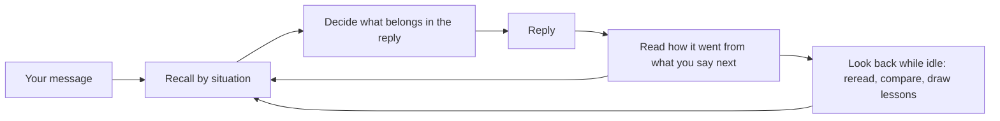

<p align="center">
  
</p>

<p align="center">
  <a href="https://github.com/asteme/asteme/actions/workflows/test.yml"></a>
  <a href="LICENSE"></a>
  
</p>

<p align="center">
  <a href="README.md">English</a> · 中文 · <a href="README.ja.md">日本語</a> · <a href="README.es.md">Español</a> · <a href="README.fr.md">Français</a> · <a href="README.de.md">Deutsch</a> · <a href="README.ru.md">Русский</a> · <a href="README.pt.md">Português</a>
</p>

**状态：开发中。** Asteme 仍在开发中。行为可能变化，也可能出错或丢失数据。现在还不要依赖它做任何重要的事。

# ASTEME

Asteme 是一个你可以与之交谈的对象，而且每次都是同一个。它记住你告诉它的事，连同这些事适用的情形；当同样的情形再次出现时，它会把相应的记忆带回来；并且根据用上之后结果如何，改变它会想起什么。

它运行在你自己的电脑上。它记得的一切都在一个 SQLite 文件里；你交给它的东西保存在这个文件旁边。

目前它有两种形态：

- **在 DeepSeek Harness 之内**，作为一个插件：对话是 harness 里的一个屏幕，旁边还有一块设置面板。
- **独立运行**，作为一个 brain：这台电脑上的一个页面，由 `brain/cli.mjs` 提供服务。

两者都在同一套机制上对话、记忆并守约。各自有各自的存储：插件使用 harness 配置档的存储，独立运行的 brain 使用它设置文件里的存储，或者用 `--person <name>` 为每个人各用一个存储。`export` 和 `import` 写出并带回一整个“人”，所以一个人可以在两者之间搬移。除此之外，它们彼此看不到对方的存储。

## 有什么不同

**唤起记忆的是情形，不是字面。** 你曾经改过一份备忘录：“决定放前面，总监只看三行。”几天后，你要一页给投资人的材料。两句话没有一个词相同，但情形是一样的（一位时间很少、又必须做决定的读者），这条记忆就回来了。

**使用会改写记忆。** 一条记忆被用过之后，你接下来说的话会被用来读出它用得怎么样。帮上忙的更容易被想起。不合场合的不再出现在那类情形里，在别处照常起作用。没有东西因为旧了就淡去，也没有东西因为存储变大就被删掉。

**每条记忆都落到你自己的话上。** 每一条都保留着它来自的那句原话。打开一条记忆，你会看到它依据什么、适用于哪里、每一次被使用的情形与结果，以及对它做过的每一次改动。你说某件事不对，你的话就压过模型的话。

**它会守约。** “六月再问我一次”会成为 Asteme 自己持有的一个承诺，一次性的或重复的，时间到了由它先开口。

**它会显示自己记得什么。** 每条记忆都是对话背后那片天空上的一颗星，越容易被想起就越亮。抓住空处的天幕，你就置身它们之中。

## 一分钟试用

需要 Node 22.5 或更高版本。无需安装任何东西，也不需要 API 密钥。

```
git clone https://github.com/asteme/asteme.git
cd asteme
npm run demo
```

演示用一位用户对上一个按脚本作答的模型，走过两周，并叙述记忆做了什么：

```
Day 1. The user corrects a memo.
  stored as a case; the exchange stood out (salience 0.55) because it was a correction
Day 3. A request with none of the memo's words: a one-pager for an investor.
  recalled by the scene: "Writing a memo for the director"
  it helped; accessibility 0.7453
Day 4. The same memory is used where it does not belong: notes for the team.
  marked out of place there; accessibility 0.605
Night. Sleep.
  integrate: one lesson drawn from two cases
```

测试以同样的方式运行：`npm test`。

想在没有模型的情况下看看对话，就运行页面自带的预览：

```
DEMO=1 ALL=900 node brain/preview.mjs 4173 zh
```

然后在这台电脑上打开 `http://127.0.0.1:4173/?token=preview`（在 PowerShell 里要先设置这两个变量：`$env:DEMO=1; $env:ALL=900`）。里面没有任何人的真实对话。

## 使用

### 在 DeepSeek Harness 中

安装 `dsh-asteme` 插件（插件 → 添加插件）。DSH 从 npm 安装和更新该插件。安装时，DSH 会请求允许运行三个依赖包（`onnxruntime-node`、`protobufjs`、`sharp`）的安装脚本。批准后，安装会继续，**ASTEME** 随后会出现在侧边栏里。

- 对话占满屏幕，记忆在旁边打开。对话顶部的「设置」只管对话本身：外观、Asteme 本身（名字、头像、说话方式、心情），以及声音与思考。
- 对话顶部的「记忆」可以搜索记忆、查看星空。在 DSH 中，它还能打开记忆列表、确认上一次回复、查看动态与章程，以及进入「记忆设置」。DSH 自己的设置里也有同一个页面，路径是「设置 → Asteme」。
- harness 自己的对话不受影响：它们是在一个会话里做事的智能体。Asteme 是一段贯穿它们全部的对话，而且它可以先开口。

### 独立运行

```
npm run brain
```

设置从 `~/.asteme/brain.json` 读取（或 `ASTEME_CONFIG` 里的路径）。密钥从不写进这个文件；`keyEnv` 给出存放它的环境变量名。

```json
{ "model": { "url": "https://your-endpoint/v1", "name": "your-model", "keyEnv": "YOUR_KEY_ENV" },
  "judge": { "keyEnv": "YOUR_JUDGE_KEY_ENV" },
  "workers": { "dsh": { "command": "dsh", "args": ["acp"], "about": "an agent with files and a shell" } },
  "store": "~/.asteme/memory.sqlite", "port": 4170, "language": "zh" }
```

这个页面只在这台电脑上应答，而且只认打印出来的地址里的那个令牌。worker 是一个智能体，它通过 Agent Client Protocol 收下文字、用文字作答；在 harness 里面 DSH 总是现成的，其他的可以在文件里加上。

一个兼容 OpenAI 的声音也可以用 `voice: { url, model, voices, keyEnv }` 以同样的方式接入。

### 作为任何智能体的记忆（MCP）

```
ASTEME_DB=./memory.sqlite \
ASTEME_LLM_URL=https://your-endpoint/v1 ASTEME_LLM_KEY=... ASTEME_LLM_MODEL=... \
node standalone/mcp.mjs
```

一个基于 stdio 的 MCP 服务器。智能体在回答之前，针对每条用户消息调用 `asteme_recall`；回答之后，用自己的回复调用 `asteme_observe`。

### 作为库

```js
import { openBrain } from "./standalone/brain.mjs";

const brain = openBrain({ path: "memory.sqlite", infer, embed });
const { note } = await brain.recall({ session: "s1", message });   // before the agent answers
brain.observe({ session: "s1", reply });                           // after it answered
await brain.rest();                                                // when idle
```

## 对话

- **起点。** 新的存储，或清空后的存储，里面还没有人。在对话之前只问一次：名字、怎么称呼你、希望它怎么说话（都可以留空，也可以全部跳过），然后把它叫醒。被叫醒、得到名字，就是它的第一个记忆：那颗星落进空空的天空，留在正中，是最亮的一颗，然后它先开口。
- **星。** 一颗星是一条记忆；最新的靠近中心，最旧的在远处，越容易被想起的越亮。拖动空处的天幕、双指捏合或双击它就能进去；拖动是移动，滚轮是缩放，Shift 拖动是转动。不管转到了哪个方向，拉动时动的仍是手底下的东西；按 `0` 或点“把天空摆正”，它就重新摆正。新学到的东西会作为一颗流星落进这片天空（这一项可以关掉）。
- **搜索。** 在搜索框里输入，匹配的星会一颗接一颗地来到它那里，排成一道松散的弧。滚轮或 ↑↓ 在它们之间移动，回车或点击打开一颗，其余的仍然淡淡地留在天空里。
- **一条记忆。** 打开一颗星，可以看到它的话、它依据什么、什么时候学到的，也可以说它仍然成立、已经不再成立、把它暂停，或者连同它的来源一起忘记它。
- **承诺。** 承诺是做出它的那条回复下面的一行，下一次的时间在标题栏里，说一声就能取消。
- **回复与反应。** 任何一条消息都可以就地回复；Asteme 可以把一个表情加在你的消息上，你也可以加在它的消息上。
- **已读标记。** 双方都能看到对方是什么时候读的。两个方向都可以关掉。
- **撤回消息。** 你的消息可以撤回；Asteme 作为回答说的话随之而去，它为这条消息派出去的工作也会被收回。
- **文件。** 一条消息里最多可以添加、粘贴或拖入六个文件。Asteme 会读取文本文件；如果模型支持图像输入，Asteme 也能查看图片。PDF 和其他类型的文件会在需要时交给 worker。
- **声音。** 当 harness 持有 DeepSeek 密钥时，回复可以用 DeepSeek 的声音朗读；朗读的文字会发送给 DeepSeek。朗读的是文字，不是 id 或长串编码。
- **你不在的时候。** 当 Asteme 说了你还没看到的话，harness 侧边栏里它图标上的一颗星会亮起，浏览器标签页的标题里也会计数。打开 Asteme 时，可以直接进对话，也可以先看记忆里等着的东西；这在面板的设置里选。

## 它如何工作



回复之前，消息按意义把记忆唤起来，再由一次模型调用读出情形、决定哪些属于这里。回复之后，这段交流被读进记忆，你那句话保留下来，作为所学之事的依据。再往后，你接下来说的话会被用来读出每条用过的记忆结果如何，而这会改变下次唤起什么。空闲时，它重读那些突出的交流（一次纠正、一次意外、一个承诺），比较可能互相矛盾的记忆，并从不同场合里得出教训。

代码从不判定某个东西是什么意思。它检查结构：引文是否一字不差、id 是否存在、某个修订有没有被改动过。意义交给模型，而模型写出的每一样东西都必须指向一条已存储的记录。

**重复性的工作分开处理。** Asteme 自己重复出现的承诺（“每天早上”“每周五的五点”）由 Asteme 持有，时间存在它自己的存储里：它不注册进 DeepSeek Harness 的定时任务，也不出现在 harness 的列表里。只有当那个时间真的要做事时，才去请求 harness。有这样的承诺在等着时，Asteme 会随 harness 一起启动，所以即使它的页面从没打开过，时间也照样到。

## 你的数据

- 一切都在你机器上的一个 SQLite 文件里；你交出去的文件保存在它旁边。没有遥测。它只在以下情况联网：访问你配置的模型接口、访问可选的 judge 或声音服务，以及一次下载本地嵌入模型。
- **导出与导入**一份完整的副本，含对话。导入只补上缺少的，绝不覆盖。
- **一份日记**：每月一个 Markdown 文件，记下说了什么、从中取走了什么、结果如何。
- **自动备份**每天一次。只删减旧的副本，绝不删减它记得的东西。
- **忘记是真的忘记**：连同来源消息一起忘记一条记忆，会把它们从每一张表里删掉，导入也带不回来。
- **私密对话**只按顺序和计数被记住，文字被略去；其中任何内容都不会被读进记忆，也不会从记忆里带进来。
- **项目**可以把在项目里学到的东西留给自己，一条记忆也可以只留在它所属的项目里。

## 目前的限制

- 0.11 是首个公开版本，仍处于开发初期。不同版本的行为可能会变化。
- 回复可能会为记忆而等待：读情形并从中挑选是一次模型调用，用推理模型时要花十到二十秒，有时更多。配置了一个小的决策模型（judge）时，它可以接替这个位置，于是回复不再等它。
- 如果模型支持图像输入，就能查看对话中发送的图片。Asteme 不会自行读取其他非文本文件（如 PDF、录音）；任务需要打开这些文件时，它会把文件连同路径一起交给 DSH。
- 朗读只使用外部借来的声音（不使用电脑里安装的声音）。自己的声音服务（兼容 OpenAI 的，或本地服务器）在设置文件里设定；目前还没有对应的界面。
- CI 在 Windows、macOS 和 Linux 上运行自动化测试并构建插件。Asteme 已在 Windows 上实际使用过，也在 Linux 上做过人工检查；macOS 尚未经过人工验证。
- 这个页面只供这台电脑使用；没有手机访问。

## 接下来

现在的 Asteme 先做好记忆：它记得你说过的话，你也能纠正它。接下来，它会有一双手：还是同一个 Asteme，可以调用你电脑上的工具办事，但在做任何无法撤销的事之前，会先征得你的同意。记忆放在第一位，因为其余能力都建立在它之上；即使模型变得更好，它也会保留原有的记忆，依然认得你。

## 文档

- [docs/BRAIN.md](docs/BRAIN.md)：brain —— 一段对话、手、一个时钟、醒着与睡着
- [DESIGN.md](DESIGN.md)：记忆模型、为什么是这样、测了什么
- [docs/IMPLEMENTATION.md](docs/IMPLEMENTATION.md)：实现过程中做出的决定
- [CHANGELOG.md](CHANGELOG.md)：每个版本改了什么
- [HANDOFF.md](HANDOFF.md)：开发状态以及接下来做什么
- [CONTRIBUTING.md](CONTRIBUTING.md)：怎么运行、目录结构、改动的规则

## 许可

代码采用 [Apache-2.0](LICENSE) 许可证，并附有 [NOTICE](NOTICE)。该许可证仅适用于代码，不涵盖本项目的名称与标志；详见 [TRADEMARKS.md](TRADEMARKS.md)。
