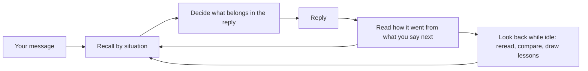

<p align="center">
  
</p>

<p align="center">
  <a href="https://github.com/asteme/asteme/actions/workflows/test.yml"></a>
  <a href="LICENSE"></a>
  
</p>

<p align="center">
  <a href="README.md">English</a> · 中文 · <a href="README.ja.md">日本語</a> · <a href="README.es.md">Español</a> · <a href="README.fr.md">Français</a> · <a href="README.de.md">Deutsch</a> · <a href="README.ru.md">Русский</a> · <a href="README.pt.md">Português</a>
</p>

<p align="center"><a href="https://asteme.github.io/asteme/zh/">网站</a></p>

**一个可以交谈、带长期记忆的本地 AI。** 它运行在你自己的电脑上，用你选的语言模型，把记得的一切放在一个 SQLite 文件里；可以作为 [DeepSeek Harness](https://github.com/deepseek-ai/deepseek-harness) 的插件、作为一个独立的页面，或者作为任何智能体都能调用的 MCP 记忆服务器来用。

下面这段短片长一分钟：很久以前说过的一句话，在该出现的时候回来了；一个约定守住了；最后，星空把它记得的一切摆在眼前。打开声音的话，背景里有钢琴声。

https://github.com/user-attachments/assets/9ee8df30-5355-444a-a890-49af275b5738

<details>
<summary>短片里的内容（文字版）</summary>

快过年的一个晚上。“快过年了。年假还没批下来，周五才知道”。Asteme 的回答，来自去年除夕说过的一句话：“去年除夕，你说春联是你爸自己踩着凳子贴的，贴歪了。”点开这条记忆，对话旁边就是它所依据的原话，和说这句话的日子。Asteme 说周五晚上来问，到了周五晚上，它先开口：“年假批下来了吗？”“批下来了。抢到了腊月二十八的票”“好。今年的春联你来贴。”最后是星空：打一个“家”字，说过的所有关于家的事，一条一条从星星里出来。这些都是虚构的，不是任何人的真实对话。

</details>

# ASTEME

Asteme 是一个你与之交谈的“谁”，而且每次都是同一个。你告诉它的事情，它会连同这件事适用的情形一起记住；同样的情形再次出现时，它会把相应的记忆想起来；而它会根据用完之后的结果，改变下一次什么会浮现在脑海里。

它运行在你自己的电脑上。它记得的一切都在一个 SQLite 文件里；你交给它的东西就放在这个文件旁边。

目前它有两种形态：

- **在 DeepSeek Harness 里面**，作为一个插件：对话就是 harness 中的一个页面，设置面板就在它旁边。
- **独立运行**，作为一个大脑：这台电脑上的一个页面，由 `brain/cli.mjs` 提供。

两者在同一套机制上说话、记忆、守约。各自有各自的存储：插件使用 harness 配置档（profile）的存储，独立的大脑使用它设置文件里的存储，或者用 `--person <name>` 为每个人各用一个存储。`export` 和 `import` 会写出并读回一个完整的人，所以一个人可以在两者之间迁移。除此之外，它们看不到彼此的存储。

**状态：开发中。** Asteme 仍在构建当中。行为可能变化，也可能失败或丢数据。在重要的事情上还不要依赖它。

## 它有什么不同

给语言模型配的记忆，大多就是检索：把和这条消息相似的文字找出来，摆到模型面前。Asteme 也从这里开始，不同的是在这前后发生的事。

**唤起记忆的是情形，不是字面。** 你曾经改过一份备忘录：“结论放前面，总监只看前三行。”几天后，你要求一页给投资人的材料。没有一个词相同，但情形是一样的（一个时间很少、却必须做决定的读者），于是这条记忆回来了。

**使用会改写记忆。** 一条记忆被用过之后，你接下来说的话会被读取，用来看效果如何。帮上忙的更容易被想起。不合场合的就不再出现在那类情形里，在别处照常起作用。不会因为旧就变淡，也不会因为存储变大就被删掉。

**每条记忆都落回你自己的话。** 每条记忆都保留着它源自的那句原话。打开一条记忆，你能看到它依据什么、适用于哪里、每一次被使用以及结果如何、以及它被做过的每一次改动。如果你说某件事不对，你的话胜过模型的话。

**它会守约。**“六月再问我一次”会变成 Asteme 自己持有的一条约定，一次性的或重复的，时间到了，它会先开口。

**它会自己开口。** 你放在心上的事，它会一直记着，不设时间。过一阵子回来，它可能会问起后来怎么样了，也可能什么也不说：这由它自己决定；它心里留着什么，你都能看到，也能收回。

**它记得什么，你都看得见。** 每条记忆都是对话背后那片天空里的一颗星，越容易想起来就越亮。抓住空白的天空，你就进到它们中间了。

## 一分钟试用

Node 22.13 或更高版本。不需要安装任何东西，也不需要 API 密钥。

```
git clone https://github.com/asteme/asteme.git
cd asteme
npm run demo
```

演示会让一位用户面对一个按脚本作答的模型，重放两周，并叙述记忆做了什么：

```
Day 1. The user corrects a memo.
  stored as a case; the exchange stood out (salience 0.55) because it was a correction
Day 3. A request with none of the memo's words: a one-pager for an investor.
  recalled by the scene: "Writing a memo for the director"
  it helped; accessibility 0.7453
Day 4. The same memory is used where it does not belong: notes for the team.
  marked out of place there; accessibility 0.605
Night. Sleep.
  integrate: one lesson drawn from two cases
```

测试也是这样运行：`npm test`。

想在没有模型的情况下看看这个对话，就运行页面自带的预览：

```
DEMO=1 ALL=900 node brain/preview.mjs 4173 zh
```

然后在这台电脑上打开 `http://127.0.0.1:4173/?token=preview`（在 PowerShell 里，先设好这两个变量：`$env:DEMO=1; $env:ALL=900`）。里面没有任何人的真实对话。

## 使用方式

**需要什么。** Node 22.13 或更高版本。一个语言模型：在 DeepSeek Harness 里，就是你在那里已经在用的那个；独立运行或通过 MCP 时，任何兼容 OpenAI 的接口都可以（一个 URL、一个模型名和一个密钥）。依赖大约 400 MB；第一次使用时会下载一次约 120 MB 的嵌入模型（multilingual-e5-small，存放在 `~/.cache/asteme/models`，在你自己的电脑上运行）。上面的演示只需要 Node。

### 在 DeepSeek Harness 里

安装插件 `dsh-asteme`（插件 → 添加插件；它来自 npm，DSH 也从那里更新它）。安装过程中，DSH 会请求允许它依赖的三个包（onnxruntime-node、protobufjs、sharp）运行安装脚本；允许之后它会继续。随后侧边栏里会出现 **ASTEME**。

- 对话占满整个画面。记忆在旁边打开；“设置”讲的是这个对话：它长什么样、Asteme 本身（名字、形象、说话方式、心情）、声音和思考。“记忆”讲的是它记得的一切：搜索、星空，以及在 DSH 里每一处照料记忆的地方。记忆相关的设置也在 DSH 自己的设置里，位于 Asteme 之下。
- 不属于对话的东西都在面板里：确认、记忆、动态、章程、设置。
- 在 harness 自己的会话里，智能体照常用它自己的工具干活，而在那里说话的也是 Asteme：同一个名字、同一种说话方式、同一份记忆。唯一的例外是 Asteme 为了把工作交出去而自己开的会话：那里仍是原本的 DeepSeek Harness，Asteme 的东西一样也不给。和 Asteme 的对话横跨所有这些会话一直延续下去，而且它可以先开口。

### 独立运行

```
npm run brain
```

设置从 `~/.asteme/brain.json` 读取（或 `ASTEME_CONFIG` 里的路径）。密钥从不写进这个文件；`keyEnv` 写的是存放它的环境变量名。

```json
{ "model": { "url": "https://your-endpoint/v1", "name": "your-model", "keyEnv": "YOUR_KEY_ENV" },
  "judge": { "keyEnv": "YOUR_JUDGE_KEY_ENV" },
  "workers": { "dsh": { "command": "dsh", "args": ["acp"], "about": "an agent with files and a shell" } },
  "store": "~/.asteme/memory.sqlite", "port": 4170, "language": "en" }
```

这个页面只在这台电脑上回应，而且只认打印出来的地址里的那个 token。工作进程（worker）是一个通过 Agent Client Protocol 接收话语、用话语作答的智能体；在 harness 里 DSH 总是现成的，其他的可以在文件里添加。

OpenAI 兼容的语音也可以用同样的方式借给它：`voice: { url, model, voices, keyEnv }`。

### 给任何智能体当记忆（MCP）

```
ASTEME_DB=./memory.sqlite \
ASTEME_LLM_URL=https://your-endpoint/v1 ASTEME_LLM_KEY=... ASTEME_LLM_MODEL=... \
node standalone/mcp.mjs
```

一个基于 stdio 的 MCP 服务器。智能体在回答前用每条用户消息调用 `asteme_recall`，回答后再用自己的回复调用 `asteme_observe`。

### 作为库

```js
import { openBrain } from "./standalone/brain.mjs";

const brain = openBrain({ path: "memory.sqlite", infer, embed });
const { note } = await brain.recall({ session: "s1", message });   // before the agent answers
brain.observe({ session: "s1", reply });                           // after it answered
await brain.rest();                                                // when idle
```

## 对话

- **开始。** 一个新的存储，或者被清空的存储，里面还没有任何人。在对话之前，它会先问一次：它叫什么名字、该怎么称呼你、该怎么跟你说话（每一项都可以留空，也可以全部跳过），然后它被唤醒。被唤醒、被命名，就是它的第一条记忆：那颗星落进空白的天空，作为最亮的一颗留在正中央，然后它先开口。
- **星星。** 一颗星就是一条记忆；最新的靠近中心，最旧的远在外圈，越容易想起来的越亮。拖动空白的天空、捏合、或者双击，就能进去；拖动是移动，滚轮是在星星之间向前穿行（向后也一样，直到天空的尽头），Shift + 拖动是旋转。不管转过多少，一拉动的仍然是手底下的东西；按 `0` 或选“天空回正”，它就恢复成正向。新学到的东西会作为一颗流星落进天空（这可以关掉）。
- **搜索。** 在搜索框里打字，匹配的星星会一颗一颗地过来，排成一段松散的弧线。用滚轮或 ↑↓ 在它们之间移动，按 Enter 或点一下打开一条，其余的则淡淡地留在天空里。
- **一条记忆。** 打开一颗星，能看到它的话、它依据什么、什么时候学到的，也可以说它仍然成立、已经不再成立，把它暂停，或者连同它的出处一起忘掉。
- **约定。** 一条约定是做出它的那条回复下面的一行字，下一次的时间在页眉里，说一声就能取消。
- **回复与表情。** 任何一条消息都可以就地回复；Asteme 可以在你的消息上贴一个表情，你也可以在它的消息上贴一个。
- **已读标记。** 双方都能看到对方什么时候读的。两个方向都可以关掉。
- **撤回消息。** 你的消息可以撤回；Asteme 针对它说的话会一起消失，它为这条消息派出去的工作也会被召回。
- **文件。** 一条消息里最多可以添加、粘贴或拖入六个文件。文本文件会被读取；图片在模型能看图时会被看；PDF 或其他东西在需要时交给工作进程。
- **语音。** 当 harness 持有 DeepSeek 密钥时，回复可以由 DeepSeek 的声音念出来；被念的文字会发送给 DeepSeek。念的是文字，不是 ID 或长串代码。
- **你不在的时候。** 当 Asteme 说了你还没看到的话，harness 侧边栏里它图标上的一颗星会亮起，浏览器标签页也会在标题里计数。打开 Asteme 时可以先去对话，也可以先去记忆里等着你的东西；这在面板的设置里选。

## 它是怎么工作的



在回复之前，消息会按意义把记忆唤起来，一次模型调用读取情形、决定哪些该放进去。回复之后，这段交流被读进记忆，你的那句话保留下来，作为所学之事的依据。之后，你接下来写的话会被读取，用来看每一条用过的记忆结果如何，而这也改变下次会想起什么。空闲时，它会重读那些突出的交流（一次纠正、一次意外、一个约定），比较可能互相矛盾、或换了说法把同一件事记了两次的记忆（后者会合并为一条），并从各自不同的场合里得出教训。

代码从不决定某件事是什么意思。它检查的是结构：引用是否准确、id 是否存在、修订有没有动过。意义留给模型，而模型写下的每一样东西都必须指向一条已存储的记录。

**重复性的工作是分开的。** Asteme 自己重复的约定（“每天早上”“每周五五点”）由 Asteme 自己持有，时间存在它自己的存储里：它不注册到 DeepSeek Harness 的定时任务里，也不出现在 harness 的列表里。只有那个时间真的要做实际工作的时候，才会去请求 harness。当这样的约定在等待时，Asteme 会和 harness 一起启动，所以即使它的页面从未被打开，时间到了也照样会到。

## 你的数据

- 一切都在你机器上的一个 SQLite 文件里；你交出去的文件放在它旁边。没有遥测。它只在你配置的模型接口、可选的评判模型或语音、以及一次下载本地嵌入模型时才联网。
- **导出与导入**一份完整的副本，包含对话。导入只补上缺少的，从不覆盖。
- **一份日记**：每月一个 Markdown 文件，记录说了什么、它从中得到了什么、结果如何。
- **自动备份**每天一次。只会清理旧的副本，绝不清理它记住的东西。
- **忘记是真的**：连同来源消息一起忘掉一条记忆，会把它们从每一张表里删掉，导入也无法把它们带回来。
- **私密对话**只以顺序和计数被记住，文字被略去；其中的任何内容都不会被读进记忆，也不会从记忆里带进来。
- **项目**可以把里面学到的东西留给自己，单条记忆也可以限定在它的项目内。

## 今天的局限

- 早期。行为在不同版本之间仍可能变化。
- 回复可能会等记忆：读取情形并从中挑选是一次模型调用，用推理模型时要花十到二十秒，有时更久。配置了一个小的决策模型（评判模型）的话，它可以接手这件事，那时回复就不再等它了。
- 交给对话的图片在模型能看图时会被看；其他不是文本的文件（PDF、录音）Asteme 自己不会读：当工作需要打开它们时，它连路径一起交给 DSH。
- 朗读只使用借来的声音（不会使用电脑上安装的声音）。你自己的语音服务（OpenAI 兼容的，或者本地服务器）要在设置文件里配置；目前还没有相应的界面。
- 测试和插件构建在 CI 里跑 Windows、macOS 和 Linux。靠眼睛看过的是 Windows 上的使用和 Linux 上的检查；macOS 还没有人看过。
- 页面只属于这台电脑；没有手机访问。

## 它要去哪里

它从记忆开始：一个会记得、也能被你纠正的“谁”。现在它也有了手：它把事情交给你电脑上的智能体（DeepSeek Harness，或任何使用 Agent Client Protocol 的智能体）去做，再告诉你结果如何。接下来的一切也是这样，建在记忆之上，因为其余的都靠它；变得更好的模型，保留的是同一份记忆和同一个你。

## 文档

- [docs/BRAIN.md](docs/BRAIN.md)：大脑——一条对话、手、一个时钟、醒着与睡着
- [CHANGELOG.md](CHANGELOG.md)：每个版本改了什么
- [CONTRIBUTING.md](CONTRIBUTING.md)：怎么运行它、目录结构、改动的规则
- [MAINTAINING.md](MAINTAINING.md)：谁决定什么，一项改动如何流转

<a href='https://ko-fi.com/wsl043'></a>

## 许可

[Apache-2.0](LICENSE)，附一份 [NOTICE](NOTICE)。许可覆盖的是代码；名称与标识属于本项目：见 [TRADEMARKS.md](TRADEMARKS.md)。
