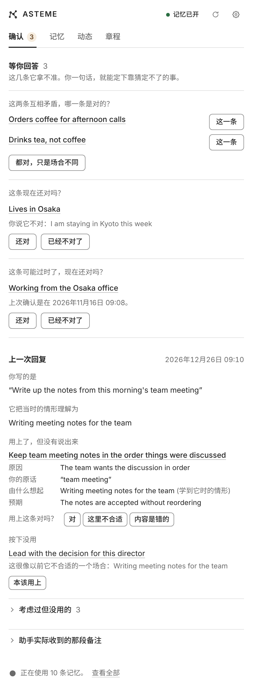

<p align="center">
  
</p>

<p align="center">
  <a href="README.md">English</a> · 中文 · <a href="README.ja.md">日本語</a> · <a href="README.es.md">Español</a> · <a href="README.fr.md">Français</a> · <a href="README.de.md">Deutsch</a> · <a href="README.ru.md">Русский</a> · <a href="README.pt.md">Português</a>
</p>

**开发中：** 项目仍在开发，行为可能变化，也可能出错或丢数据。请不要用于重要用途。

# ASTEME

Asteme 是给 AI 助手用的长期记忆。它不是在过去的对话里找相似的词，而是把你说过的话连同“它适用的情形”一起记住，等同样的情形再次出现时想起来，并根据用上之后有没有帮上忙，调整每条记忆被想起的难易。

它运行在你自己的电脑上，只用一个 SQLite 文件。可以作为 DeepSeek Harness 的插件、供任何智能体使用的 MCP 服务器，或者一个库来使用。

<p align="center">
  
</p>

## 有什么不同

**唤起记忆的是情形，不是字面。** 假设你改过一份备忘录：“结论放前面，总监只看前三行。”几天后你要一页给投资人的材料。两句话没有一个词相同，但情形一样（读者时间很少，却要做决定），这条记忆就会回来。

**使用的结果会改写记忆。** 用过一条记忆之后，它会从你接下来说的话里判断效果。帮上忙的更容易被想起；不合场合的不再出现在那类情形里，在别处照常起作用。不会因为时间久就淡忘，也不会因为数量多就被删掉。

**每条记忆都能追到你自己的原话。** 每条记忆都保留着它出处的那句话。打开任意一条，都能看到它的依据、适用于哪里、每次被用上的结果，以及它的每一次改动。你说它不对，就以你的话为准，而不是模型的判断。

此外，它会在对话之间回顾，从不同的经历里得出教训；发现两条记忆矛盾时会来问你；还有一份学习改变不了的目的与价值。各项机制及其测试见 [DESIGN.md](DESIGN.md)（英文）。

## 一分钟试用

需要 Node 22.5 或更高版本。无需安装依赖，也不需要 API 密钥。

```
git clone https://github.com/asteme/asteme.git
cd REPO
npm run demo
```

演示会用一个按脚本作答的模型，重放与一位用户相处的两周，并逐步说明记忆做了什么。`npm test` 以同样的方式运行全部测试。想看界面，用浏览器打开 `client/preview/preview.html`。

## 使用方式

### 给任何智能体当记忆（MCP）

```
ASTEME_DB=./memory.sqlite \
ASTEME_LLM_URL=https://your-endpoint/v1 ASTEME_LLM_KEY=... ASTEME_LLM_MODEL=... \
node standalone/mcp.mjs
```

这是一个基于 stdio 的 MCP 服务器。智能体在回答前调用 `asteme_recall`，回答后调用 `asteme_observe`。

### 作为库

```js
import { openBrain } from "./standalone/brain.mjs";

const brain = openBrain({ path: "memory.sqlite", infer, embed });
const { note } = await brain.recall({ session: "s1", message });   // 回答之前
brain.observe({ session: "s1", reply });                           // 回答之后
await brain.rest();                                                // 空闲时
```

### 作为 DeepSeek Harness 插件

`plugin/` 是适配层，`client/` 是设置面板。这是目前用得最多的方式。

## 面板

- **确认**：它拿不准的事，以及上一次回复用了什么、为什么。点一下就能告诉它“对／这里不合适／记错了”，这一下就是它学习的来源。
- **记忆**：它记得的一切。每一条都可以打开查看依据。
- **动态**：你不在的时候它做了什么；什么都没发生时，说明原因。
- **章程**：它的目的与价值。由你来写，学习不会改变它。

支持英文、日文和中文。

## 要去往哪里

我们认为，记忆不是一份可以检索的记录。它是记住发生过什么，根据事情的结果改变想法，并且从不抹去，只是有些事会变得不那么容易想起。每一条记忆是一颗星，而当下的情形把它们连成图形。

我们想走到的地方，是一个与同一个人相处足够久之后，对这个人来说成为“某一个谁”的助手。Asteme 还没有到那里。今天它只是这个循环的第一圈，运行在一台电脑上，设计好的部分多于已被验证的部分。哪些已经验证，[更新日志](CHANGELOG.md) 和 [`DESIGN.md`](DESIGN.md) 里写得很清楚。

## 你的数据

- 全部保存在你电脑上的一个 SQLite 文件里。没有遥测。只有访问你配置的模型接口、以及首次下载本地嵌入模型时才会联网。
- **导出与导入**：包含对话的完整副本。导入只补上缺少的部分，不会覆盖。
- **日记**：每月一个 Markdown 文件，记录说了什么、它记下了什么、结果如何。
- **自动备份**：每天一次。只清理旧副本，绝不清理记忆本身。
- **忘记就是真的忘记**：连同原话一起忘记后，所有表里都会删除，导入也不会把它带回来。

## 许可

Not yet published. All rights reserved for now: see [LICENSE](LICENSE).


