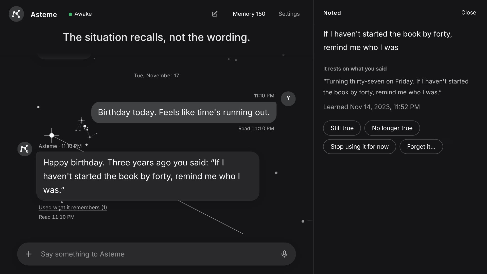

# dsh-asteme



[Asteme](https://github.com/asteme/asteme) inside [DeepSeek Harness](https://github.com/deepseek-ai/deepseek-harness): a local AI you talk to, with long-term memory. It is someone you talk to, and the same one each time. It remembers what you tell it together with the situation it applies to, brings a memory back when that situation comes up again, and changes what comes to mind from how using it turned out. It can hand work to a DSH agent and tell you how it went.

It runs on your computer. Everything it remembers is in one SQLite file.

[中文](https://github.com/asteme/asteme/blob/main/README.zh.md) · [日本語](https://github.com/asteme/asteme/blob/main/README.ja.md) · [Español](https://github.com/asteme/asteme/blob/main/README.es.md) · [Français](https://github.com/asteme/asteme/blob/main/README.fr.md) · [Deutsch](https://github.com/asteme/asteme/blob/main/README.de.md) · [Русский](https://github.com/asteme/asteme/blob/main/README.ru.md) · [Português](https://github.com/asteme/asteme/blob/main/README.pt.md)

## Install

In DSH, open Plugins and add `dsh-asteme`. Or from a terminal:

```
dsh plugin --profile web add dsh-asteme
```

Then send one message in a DSH session (Asteme speaks with the model you use there), and open ASTEME in the side bar.

Once it is installed, the agent in your own DSH sessions does its work as before and speaks as Asteme too: the same name, the same way of speaking, the same memory. A session Asteme itself starts to hand work to is the exception: it stays plain DSH and is given nothing of Asteme's.

**Status: in development.** Behavior may change, and it may fail or lose data. Do not rely on it for anything important yet.

The source, the documentation in eight languages and the issues are at <https://github.com/asteme/asteme>. The site: <https://asteme.github.io/asteme/>.

Apache-2.0: see LICENSE and NOTICE. The name and the mark are the project's own.

## After an update

A native library that a plugin loaded into DSH's process stays there until DSH is restarted; reloading or switching the plugin off does not remove it. Versions up to 0.11.0-alpha.5 loaded the embedding model's libraries into DSH itself. After updating from one of them, restart DSH once. From 0.11.0-alpha.6 on, those libraries are loaded only in Asteme's own embedding process.
