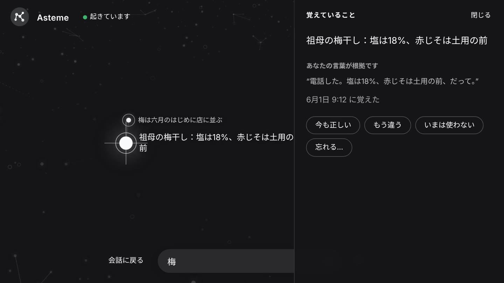
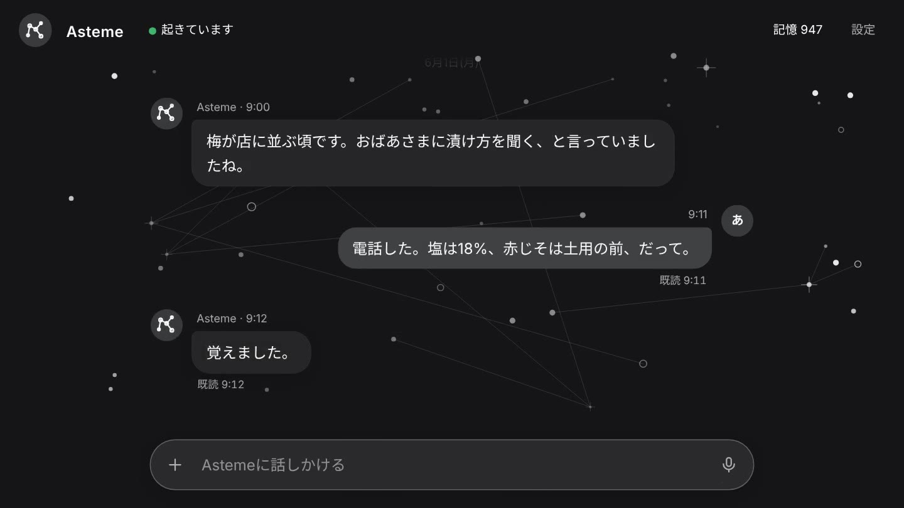
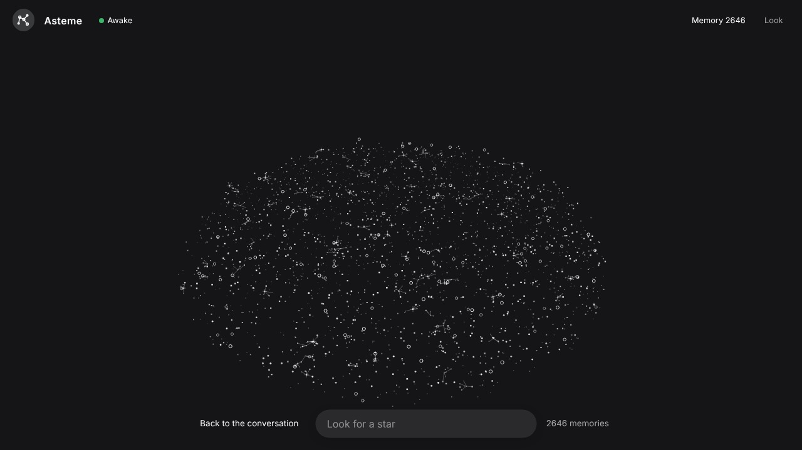

<h1 align="center">Asteme</h1>

<em>覚えている。</em>

<a href="README.md">English</a> · <a href="README.zh.md">中文</a>

Asteme は、話しかける相手です。いつも同じ一人です。

- **続いていく一本の会話。** 戻ってくるたびに最初からにはなりません。
- **大事なことを覚えている。** 先月話したことが、必要なときにそこにあります。言い直さなくていい。
- **全部、見える。** 覚えていることは一つひとつが星です。会話の後ろの空をつかむと、その中に入れます。新しい記憶は中心に、古い記憶は遠くに、思い出しやすい記憶ほど明るく。
- **あなたのもの。** 覚えたことはあなたのコンピューターに置かれます。どの記憶も開いて、どこから来たかを見て、直して、忘れさせることができます。
- **向こうから話しかける。** 待っていたことが届いたら、知らせてくれます。

 

## いつ

開発中で、まだ使えません。公開の知らせを受け取るには、このリポジトリに Star か Watch を付けてください。

---

© 2026 WSL043. All rights reserved. ここの文章・画像・動画は、Asteme を紹介する目的でのリンクと引用ができます。「Asteme」の名前とマークはこのプロジェクトを示すものです。
