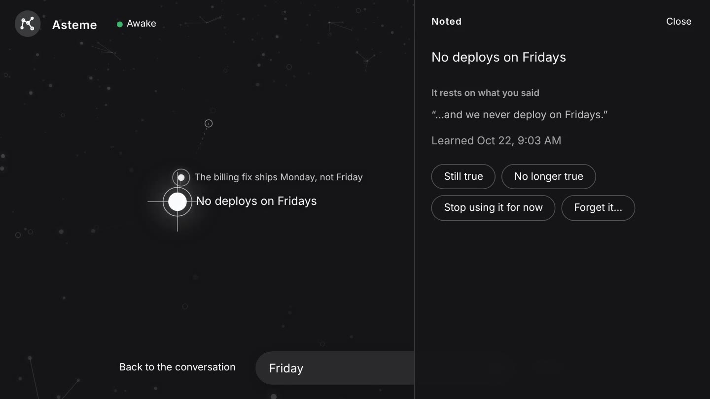
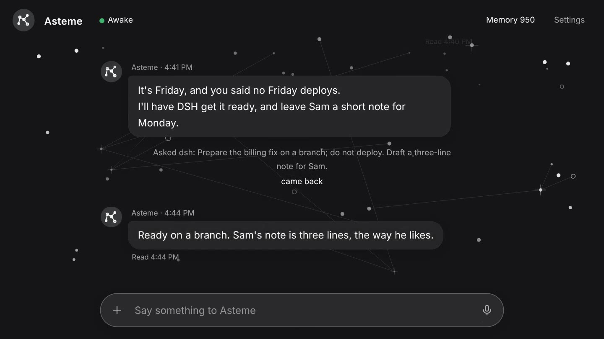
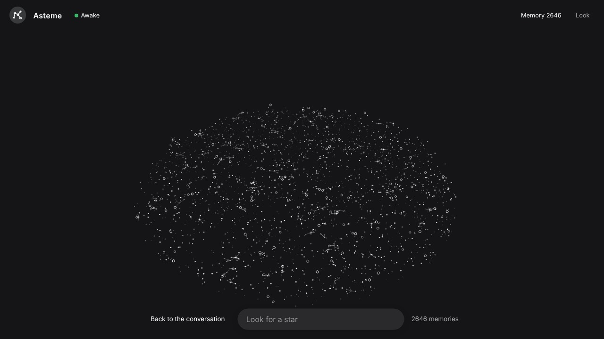

<h1 align="center">Asteme</h1>

<em>It remembers.</em>

<a href="README.ja.md">日本語</a> · <a href="README.zh.md">中文</a>

Asteme is someone you talk to, and the same one each time.

- **One conversation that goes on.** It does not start over when you come back.
- **It keeps what matters.** What you told it last month is there when it is needed, without you saying it again.
- **You can see all of it.** Everything it remembers is a star. Take hold of the sky behind the conversation and you are among them: the newest near the centre, the oldest far out, the ones that come to mind easily shining brightest.
- **It is yours.** What it remembers is kept on your own computer. You can open any memory, see where it came from, correct it, or have it forgotten.
- **It can speak first.** When something it was waiting for arrives, it tells you.

 

## When

Asteme is being built and is not available yet. Star or watch this repository to hear when it is.

---

© 2026 WSL043. All rights reserved. The text, pictures and video here may be linked to and quoted when writing about Asteme. The name "Asteme" and its mark identify this project.
