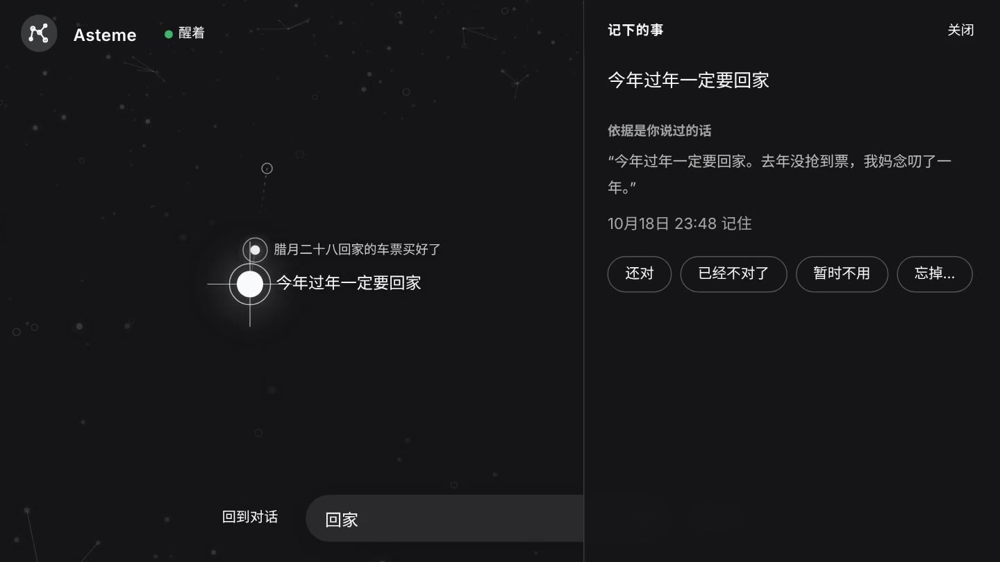
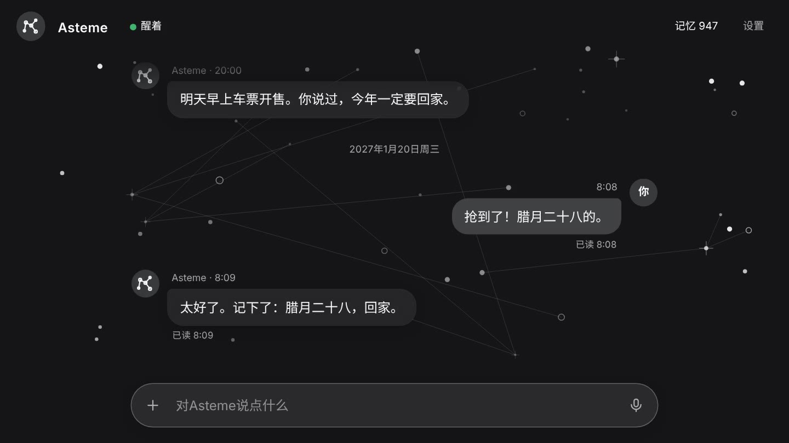
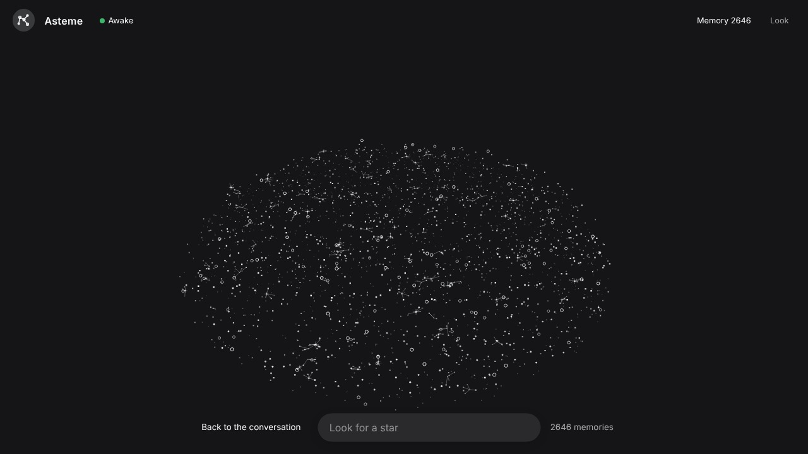

<h1 align="center">Asteme</h1>

<em>它记得。</em>

<a href="README.md">English</a> · <a href="README.ja.md">日本語</a>

Asteme 是一个可以说话的对象，而且每次都是同一个。

- **一场一直继续的对话。** 你回来的时候，不用从头开始。
- **重要的事，它记着。** 上个月说过的话，需要的时候就在那里，不用再说一遍。
- **全都看得见。** 它记得的每件事都是一颗星。抓住对话背后的天空，就能走进星群：新的在中心，旧的在远处，越容易想起的越亮。
- **它是你的。** 它记住的东西放在你自己的电脑上。任何一条记忆都可以打开，看它从哪里来，可以改正，也可以让它忘掉。
- **它会先开口。** 等的事情到了，它会告诉你。

 

## 什么时候

Asteme 还在开发中，暂时不能使用。想在发布时收到消息，请给这个仓库点 Star 或 Watch。

---

© 2026 WSL043. All rights reserved. 这里的文字、图片和视频，可以在介绍 Asteme 时链接和引用。“Asteme”这个名字及其标志代表本项目。
